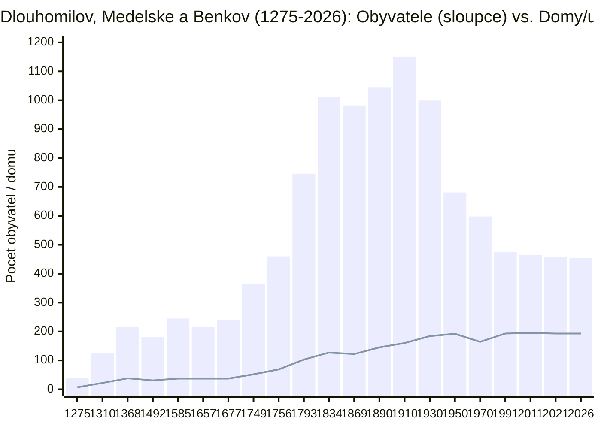
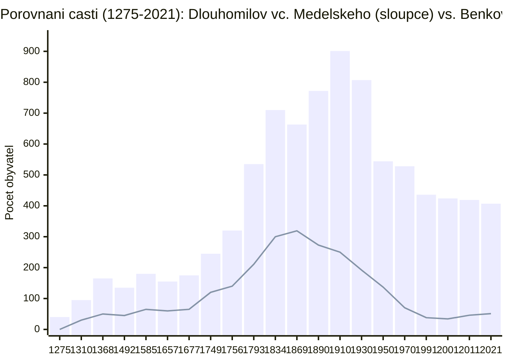
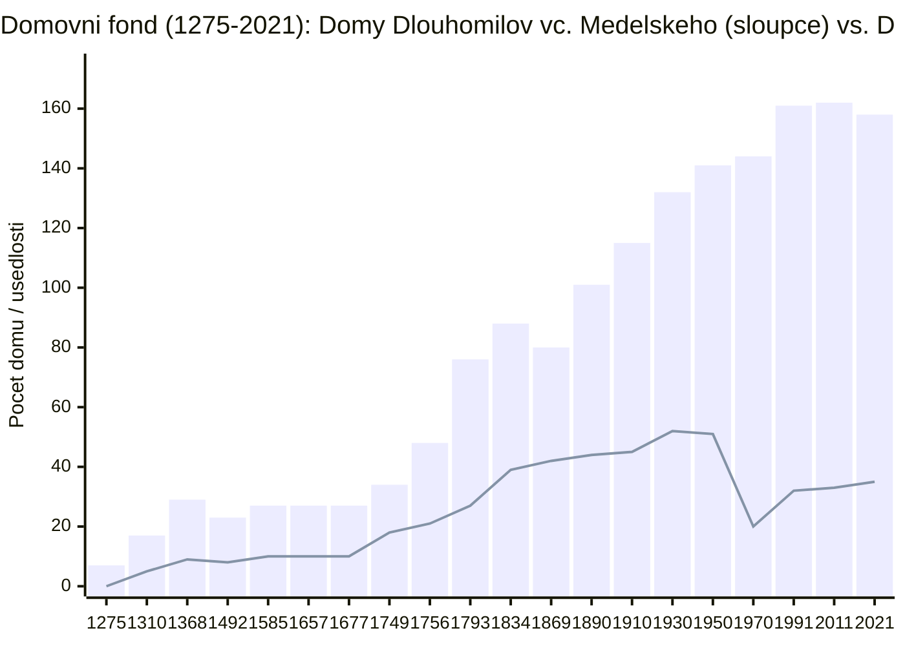
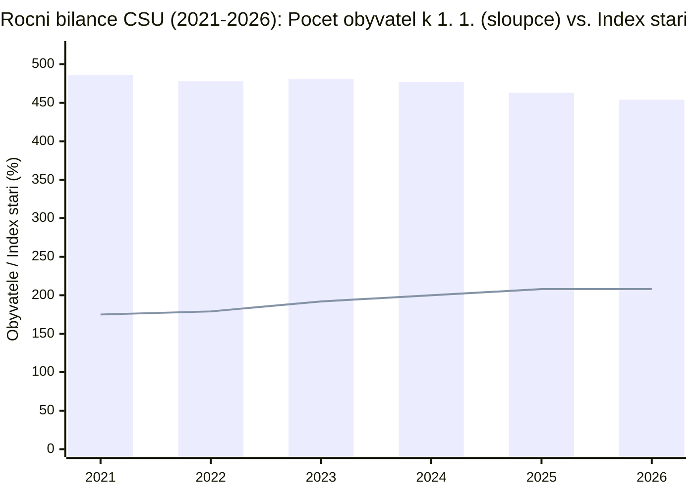
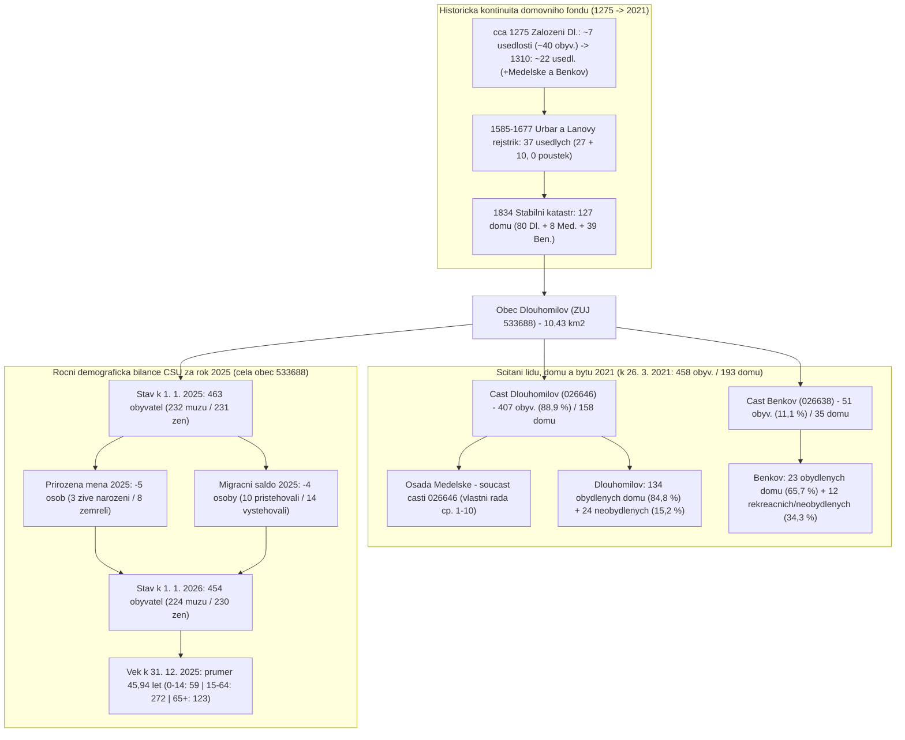

# Demografický a sídelní vývoj Dlouhomilova, Medelského a Benkova (1275–2026)

*Sedm a půl století vývoje domovního fondu a obyvatelstva: od lokačního rozvrhu zemana Dlúhomila z Hané (cca 1275) přes zemské desky (1356–1368), urbář (1585), lánové rejstříky (1657–1677), tereziánský (1749–1756) a stabilní katastr (1834) až po moderní sčítání lidu a roční bilanci ČSÚ k 1. 1. 2026*

---

## 1. Územně-správní a statistická identifikace obce (RÚIAN / ČSÚ)

| Úroveň / Číselník ČSÚ | Název jednotky | Kód ČSÚ / RÚIAN | Katastrální území (kód) | Výměra | Poznámka |
| :--- | :--- | :---: | :---: | :---: | :--- |
| **Obec (ZÚJ / CISOB 43)** | **Dlouhomilov** | `533688` | 2 katastrální území | **10,43 km²** (1 043,36 ha) | Okres Šumperk (`CZ0715`), Olomoucký kraj (`CZ071`), ORP Zábřeh |
| **Část obce (CISOB 42)** | **Dlouhomilov** *(Lomigsdorf)* | `026646` | Dlouhomilov (`626643`) | **7,31 km²** (730,72 ha) | Zahrnuje i severní osadu **Medelské** (*Dreihofen*, vlastní řada čp. 1–10) |
| **Část obce (CISOB 42)** | **Benkov** *(Benke)* | `026638` | Benkov u Dlouhomilova (`626635`) | **3,13 km²** (312,65 ha) | Samostatná obec do r. 1960; od r. 1960 místní část obce Dlouhomilov |

> **Metodická poznámka k rekonstrukci 1275–1869 a datům ČSÚ 1869–2026:**
> - **Období 1275–1834:** Vychází ze zjištěných počtů usedlostí a domů v primárních pramenech (*Moravské zemské desky ZDO I & IV*, *Urbář panství Zábřeh 1585*, *Lánové rejstříky MZA D 1 1656–1677*, *Rektifikační akta MZA D 2 1749–1756*, *Tereziánské číslování 1770–1771*, *Schwoyova topografie 1793*, *Stabilní katastr 1834* a *Wolny 1839*). Kde pramen uvádí pouze počet osedlých usedlostí/domů, je počet obyvatel odvozen standardním historicko-demografickým koeficientem lidnatosti selských a domkářských domácností (`~5,7` až `7,0` os./dům dle období; označeno vlnovkou `~`). Pro Benkov (1793: `27` domů / `211` obyv.; 1839: `39` domů / `300` obyv.) a Dlouhomilov (1834: `80` domů / `648` obyv.) jsou dochovány přímo dobové úřední součty obyvatel.
> - **Období 1869–2026:** Každoroční demografická bilance ČSÚ (`OBY01`, `OBY02`) sleduje obec jako celek (`533688`), zatímco desetiletá sčítání lidu (naposledy **SLDB 2021** k 26. 3. 2021) poskytují přesný rozpad na části **Dlouhomilov (`026646`)** a **Benkov (`026638`)**.

---

## 2. Grafické znázornění v knihovně Mermaid (1275–2026)

### 2.1 Sedm a půl století vývoje (1275–2026): Obyvatelé (sloupce) vs. Domovní fond (křivka)

Protažení časové řady až k lokačnímu horizontu **cca 1275** ukazuje tři velké epochy údolí:
1. **Postupná kolonizace údolí a raně novověká stabilita (1275–1677):** Při samotném založení vsi kolem roku **1275** stál v údolí svobodný *dvuor Dlúhomiluov* s hrstkou prvních osadníků klučících prales ve dvacetileté lhůtě (**~7 dřevěných usedlostí**, ~40 obyv.; **Medelské** a horský **Benkov** tehdy ještě neexistovaly). Po uplynutí lhůty a druhotné kolonizaci strání (kolem **1310**: **~22 usedlostí**, vznik *Tří dvorů* v Medelském a počátek Benkova) vyrostla síť v předhusitské době na **~38 stavení** (*ZDO I & IV*, 1356–1385), po poklesu za válek 15. století a útěků z tunklovské roboty (**1492**: **~31 usedlostí**) se ustálila na **37 usedlostech** v urbáři r. 1585 a přečkala i třicetiletou válku s **nulovým počtem poustek** (`37` usedlých v letech 1585, 1657 i 1677).
2. **Tereziánský lnářský a domkářský rozmach (1677–1910):** Díky předení lnu pro šumperský trh a dělení zahrad vyrostl počet domů z **37** (1677) na **69** (1756), **127** (1834) a **160** při populačním maximu **1 151 obyvatel** v roce **1910**.
3. **Demografické nůžky 20. a 21. století (1910–2026):** Po roce 1945 klesl počet obyvatel na **681** (1950) a ustálil se kolem **454–486 osob**, zatímco domovní fond dál rostl až na **193–195 domů** (obsazenost klesla z `8,0` na `2,4` os./dům).

### 2.2 Srovnání vývoje částí Dlouhomilov (vč. Medelského) a Benkov (1275–2021)

### 2.3 Růst domovního fondu podle zjištěných počtů usedlostí a domů (1275–2021)

### 2.4 Nejnovější roční bilance ČSÚ (2021–2026) a bilanční schéma obce

---

## 3. Nejnovější roční demografická bilance ČSÚ (2021–2026)

| Referenční datum (1. 1.) | Obyvatelé celkem | Muži | Ženy | Průměrný věk (k 31. 12.) | Průměrný věk muži / ženy | Index stáří 65+ / 0–14 (k 31. 12.) |
| :---: | :---: | :---: | :---: | :---: | :---: | :---: |
| **1. 1. 2021** | **486** | 238 | 248 | 45,00 let | 43,72 / 46,24 | 175,0 % |
| **1. 1. 2022** | **478** | 234 | 244 | 45,15 let | 43,79 / 46,47 | 178,9 % |
| **1. 1. 2023** | **481** | 237 | 244 | 45,47 let | 44,12 / 46,79 | 192,3 % |
| **1. 1. 2024** | **477** | 234 | 243 | 46,01 let | 44,62 / 47,36 | 200,0 % |
| **1. 1. 2025** | **463** | 232 | 231 | 45,94 let | 44,45 / 47,39 | **208,5 %** |
| **1. 1. 2026** | **454** | **224** (49,3 %) | **230** (50,7 %) | *45,94 let\** | *44,45 / 47,39\** | *208,5 %\** |

*\* Pozn.: Koncový stav k 31. 12. 2025 je totožný s počátečním stavem k 1. 1. 2026 (454 obyvatel, hustota zalidnění 43,5 obyv./km²). Věkové složení k 31. 12. 2025: **59** dětí 0–14 let (13,0 %), **272** osob 15–64 let (59,9 %), **123** seniorů 65+ (27,1 %). Pohyb za rok 2025: **3** živě narození, **8** zemřelých (−5), **10** přistěhovalých, **14** vystěhovalých (−4), celkem **−9 osob**; sňatky 0, rozvody 2.*

---

## 4. Detailní srovnání místních částí Dlouhomilov a Benkov (SLDB 2021)

| Ukazatel (rozhodný okamžik 26. 3. 2021) | Část Dlouhomilov (`026646`, vč. Medelského) | Část Benkov (`026638`) | Obec celkem (`533688`) |
| :--- | :---: | :---: | :---: |
| **Obyvatelé (obvyklý pobyt)** | **407** (88,9 %) | **51** (11,1 %) | **458** (227 M / 231 Ž) |
| **Hlášení k trvalému pobytu** | **433** | **49** | **482** (237 M / 245 Ž) |
| **Průměrný věk (SLDB 2021)** | — | — | **45,3 let** (M 44,3 / Ž 46,3) |
| **Domovní fond celkem** | **158** (vše RD / 1 ost.) | **35** (100 % RD) | **193 domů** (0 bytových domů) |
| **Obydlené domy** | **134** (84,8 %) | **23** (65,7 %) | **157** (81,3 %) |
| **Neobydlené domy (rekreace aj.)** | **24** (15,2 %) | **12** (34,3 %) | **36** (18,7 %) |
| **Byty celkem / z toho obydlené** | **193** / **156** (80,8 %) | **37** / **23** (62,2 %) | **230** / **179** (77,8 %) |

---

## 5. Kompletní historická řada domů a obyvatel (1275–2026)

| Rok / Horizont | Obyv. Dl.+Med. | Domy Dl.+Med. | Obyv. Benkov | Domy Benkov | Obec celkem (obyv.) | Domy celkem | Pramen, rozpad osady Medelské & metodická poznámka |
| :---: | :---: | :---: | :---: | :---: | :---: | :---: | :--- |
| **cca 1275** | ~40 | **~7** | 0 | 0 | **~40** | **~7** | Počátek lokace v údolí: *dvuor Dlúhomiluov* + ~6 prvních osadníků ve 20leté lhůtě (**Medelské** a **Benkov** ještě nevznikly) |
| **cca 1310** | ~95 | **~17** | ~30 | ~5 | **~125** | **~22** | Po uplynutí lokační lhůty: ~14 osazených lánů v Dl. + založení *Tří dvorů* v **Medelském** (3) a počátek horského **Benkova** (~5) |
| **1356–1385** | ~165 | **~29** | ~50 | ~9 | **~215** | **~38** | *ZDO I & IV*: 3 vladycké dvorce, ~14 lánů, 9 dvorků (*curticulae*, 1368), 2 krčmy, mlýn + **Medelské** (3) a **Benkov** (1385) |
| **1492** | ~135 | **~23** | ~45 | ~8 | **~180** | **~31** | *Knihy půhonné KP VI*: útěky poddaných z tunklovské roboty a pusté dědiny (*Duchek*, *Števík*); r. 1513 *hrad Brníčko zbořený* |
| **1585** | ~180 | **27** | ~65 | **10** | **~245** | **37** | *Urbář panství Zábřeh (URB00015585)*: Dlouhomilov **22** usedlíků + **Medelské** **5** položek (**8** držitelů) + Benkov **10** |
| **1657** | ~155 | **27** | ~60 | **10** | **~215** | **37** | *1. lánová vizitace (MZA D 1)*: plná osedlost po třicetileté válce (**0 poustek**; 18 z 27 gruntů mění hospodáře) |
| **1677** | ~175 | **27** | ~65 | **10** | **~240** | **37** | *Lánový rejstřík z 13. 10. 1677 (MZA D 1, sign. 141)*: Dl. 830 měřic (39 koní), Benkov 310 měřic (9 koní) |
| **1749** | ~245 | **34** | ~120 | ~18 | **~365** | **52** | *Tereziánské fasiony (MZA D 2-1)*: 27 starých usedlostí + 7 nových domkařů (+ 6 podruhů = 40 berních položek) |
| **1756** | ~320 | **48** | ~140 | ~21 | **~460** | **69** | *Lokální vizitace 17. 8. 1756 (MZA D 2-2)*: 48 položek vč. obecní pastoušky č. 48; předení příze pro Šumperk |
| **1793** | ~535 | ~76 | **211** | **27** | **~746** | **103** | *Schwoyova topografie (1793)*: v Benkově přesně 27 domů a 211 obyv.; v Dlouhomilově postavena škola čp. 12 |
| **1834** | ~710 | **88** | **300** | **39** | **~1 010** | **127** | *Stabilní katastr 1834 & Wolny*: Dlouhomilov **80** domů (**648** obyv.) + **Medelské** **8** domů (~62 os.) + Benkov **39** d. (**300** os.) |
| **1869** | 663 | 80 | **319** | 42 | **982** | 122 | 1. moderní sčítání lidu; historické maximum obyvatel Benkova (319) |
| **1880** | 699 | 96 | 283 | 44 | **982** | 140 | Dlouhomilov 543 obyv. / 75 domů + **Medelské** 156 obyv. / 21 domů |
| **1890** | 772 | 101 | 273 | 44 | **1 045** | 145 | Dlouhomilov 623 obyv. / 81 domů + **Medelské** 149 obyv. / 20 domů |
| **1900** | 847 | 106 | 243 | 43 | **1 090** | 149 | Dlouhomilov 710 obyv. / 86 domů + **Medelské** 137 obyv. / 20 domů |
| **1910** | **901** | 115 | 250 | 45 | **1 151** | 160 | **Historické maximum obce**; Dl. 604/74 + **Medelské** 297/41 |
| **1921** | 820 | 118 | 211 | 45 | **1 031** | 163 | 1. československé sčítání (15. 2. 1921); domy: Dl. 76 + **Medelské** 42 |
| **1930** | 807 | 132 | 192 | 52 | **999** | 184 | Dlouhomilov 667 obyv. / 108 domů + **Medelské** 140 obyv. / 24 domů |
| **1950** | 544 | 141 | 137 | 51 | **681** | 192 | Pokles o 318 osob po r. 1945 (odsun Němců z Benkova a odchod rodin do pohraničí) |
| **1961** | 591 | 174\* | 98 | *vč. Dl.\** | **689** | 174 | V r. **1960** připojen Benkov k Dlouhomilovu; domy r. 1961 sčítány společně |
| **1970** | 528 | 144 | 70 | 20 | **598** | 164 | V letech 1970 a 1980 vykazoval ČSÚ pouze trvale obydlené domy |
| **1980** | 447 | 137 | 44 | 17 | **491** | 154 | Pokračující urbanizace a odchod mladých rodin do měst |
| **1991** | 436 | 161 | 38 | 32 | **474** | 193 | Od r. 1991 jsou do domovního fondu opět započteny i rekreační chalupy |
| **2001** | 424 | 160 | **34** | 32 | **458** | 192 | **Historické minimum Benkova** (34 stálých obyvatel) |
| **2011** | 419 | 162 | 46 | 33 | **465** | 195 | Návrat stálého bydlení do Benkova (+35 %) |
| **2021** | 407 | 158 | 51 | 35 | **458** | 193 | SLDB k 26. 3. 2021 (obvyklý pobyt; k trvalému pobytu hlášeno 482 osob) |
| **1. 1. 2026** | *—* | *—* | *—* | *—* | **454** | *—* | Nejnovější roční bilance ČSÚ (`OBY02A`: 224 mužů / 230 žen) |

---

## 6. Primární datové zdroje a návazné studie

1. **Středověké a raně novověké prameny (1275–1834):**
   - [Původ zakladatele Dlúhomila a regestář ZDO I–X (1266–1447)](puvod_dluhomila_a_zdo_1356_1447.md) — lokační rekonstrukce a 32 deskových vkladů.
   - [Zemské desky a knihy půhonné (1466–1622) & Urbář panství Zábřeh 1585](zemske_desky_a_puhony_1466_1622.md) — soupis `22 + 5 (8) + 10` usedlíků z r. 1585 (`URB00015585`).
   - [Lánové rejstříky, rektifikační akta a dominikální fase MZA Brno D 1–D 3 (1656–1756)](lanove_rejstriky_a_rektifikace_1657_1756.md) — soupisy z let 1657, 1677, 1749 a 1756.
   - **Stabilní katastr 1834 (`MOR102618340`) & historické topografie Moravy:** F. J. Schwoy (*Topographie vom Markgrafthum Mähren*, Bd. I, Wien 1793) a G. Wolny (*Die Markgrafschaft Mähren*, Bd. V: Olmützer Kreis, Brünn 1839).
2. **Český statistický úřad (1869–2026):**
   - **DataStat API v1 (`data.csu.gov.cz`):** sady `OBY02A` (stavy k 1. 1. 2021–2026), `OBY01B01` (pohyb obyvatel 2025), `OBY02E` a `OBY02F` (věkové složení a index stáří k 31. 12. 2025), `SLDZOB03`.
   - **Otevřená data SLDB 2021 (`csu.gov.cz/vysledky-scitani-2021-otevrena-data`):** ZÚJ `533688`, části obce `026646` (Dlouhomilov) a `026638` (Benkov).
   - **Historický lexikon obcí České republiky 1869–2011** (ČSÚ Praha 2015, příloha okresu Šumperk `130084150715.xlsx`).

---

*Interaktivní verze s křivkovým SVG grafem (1275–2026): [demografie.html](https://karelberka.github.io/Dlouhomilov/demografie.html)*
