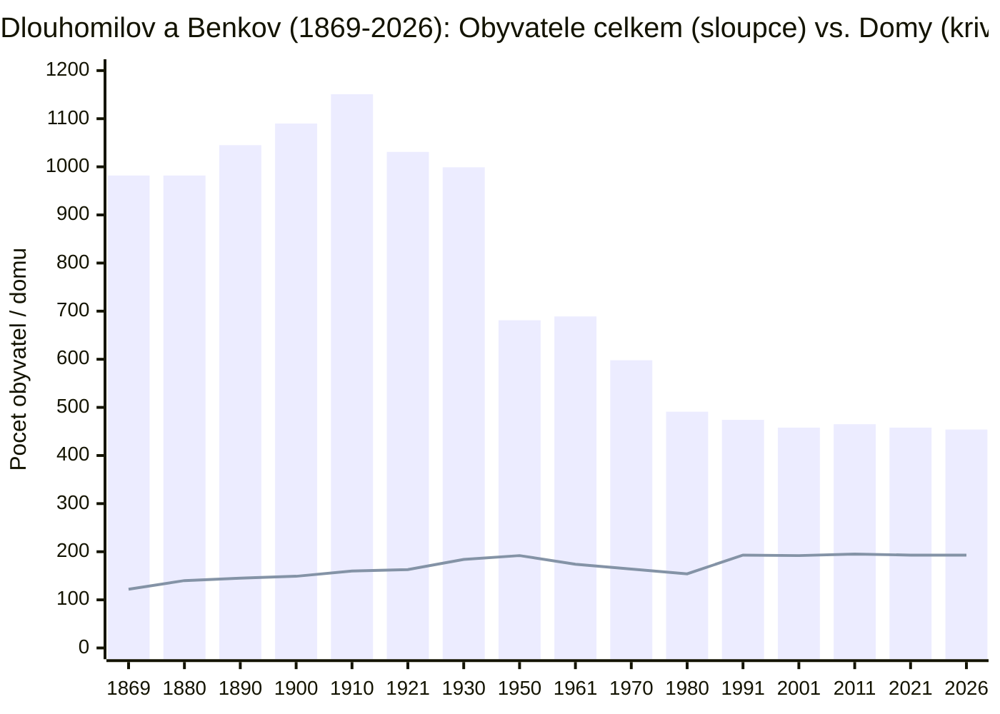
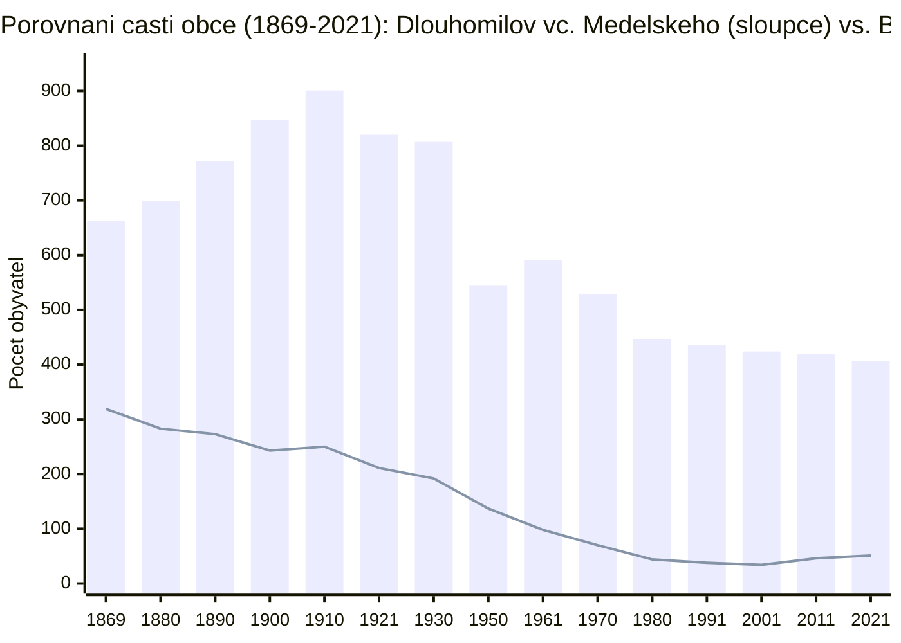
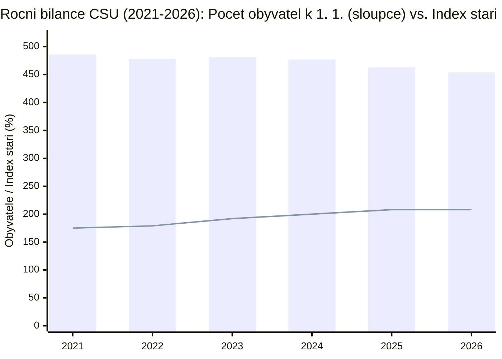
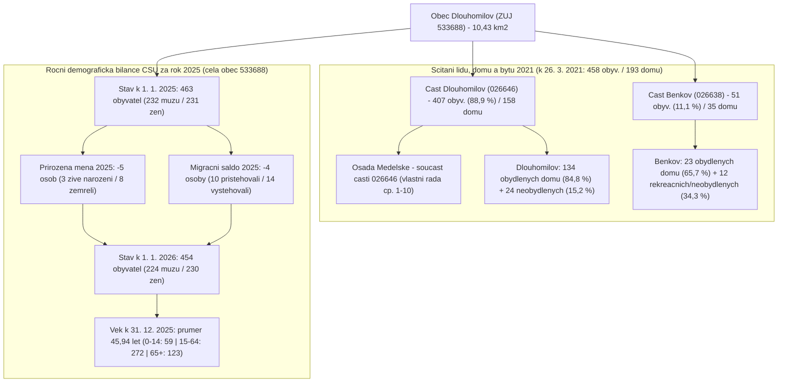

# Demografický vývoj Dlouhomilova, Medelského a Benkova v datech ČSÚ (1869–2026)

*Kompletní statistická studie, časové řady sčítání lidu a domů (1869–2021), srovnání místních částí ze SLDB 2021 a nejnovější roční bilance Českého statistického úřadu k 1. 1. 2026*

---

## 1. Územně-správní a statistická identifikace obce (RÚIAN / ČSÚ)

| Úroveň / Číselník ČSÚ | Název jednotky | Kód ČSÚ / RÚIAN | Katastrální území (kód) | Výměra | Poznámka |
| :--- | :--- | :---: | :---: | :---: | :--- |
| **Obec (ZÚJ / CISOB 43)** | **Dlouhomilov** | `533688` | 2 katastrální území | **10,43 km²** (1 043,36 ha) | Okres Šumperk (`CZ0715`), Olomoucký kraj (`CZ071`), ORP Zábřeh |
| **Část obce (CISOB 42)** | **Dlouhomilov** *(Lomigsdorf)* | `026646` | Dlouhomilov (`626643`) | **7,31 km²** (730,72 ha) | Zahrnuje i severní osadu **Medelské** (*Dreihofen*, vlastní řada čp. 1–10) |
| **Část obce (CISOB 42)** | **Benkov** *(Benke)* | `026638` | Benkov u Dlouhomilova (`626635`) | **3,13 km²** (312,65 ha) | Samostatná obec do r. 1960; od r. 1960 místní část obce Dlouhomilov |

> **Metodická poznámka ČSÚ:** Každoroční demografická bilance obyvatelstva (datové sady `OBY01` a `OBY02` – stavy k 1. 1., věkové složení k 31. 12., narození, zemřelí a stěhování) je Českým statistickým úřadem publikována výhradně za **celou obec ZÚJ `533688`**. Přesný rozpad na místní části **Dlouhomilov (`026646`)** a **Benkov (`026638`)** zjišťuje ČSÚ v desetiletých **Sčítáních lidu, domů a bytů (SLDB)** – naposledy k rozhodnému okamžiku **26. 3. 2021**.

---

## 2. Grafické znázornění v knihovně Mermaid

### 2.1 Demografické nůžky (1869–2026): Obyvatelé celkem (sloupce) vs. Domovní fond (křivka)

Zatímco počet obyvatel celé obce kulminoval v roce **1910** na **1 151 osobách** a po roce 1945 klesl ke stabilizované hladině kolem **454–486 obyvatel**, počet domů vytrvale rostl ze **122** (1869) na **193 rodinných domů** (2021). Průměrná obsazenost domu tak klesla z **8,0 osob na dům** (1869) na dnešních **2,4 osoby na dům** (resp. **2,9 osoby** na trvale obydlený dům).

### 2.2 Srovnání vývoje částí Dlouhomilov (vč. Medelského) a Benkov (1869–2021)

Údolní český **Dlouhomilov** s osadou **Medelské** rostl díky rozmachu zemědělství, řemesel a dojížďky do šumperských bělidel až do roku 1910 (**901 obyv.**). Výše položený německojazyčný **Benkov** měl nejvíce obyvatel již při prvním sčítání roku 1869 (**319 obyv.**), po odsunu a kolektivizaci klesl až na historické minimum **34 obyvatel** v roce 2001 a v posledních dvou dekádách zažívá mírné oživení (**46 obyv.** v r. 2011, **51 obyv.** v r. 2021).

### 2.3 Nejnovější roční bilance ČSÚ (2021–2026): Stav obyvatel a index stáří

Mezi lety 2021 a 2025/2026 vzrostl **index stáří** (počet seniorů 65+ na 100 dětí ve věku 0–14 let) ze **175,0 %** na **208,5 %** – na každé dítě do 15 let dnes v obci připadají více než dva senioři nad 65 let.

### 2.4 Územní struktura obce (SLDB 2021) a bilanční tok roku 2025 → 1. 1. 2026

---

## 3. Nejnovější roční demografická bilance ČSÚ (2021–2026)

### 3.1 Vývoj stavu obyvatel, průměrného věku a indexu stáří (`OBY02A`, `OBY02E`, `OBY02F`)

| Referenční datum (1. 1.) | Obyvatelé celkem | Muži | Ženy | Průměrný věk (k 31. 12.) | Průměrný věk muži / ženy | Index stáří 65+ / 0–14 (k 31. 12.) |
| :---: | :---: | :---: | :---: | :---: | :---: | :---: |
| **1. 1. 2021** | **486** | 238 | 248 | 45,00 let | 43,72 / 46,24 | 175,0 % |
| **1. 1. 2022** | **478** | 234 | 244 | 45,15 let | 43,79 / 46,47 | 178,9 % |
| **1. 1. 2023** | **481** | 237 | 244 | 45,47 let | 44,12 / 46,79 | 192,3 % |
| **1. 1. 2024** | **477** | 234 | 243 | 46,01 let | 44,62 / 47,36 | 200,0 % |
| **1. 1. 2025** | **463** | 232 | 231 | 45,94 let | 44,45 / 47,39 | **208,5 %** |
| **1. 1. 2026** | **454** | **224** (49,3 %) | **230** (50,7 %) | *45,94 let\** | *44,45 / 47,39\** | *208,5 %\** |

*\* Pozn.: Koncový stav k 31. 12. 2025 je totožný s počátečním stavem k 1. 1. 2026 (454 obyvatel, hustota zalidnění 43,5 obyv./km²).*

### 3.2 Věková struktura k 31. 12. 2025 / 1. 1. 2026 (`OBY02E`) a pohyb obyvatel za rok 2025 (`OBY01B01`)

- **Děti (0–14 let):** **59 osob** (**13,00 %**) — 29 chlapců (12,95 % mužů) a 30 dívek (13,04 % žen).
- **Produktivní věk (15–64 let):** **272 osob** (**59,91 %**) — 140 mužů (62,50 %) a 132 žen (57,39 %).
- **Senioři (65+ let):** **123 osob** (**27,09 %**) — 55 mužů (24,55 %) a 68 žen (29,57 %).
- **Bilance pohybu za rok 2025** *(střední stav k 1. 7. 2025: 457 obyv.)*:
  - Živě narození: **3** • Zemřelí: **8** → **přirozený přírůstek −5 osob**.
  - Přistěhovalí: **10** • Vystěhovalí: **14** → **migrační saldo −4 osoby**.
  - **Celkový přírůstek/úbytek:** **−9 osob** (`463 → 454`).
  - Sňatky: **0** • Rozvody: **2**.

---

## 4. Detailní srovnání místních částí Dlouhomilov a Benkov (SLDB 2021)

| Ukazatel (rozhodný okamžik 26. 3. 2021) | Část Dlouhomilov (`026646`, vč. Medelského) | Část Benkov (`026638`) | Obec celkem (`533688`) |
| :--- | :---: | :---: | :---: |
| **Obyvatelé (obvyklý pobyt)** | **407** (88,9 %) | **51** (11,1 %) | **458** (227 M / 231 Ž) |
| **Hlášení k trvalému pobytu** | **433** | **49** | **482** (237 M / 245 Ž) |
| **Průměrný věk (SLDB 2021)** | — | — | **45,3 let** (M 44,3 / Ž 46,3) |
| **Domovní fond celkem** | **158** (vše RD / 1 ost.) | **35** (100 % RD) | **193 domů** (0 bytových domů) |
| **Obydlené domy** | **134** (84,8 %) | **23** (65,7 %) | **157** (81,3 %) |
| **Neobydlené domy (rekreace aj.)** | **24** (15,2 %) | **12** (34,3 %) | **36** (18,7 %) |
| **Byty celkem / z toho obydlené** | **193** / **156** (80,8 %) | **37** / **23** (62,2 %) | **230** / **179** (77,8 %) |

- **Rodinný stav obyvatel obce (SLDB 2021, N = 458):** ženatí/vdané **216** (108 M / 108 Ž), svobodní **170** (93 M / 77 Ž), rozvedení **42** (21 M / 21 Ž), ovdovělí **29** (4 muži vs. 25 žen), nezjištěno 1.
- **Ekonomická aktivita (SLDB 2021, N = 458):** pracovní síla **200 osob** (186 zaměstnaných [vč. 22 pracujících důchodců a 6 pracujících studentů] + 14 nezaměstnaných; 108 M / 92 Ž); ekonomicky neaktivní **255 osob** (136 nepracujících důchodců, 69 žáků a studentů, 13 osob na rodičovské dovolené, 36 předškolních dětí a osob v domácnosti, 1 ostatní); nezjištěno 3.

---

## 5. Historická řada všech sčítání lidu a domů (1869–2026)

| Rok / Datum | Obyv. Dlouhomilov | Domy Dlouhomilov | Obyv. Benkov | Domy Benkov | Obec celkem (obyv.) | Domy celkem | Detail osady Medelské & Metodické poznámky |
| :---: | :---: | :---: | :---: | :---: | :---: | :---: | :--- |
| **1869** | 663 | 80 | 319 | 42 | **982** | 122 | 1. moderní rakouské sčítání lidu; maximum obyvatel Benkova (319) |
| **1880** | 699 | 96 | 283 | 44 | **982** | 140 | Dlouhomilov 543 obyv. / 75 domů + **Medelské** 156 obyv. / 21 domů |
| **1890** | 772 | 101 | 273 | 44 | **1 045** | 145 | Dlouhomilov 623 obyv. / 81 domů + **Medelské** 149 obyv. / 20 domů |
| **1900** | 847 | 106 | 243 | 43 | **1 090** | 149 | Dlouhomilov 710 obyv. / 86 domů + **Medelské** 137 obyv. / 20 domů |
| **1910** | **901** | 115 | 250 | 45 | **1 151** | 160 | **Historické maximum obce**; Dl. 604/74 + **Medelské** 297/41 |
| **1921** | 820 | 118 | 211 | 45 | **1 031** | 163 | 1. československé sčítání (15. 2. 1921); domy: Dl. 76 + **Medelské** 42 |
| **1930** | 807 | 132 | 192 | 52 | **999** | 184 | Dlouhomilov 667 obyv. / 108 domů + **Medelské** 140 obyv. / 24 domů |
| **1950** | 544 | 141 | 137 | 51 | **681** | 192 | Pokles o 318 osob po r. 1945 (odsun Němců z Benkova a odchod rodin do pohraničí) |
| **1961** | 591 | 174\* | 98 | *vč. Dl.\** | **689** | 174 | V r. **1960** připojen Benkov k Dlouhomilovu; domy r. 1961 sčítány společně |
| **1970** | 528 | 144 | 70 | 20 | **598** | 164 | V letech 1970 a 1980 vykazoval ČSÚ pouze trvale obydlené domy |
| **1980** | 447 | 137 | 44 | 17 | **491** | 154 | Pokračující urbanizace a odchod mladých rodin do měst |
| **1991** | 436 | 161 | 38 | 32 | **474** | 193 | Od r. 1991 jsou do domovního fondu opět započteny i rekreační chalupy |
| **2001** | 424 | 160 | **34** | 32 | **458** | 192 | **Historické minimum Benkova** (34 stálých obyvatel) |
| **2011** | 419 | 162 | 46 | 33 | **465** | 195 | Návrat stálého bydlení do Benkova (+35 %) |
| **2021** | 407 | 158 | 51 | 35 | **458** | 193 | SLDB k 26. 3. 2021 (obvyklý pobyt; k trvalému pobytu hlášeno 482 osob) |
| **1. 1. 2026** | *—* | *—* | *—* | *—* | **454** | *—* | Nejnovější roční bilance ČSÚ (`OBY02A`: 224 mužů / 230 žen) |

---

## 6. Primární datové zdroje a citace

1. **Český statistický úřad – DataStat API v1 (`data.csu.gov.cz`):**
   - Datová sada `OBY02A` (*Počet obyvatel v obcích k 1. 1.*, území `533688`, období 2021–2026).
   - Datová sada `OBY01B01` (*Pohyb obyvatel v obcích za rok 2025*, území `533688`).
   - Datové sady `OBY02E` a `OBY02F` (*Věkové složení, průměrný věk a index stáří v obcích k 31. 12.*, území `533688`, období 2021–2025).
   - Datová sada `SLDZOB03` (*Základní výsledky SLDB 2021 za obec `533688`*).
2. **Český statistický úřad – Otevřená data SLDB 2021 (`csu.gov.cz/vysledky-scitani-2021-otevrena-data`):**
   - Soubory `sldb2021_obyv_byt_cob_zsj.csv`, `sldb2021_regpobyt_pohlavi.csv`, `sldb2021_domy_obydlen_druh.csv`, `sldb2021_byty_obydlenost_druhdomu.csv`, `sldb2021_pohlavi.csv`, `sldb2021_prumvek_pohlavi.csv`, `sldb2021_aktivita_pohlavi.csv` (filtrováno pro ZÚJ `533688` a části obce `026646` Dlouhomilov a `026638` Benkov).
3. **Český statistický úřad – Historický lexikon obcí České republiky 1869–2011:**
   - Tabulková příloha okresu Šumperk (`130084150715.xlsx`) a III.–IV. díl ČSÚ Praha 2015 (řady obyvatelstva a domů 1869–2011 včetně historického rozpadu na Dlouhomilov, osadu **Medelské** a Benkov).

---

*Interaktivní verze s křivkovým SVG grafem: [karelberka.github.io/Dlouhomilov](https://karelberka.github.io/Dlouhomilov/)*
