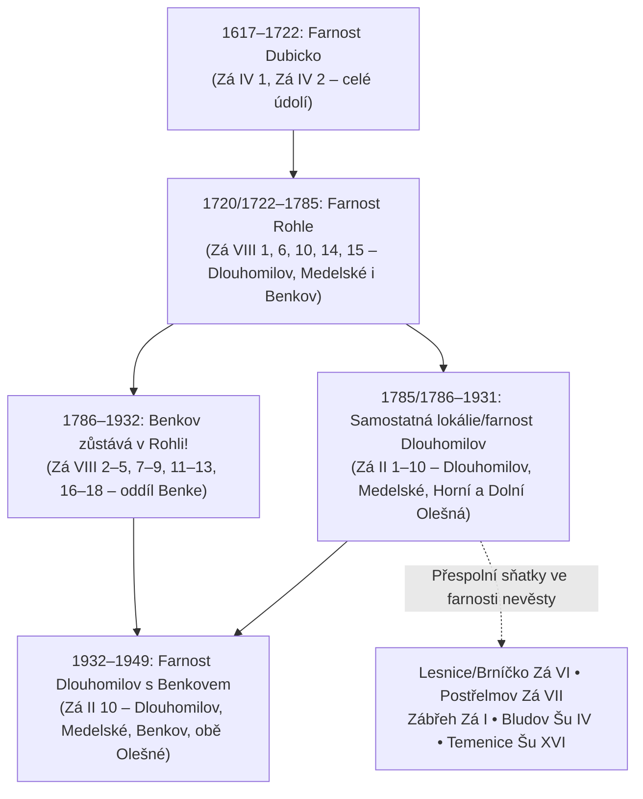

# Kompletní katalog matrik farností Dlouhomilov a Rohle (1617–1949) & Pilotní plán oddacích knih

Tento katalog sjednocuje archivní signatury, inventární čísla, vnitřní členění po obcích, ověřené permalinky do digitální badatelny **Zemského archivu v Opavě (`digi.archives.cz`)** a metodický rozpočet pro 1. etapu systematického vytěžení oddacích matrik (**Dlouhomilov**, **Medelské** a **Benkov**).

---

## 1. Vývoj farní příslušnosti údolí (1617–1949)

Pro pochopení, ve kterém svazku hledat obyvatele jednotlivých částí dnešní obce, je klíčové časové rozdělení farností:

* **Dlouhomilov (*Lomigsdorf*) & Medelské (*Dreihöfen*):** Od zřízení lokálie při kostele Všech svatých v roce **1785/1786** spadají nepřetržitě pod farní úřad **Dlouhomilov** (řada `Zá II 1–10`). Osada **Medelské** je v knihách `Zá II` zapisována společně v oddíle Dlouhomilova (vlastní `čp. 1–2` a společná řada `čp. 31–42`).
* **Benkov (*Benke*):** Po roce 1786 **nepřešel** pod Dlouhomilov, ale zůstal u farnosti **Rohle** (řada `Zá VIII`) až do roku **1932**, kdy přešel do dlouhomilovské matriky `Zá II 10`. Benkov má v obou farnostech vlastní samostatnou řadu čísel popisných (`čp. 1–45`).
* **Horní a Dolní Olešná (*Ober- / Nieder-Ullischen*):** Tvoří druhou polovinu dlouhomilovské farnosti (`Zá II 1–10`), avšak mají vlastní samostatné oddíly a vlastní čísla popisná (`čp. 1–60+`). Při přepisu je nutné je důsledně odlišovat od Dlouhomilova.

---

## 2. Kompletní soupis svazků farnosti Dlouhomilov (`Zá II 1–10`, 1786–1949)

**Archiv:** Zemský archiv v Opavě – pobočka Olomouc • **Fond:** Sbírka matrik Severomoravského kraje (`NAD 165`) • **Původce:** Římskokatolický farní úřad Dlouhomilov.

| Sign. | Inv. č. | Druh | Období | Počet sn. | Územní rozsah a vnitřní členění oddílů | Stav ověření & odkaz DigiArchiv ZAO |
| :--- | :--- | :--- | :--- | :--- | :--- | :--- |
| **`Zá II 1`** | `8359` | **N** | `1786–1855` | `231` | Dlouhomilov (vč. Medelského, str. `1–180`), Dolní a Horní Olešná | [Permalink Zá II 1](https://digi.archives.cz/da/permalink?xid=be979c78-f13c-102f-8255-0050568c0263) |
| **`Zá II 2`** | `8360` | **N** | `1856–1863` | *(k ověření)* | Dlouhomilov (vč. Medelského), Dolní a Horní Olešná *(r. 1857 Fol. 11 = `sn. 12`)* | [Permalink Zá II 2](https://digi.archives.cz/da/permalink/be979cfa-f13c-102f-8255-0050568c0263) |
| **`Zá II 3`** | `8361` | **N, I-N** | `1864–1890` | *(k ověření)* | Dlouhomilov (vč. Medelského), Dolní a Horní Olešná *(r. 1879 Fol. 63 = `sn. 63/89`, rejstřík I-N písm. D = `sn. 287`)* | [Permalink Zá II 3](https://digi.archives.cz/da/permalink/be979d68-f13c-102f-8255-0050568c0263) |
| **`Zá II 4`** | `8362` | **O** | `1786–1855` | `92` | Dlouhomilov (vč. Medelského, str. `1–68`; `pag. 1` otevírá `1786–1787`), Dolní a Horní Olešná | [Permalink Zá II 4](https://digi.archives.cz/da/permalink?xid=be979dd6-f13c-102f-8255-0050568c0263) |
| **`Zá II 5`** | `8363` | **O, Z, I-O, I-Z** | `1856–1888` | *(k ověření)* | Dlouhomilov (vč. Medelského), Dolní a Horní Olešná *(éra sčítání 1857, 1869, 1880; O r. 1878 Pag. 58 = `sn. 30`, Z r. 1878 Pag. 54 = `sn. 147`; přesné hranice oddílů ověřit na snímcích)* | [Permalink Zá II 5](https://digi.archives.cz/da/permalink/be979e58-f13c-102f-8255-0050568c0263) |
| **`Zá II 6`** | `8364` | **Z** | `1786–1855` | *(k ověření)* | Dlouhomilov (vč. Medelského), Dolní a Horní Olešná | *Permalink a počet snímků k doplnění v prohlížeči* |
| **`Zá II 7`** | `11248` | **O, I-O, Z, I-Z** | `1889–1929` | `349` | **O Dlouhomilov:** `sn. 2–90` *(1889–1929; rozlišení 2087×1624 px)* • **O H. Olešná:** `sn. 91–145` • **O D. Olešná:** `sn. 146–175` • **I-O:** cca `sn. 176–185` • **Z (Dl. + Olešné):** `sn. 186–340` • **I-Z:** `sn. 341–349` | [Permalink Zá II 7](https://digi.archives.cz/da/permalink/dd4acd7737c68136:35b157ca:120f9b45c5a:-7333) |
| **`Zá II 8`** | *(k ověření)* | **N (+ I-N)** | `1891–1913` | *(k ověření)* | Navazuje na `Zá II 3` (`1864–1890`) a předchází živé matrice `Zá II 9` | *Inv. č., počet snímků a permalink k doplnění v prohlížeči* |
| **`Zá II 9`** | *živá kniha* | **N (+ I-N)** | `1914–1949` | *mimo archiv* | Dlouhomilov a přifařené obce (**100letá zákonná lhůta běží do r. 2049/2050**) | **Uloženo na Obecním úřadě Brníčko (matriční úřad)** – není online |
| **`Zá II 10`** | `14834` | **O, Z, I-O, I-Z** | `1930–1949` | `239` | `sn. 1–2` desky/obsah • **O Dlouhomilov + Benkov (od 1932) + společné 1942–49:** `sn. 4–94, 105–125` *(4077×3093 px)* • **O H. Olešná (něm.):** `sn. 95–104` • **O D. Olešná:** `sn. 126–142` • **I-O:** `sn. 143–163` • **Z Dl. + společné:** `sn. 164–198` • **Z Olešné:** `sn. 199–216` • **I-Z:** `sn. 217–239` | [Permalink Zá II 10](https://digi.archives.cz/da/permalink/29e3f91ac933f2f4:262ea947:14854cd873e:-7eb6) |

*(Pozn.: V dřívějších pracovních zápisech se u `Zá II 3` objevilo omylem inv. č. 8064 / 1854–1890; originální sken z archivu ZAO Opava v `assets/archives/matriky/` jednoznačně dokládá `inv. č. 8361`, `sign. Zá II 3`, `1864–1890`.)*

---

## 3. Matriky pro Benkov (farnost Rohle `Zá VIII`, do r. 1932) a předlokální / přespolní fondy

### A. Farnost Rohle (`Zá VIII`) – kmenový fond pro Benkov (*Benke*) až do roku 1932

| Sign. | Inv. č. | Druh | Období | Rozsah pro Benkov / Dlouhomilov | Stav & odkaz DigiArchiv ZAO |
| :--- | :--- | :--- | :--- | :--- | :--- |
| **`Zá VIII 1`** | `8409` | **N** | `1720–1786` | Společný oddíl `1720–1771` (`str. 1–495`); **Benkov** `str. 535–559` (`sn. 313–325`, zač. `Fol. 99`), **Dlouhomilov** `str. 617–632` (`sn. 341–346`) | [Permalink Zá VIII 1](https://digi.archives.cz/da/permalink/be97b69a-f13c-102f-8255-0050568c0263) |
| **`Zá VIII 6`** | `8414` | **O, I-O** | `1721–1785` | Společný oddíl `1721–1771` (`str. 1–151`); **Benkov** `str. 165–170`, **Dlouhomilov** `str. 188–192` | [Permalink Zá VIII 6](https://digi.archives.cz/da/permalink/be97b988-f13c-102f-8255-0050568c0263) |
| **`Zá VIII 10`** | `8418` | **Z** | `1721–1786` | Společný oddíl `1721–1771` (`str. 1–268`); **Benkov** `str. 287–300`, **Dlouhomilov** `str. 331–340` | [Permalink Zá VIII 10](https://digi.archives.cz/da/permalink/be9810c2-f13c-102f-8255-0050568c0263) |
| **`Zá VIII 14`** | `8422` | **I-N** | `1720–1787` | Rejstřík narozených celé farnosti (47 sn., vč. *Lomigsdorf* a *Benke*) | [Permalink Zá VIII 14](https://digi.archives.cz/da/permalink/be981388-f13c-102f-8255-0050568c0263) |
| **`Zá VIII 15`** | `8423` | **I-Z** | `1721–1786` | Rejstřík zemřelých celé farnosti | [Permalink Zá VIII 15](https://digi.archives.cz/da/permalink/be98141e-f13c-102f-8255-0050568c0263) |
| **`Zá VIII 2–5`** | `8410–8413` | **N** | `1786–19. stol.` | Pokračování křtů pro Rohli a **Benkov (*Benke*)** po zřízení dlouhomilovské lokálie | *Permalinky a snímky oddílu Benke k doplnění v prohlížeči Chrome* |
| **`Zá VIII 7–9`** | `8415–8417` | **O (+ I-O)** | `1786–19. stol.` | **Oddací knihy pro Benkov (*Benke*)** do přechodu na novodobé svazky | *Permalinky a snímky oddílu Benke k doplnění v prohlížeči Chrome* |
| **`Zá VIII 11–13`** | `8419–8421` | **Z** | `1786–19. stol.` | Úmrtní knihy pro **Benkov (*Benke*)** | *Permalinky a snímky oddílu Benke k doplnění v prohlížeči Chrome* |
| **`Zá VIII 16–18`** | mj. `11251` | **N / O / Z / Indexy** | konec 19. stol. – `1932+` | Novější svazky Rohle zachycující **Benkov** v éře sčítání `1890–1921` až do přefaření r. `1932` *(u `N` pozor na 100letou ochrannou lhůtu)* | *Permalinky a snímky oddílu Benke k doplnění v prohlížeči Chrome* |

### B. Předlokální farnost Dubicko (`1617–1722`) a přespolní oddací knihy (farnost nevěsty)

| Farnost | Sign. & inv. č. | Druh & období | Význam pro údolí Dlouhomilova | Odkaz DigiArchiv ZAO |
| :--- | :--- | :--- | :--- | :--- |
| **Dubicko** | `Zá IV 1` (`8376`) | **N** `1617–1694`, **O** `1650–1694`, **Z** `1651–1694` | Nejstarší matriky údolí (`290` sn.; již r. 1653 dokládá sňatky „w Dlauhomilowie“ a r. 1654 „z Medelskýho“) | [Permalink Zá IV 1](https://digi.archives.cz/da/permalink?xid=be97a52e-f13c-102f-8255-0050568c0263) |
| **Dubicko** | `Zá IV 2` (`8377`) | **N/O/Z** `1695–1762` | Vyčleněný oddíl křtů horních vsí `1695–1722` na `str. 948–1095` (`537` sn.); též sňatky do r. 1720/1722 | [Permalink Zá IV 2](https://digi.archives.cz/da/permalink/be97a5e2-f13c-102f-8255-0050568c0263) |
| **Lesnice (Brníčko)** | `Zá VI 5` (`8395`) | **O, I-O** `1785–1869` | Přespolní sňatky ve farnosti nevěsty (Brníčko, Strupšín, Lesnice, Leština, Kolšov; např. `sn. 70` sňatek 1786 Pavla Dvořáka z čp. 22) | [Permalink Zá VI 5](https://digi.archives.cz/da/permalink/be97f8b2-f13c-102f-8255-0050568c0263) |
| **Lesnice (Brníčko)** | `Zá VI 6` (`8396`) | **O, I-O** `1870–1895` | Sňatky dlouhomilovských a benkovských ženichů s nevěstami z Brníčka či Leštiny | [Permalink Zá VI 6](https://digi.archives.cz/da/permalink/be97afec-f13c-102f-8255-0050568c0263) |
| **Lesnice (Brníčko)** | `Zá VI 19` (`12328`) | **O** `1908–1939` | `276` sn., oddíly po obcích – sňatky v Brníčku a okolí v 1. polovině 20. století | [Permalink Zá VI 19](https://digi.archives.cz/da/permalink/29e3f91ac933f2f4:262ea947:14854cd873e:-7ebb) |
| **Zábřeh, Postřelmov, Bludov, Temenice** | `Zá I`, `Zá VII`, `Šu IV`, `Šu XVI` | `N / O / Z` | Sousední farnosti příchozích manželek a úředníků (Postřelmov, Bludov `inv. 7990/8055`, Šumperk/Temenice `Šu XVI 13`, Zábřeh) | `https://digi.archives.cz/da/` |

---

## 4. Pilotní plán: Oddací knihy (`O` + `I-O`) v éře sčítání (`1856–1949`)

### A. Kvantitativní východiska ze zpracovaných sčítání (`1857–1921`)
Analýza aktuální databáze webu (`scratch/analyze_matriky_readiness.js`) ukázala, proč jsou oddací knihy a rejstříky `I-O` nejefektivnějším prvním cílem po dokončení sčítání lidu:

* **Sčítací rejstřík (`data/census_registry.js`):** **`5 258` záznamů** napříč **`167` domy** (`3 956` Dlouhomilov, `254` Medelské, `1 048` Benkov).
* **Rodná příjmení provdaných žen, vdov a matek:** Z **`1 109`** zápisů vdaných či ovdovělých žen zná rodné příjmení (`roz.`/`geb.`) jen **`43`** osob (`3,9 %`), zatímco **`1 066` zápisů (`96,1 %`) jej nezná**:
  * **Dlouhomilov:** `788` neznámých z `821` (`33` známých)
  * **Medelské:** `50` neznámých z `51` (`1` známé)
  * **Benkov:** `228` neznámých z `237` (`9` známých)
* **Sjednocené identity (`data/census_links.js`):** Z **`1 327`** sjednocených osob je **`689` žen** (pouze **`37`** má uvedeno rodné příjmení nebo otce), alespoň 1 matriční událost má zatím jen **`128`** osob (`9,6 %`) a na rozřešení čeká **`210` nejednoznačných návrhů `prob`** (`candidateSuggestions`).
* **Dosavadní pracovní excerpce z 1. 11. 2026 (`pracovni/2026-11-01_domy/matriky/`):** Z `109` prošlých snímků bylo vypsáno `928` záznamů s čp. (`493` Dlouhomilov, `319` Olešné, `14` Benkov, `102` ostatní/nejasné). Zatímco v `Zá II 10` je už přečtena většina rejstříku `I-O` (`19` z `21` snímků, chybí `sn. 147`), v klíčovém svazku **`Zá II 7` (`1889–1929`) není z rejstříku `I-O` přečten ani jediný snímek (`0` snímků)** a z oddílu `O Dlouhomilov` (`sn. 2–90`) jen `8` snímků!

### B. Prioritní fronta snímků (uložena v `pracovni/matriky/fronta_oddanich_matrik.csv`)

| Priorita | Svazek & inv. č. | Oddíl & období | Odhad snímků | Již přečteno | Zbývá | Přínos pro databázi sčítání |
| :--- | :--- | :--- | :--- | :--- | :--- | :--- |
| **1** | **`Zá II 7`** (`11248`) | **`I-O` Dlouhomilov + Olešné** (`1889–1929`) | ~`10` sn. (`~176–185`) | `0` | ~`10` | Okamžitá mapa všech sňatků mezi sčítáními `1890–1921` pro rychlé sjednocení žen |
| **2** | **`Zá II 5`** (`8363`) | **`I-O` + `O` Dlouhomilov + Medelské** (`1856–1888`) | ~`56` sn. (`O ~44`, `I-O ~12`) | `1` (`sn. 30`) | ~`55` | Odhalení rodných příjmení a návazností pro sčítání `1857`, `1869` a `1880` |
| **3** | **Rohle `Zá VIII 7–9, 16–18`** | **`I-O` + `O` oddíl *Benke*** (`1857–1932`) | ~`65` sn. *(odhad)* | `0` | ~`65` | První přímé pokrytí `228` provdaných žen v Benkově (po zjištění permalinků v Chrome) |
| **4** | **`Zá II 7`** (`11248`) | **`O` Dlouhomilov + Medelské** (`1889–1929`, `sn. 2–90`) | `89` sn. | `8` | `81` | Plný přepis rodičů, čp. a svědků (nutné `--upscale 2` kvůli `2087×1624 px`) |
| **5** | **`Zá II 10`** (`14834`) | **Revize `I-O` + doplnění `O`** (`1930–1949`) | `133` sn. (`21 I-O` + `112 O`) | `51` (`19`+`32`) | `82` | Uzavření osudů dětí ze sčítání `1910–1921` v Dlouhomilově, Medelském i Benkově |
| **6** | **`Zá VI 5, 6, 19`** | **Přespolní nevěsty (Brníčko/Lesnice)** | ~`35` sn. *(cíleně)* | `1` | ~`34` | Vyhledání sňatků dlouhomilovských a benkovských mužů konaných ve farnosti nevěsty |

---

## 5. Jak zahájit přepis v dalším kroku

1. **Jednotlivé snímky bez zapnutého vzdáleného ladění:** V prohlížeči na `digi.archives.cz` otevři první snímek rejstříku **`Zá II 7` (`I-O`, kolem `sn. 176`)** nebo předsádku **`Zá II 5` (`sn. 1–2` pro určení hranic oddílů `O`/`I-O`)**, spusť v konzoli `copy(window.zoomifyImgPath)` a pošli URL dlaždic do chatu. Skript `pracovni/matriky/matriky_zoomify.py` jej šetrně stáhne a připraví čitelné zvětšené výřezy.
2. **Automatická katalogizace zbývajících svazků (`Zá VIII` po r. 1786, `Zá II 6`, `Zá II 8`):** Spusť Google Chrome a povol vzdálené ladění na `chrome://inspect/#remote-debugging`; agent pak v jedné šetrné relaci doplní chybějící permalinky a rozsahy oddílu *Benke*.
