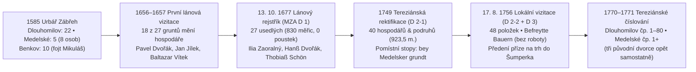

# Lánové rejstříky, rektifikační akta a dominikální fase (1656–1756)
*MZA Brno – fondy D 1, D 2 a D 3 pro panství Zábřeh: Dlouhomilov (Lomigsdorf), Medelské (Dreihofen) a Benkov (Benke)*

---

## 1. Pramenná základna v Moravském zemském archivu v Brně (MZA)

Mezi předbělohorským urbářem zábřežského panství z roku 1585 a nejstaršími dochovanými farními matrikami (Dubicko 1617, Zábřeh 1649) a josefínským číslováním domů (1770–1771) tvoří berní operáty v Moravském zemském archivu v Brně (**MZA Brno**, badatelna [ARON](https://www.mza.cz/aron/)) páteřní jmennou řadu pro rekonstrukci všech usedlostí údolí:

1. **MZA Brno, fond D 1 – Lánové rejstříky (1656–1679), sign. 141 (*Panství Zábřeh*)**
   - [Přímý odkaz do ARON (`d4a61780-da2e-4276-89f2-5d47d83230ba`)](https://www.mza.cz/aron/apu/d4a61780-da2e-4276-89f2-5d47d83230ba)
   - Kniha druhé lánové vizitace uzavřená císařskou komisí v Zábřehu dne **13. října 1677** (*Hohenstadt, 13. 8bris 1677*, sn. 103). U každého držitele uvádí i jeho předchůdce z první poválečné vizitace (**1656–1657**, formule *„vor …“*), počet tažného dobytka (*Pferd*) a výměru orné půdy v měřicích a osminách (*Metzen / Achtel*) rozdělenou do bonitních tříd.
   - **Dlouhomilov (*Lomigsdorf*):** `fol. 76r–77v` (snímky 78–80) • **Benkov (*Dorf Benke*):** `fol. 79r–79v` (snímky 81–82) • **Sumář panství:** `fol. 100` (sn. 102) • **Rejstřík vsí:** sn. 104.
2. **MZA Brno, fond D 2 – Rektifikační akta (1667–1768), Řada I, sign. 141 (*Panství Zábřeh*), Část 1 (Fascikl 141-1)**
   - [Přímý odkaz do ARON (`5a87932f-15c7-40be-a2c6-15f211a21866`)](https://www.mza.cz/aron/apu/5a87932f-15c7-40be-a2c6-15f211a21866)
   - Souhrnné rustikální fasiony z roku **1749** (*Specification deren in Anno 1749 überreichten Fassionen… Herrschaft Hohenstadt*, datováno v Zábřehu `14. 8bris 1749` na sn. 664). V prvním sloupci cituje předchůdce z lánové vizitace roku 1677 a v rubrikách 1–6 rozepisuje jednotlivé tratě polí, pusté pozemky, sady, louky a řemesla všech sedláků, domkařů i podruhů.
   - **Dlouhomilov (*Lomigsdorf*):** `fol. 219–227` (snímky 561–569) • **Rejstřík:** sn. 663.
3. **MZA Brno, fond D 2 – Rektifikační akta, Řada I, sign. 141 (*Panství Zábřeh*), Část 2 (Fascikl 141-2)**
   - [Přímý odkaz do ARON (`d8e84be1-cdb7-4a71-b496-57614df8003f`)](https://www.mza.cz/aron/apu/d8e84be1-cdb7-4a71-b496-57614df8003f)
   - Protokol císařské **lokální vizitace ze srpna 1756** (*Bey der in Anno 1756 vorgenommenen Local-Visitation befunden worden*), uzavřený pro Dlouhomilov dne **17. srpna 1756** v Zábřehu (snímky 427–439). Obsahuje aktuální jména držitelů (*modo …*), katastrální výměry půdy, obecních pastvin a lesů i třináctibodový hospodářsko-právní dotazník **Ad Generalia**.
4. **MZA Brno, fond D 3 – Dominikální fase (1750–1851), sign. 172/1, karton 32 (*Panství Zábřeh & svobodný dvůr Kolšov*)**
   - [Přímý odkaz do ARON (`4c3aaca2-fbe2-49f9-af4c-14bf09a0920f`)](https://www.mza.cz/aron/apu/4c3aaca2-fbe2-49f9-af4c-14bf09a0920f)
   - Vrchnostenské přiznání lichtenštejnské správy z roku **1750** (*Obrigkeitliche Bekantnuß-Tabella der Fürstlich Liechtensteinischen Herrschaft Hohenstadt*), sloužící k jednoznačnému ověření panských (dominikálních) dvorů na celém panství.

---

## 2. Dlouhomilov (*Lomigsdorf*): Všech 27 usedlíků z roku 1677 ve srovnání s vizitací 1656–1657 a rokem 1749

Druhá lánová vizitace zapsala v Dlouhomilově (*fol. 76r–77v*) přesně **27 osedlých hospodářů** (*Summa angeseßene Würth: 27*) a **žádnou starou ani novou poustku (`0` Ödungen)** – na rozdíl od sousedního Strupšína (`fol. 78r`, sn. 80), kde se ještě v letech 1656–1677 nově osazovaly 4 poválečné poustky. Oproti předbělohorskému urbáři z roku 1585 (22 usedlíků) se sídelní struktura dokonce rozrostla o 5 drobných domkařských stavení.

Všech **19 usedlíků s poli** (`1. Latus` č. 1–10 + `2. Latus` č. 11–19) drželo v roce 1677 dohromady **830 měřic** orné půdy (v 2. třídě `276` m. `5 2/4` osm. = `276 5/8` m.; ve 3. třídě `553` m. `2 2/4` osm. = `553 2/8` m.), což spolu s 8 domkaři bez polí představovalo přesně **6 lánů a `3 1/4` osminy** berního základu. Rychtářské hospodářství (`90` měřic) bylo o polovinu větší než velké selské grunty (`60` měřic).

| Č. | Kategorie (1677) | Hospodář 1656–1657 (*vor …*) | Hospodář 1677 (*Lánový rejstřík*) | Koní | Půda 1677 (`Sec.` + `Ter.` = celkem) | Nástupce 1749 (*D 2, fol. 220–226*) & vazba na čp. / rod |
| :--- | :--- | :--- | :--- | :--- | :--- | :--- |
| **1.** | *Erbrichterey* | **Gira Blahařek(?)** | **Ilia Zaoralný**, *Erbrichter* | 1 | `30` + `60` = **`90` m.** | **Martin Skaliczka** (*fol. 220* čteno *Paloczka/Skaliczka*; r. 1756 *Martin Skalicka → **Florian Klotas***, *Befreytter Erbrichter*) → **rychta čp. 7** |
| **2.** | *Große Pauern gründt* | **Pawel Dworžak** *(doložen 1651)* | **Hanß Dworžak** (Jan Dvořák) | 3 | `20` + `40` = **`60` m.** | **Paul Wokal** (1756 *Paul Brauškal(?) → vdova Elisabeth*); v soupisu polí mj. *„ein stückl bey Medelsker grundt“* → linie **Dvořáků (`čp. 29` / `22`)** |
| **3.** | *Große Pauern gründt* | *(bez změny rodu – Vlček 1585)* | **Jan Wlček** (Jan Vlček) | 2 | `20` + `40` = **`60` m.** | **Matouß Wlček** (`48` m. + `12` pustých) |
| **4.** | *Große Pauern gründt* | *(bez změny rodu – Vokšan 1585)* | **Jan Wokšan** (Jan Vokšan) | 1 | `20` + `40` = **`60` m.** | **Jiržik Dworžak** (`50` + `10` m.) – pokračování rodu **Dvořáků** na velkém gruntu |
| **5.** | *Große Pauern gründt* | **Jan Dražný** | **Giržik Gýlek** (Jiřík Jílek) | 1 | `20` + `40` = **`60` m.** | **Matouß Gýlek / Jílek** (louka *w Medelsky Strani*) → rod **Jílků** (`čp. 10`) |
| **6.** | *Große Pauern gründt* | **Gira Michalek** | **Jan Schindler** | 2 | `20` + `40` = **`60` m.** | **Pawel Jangl** (Jankl) |
| **7.** | *Mittlere Pauern gründt* | **Jan Gýlek** *(nejstarší Jílek)* | **Mikulaß Gýlek** (Mikuláš Jílek) | 2 | `13 2/8` + `26 5/8` = **`40` m.** | **Matieg Gýlek / Jílek** → druhá větev rodu **Jílků** (`čp. 10`) |
| **8.** | *Mittlere Pauern gründt* | **Giržik Kupka** | **Matieg Michalek** | 5 | `13 2/8` + `26 5/8` = **`40` m.** | **Jan Zawodný** |
| **9.** | *Mittlere Pauern gründt* | **Jan Wachotka** *(Vachutka 1585)* | **Martin Wachotka** (Vachutka) | **6** | `13 2/8` + `26 5/8` = **`40` m.** | **Niculaß Wachutka** (*Mikuláš Vachutka* – nejvíce koní v obci v r. 1677) |
| **10.** | *Mittlere Pauern gründt* | *(bez změny rodu)* | **Matheuß Škoda** | 5 | `13 2/8` + `26 5/8` = **`40` m.** | **Jan Škoda** (louka *w Medelsky Strani*) |
| **11.** | *Mittlere Pauern gründt* | **Matheuß Blahařek** | **Jan Wlček der Jüngere** | 1 | `13 2/8` + `26 5/8` = **`40` m.** | **Joseph Wlček** (doložen i r. 1756, sn. 431) |
| **12.** | *Kleine Pauern gründt* | **Jan Horniček** *(Horníček 1585)* | **Peter Schindler** | 1 | `10` + `20` = **`30` m.** | **Frantz Jilek** (i r. 1756, sn. 431; pole *u Medla gruntes mihle*) |
| **13.** | *Kleine Pauern gründt* | **Peter Wokšan** | **Wawra Horniček** *(1749 psán Pawel)* | 3 | `10` + `20` = **`30` m.** | **Jan Horniček** (1756 *→ Nicolaus Horniček*; pole *u Medelsk. gruntu*) |
| **14.** | *Kleine Pauern gründt* | *(bez změny rodu)* | **Thomaß Wýchatý** | 1 | `10` + `20` = **`30` m.** | **Pawel Babiczka** |
| **15.** | *Kleine Pauern gründt* | **Gira Šuster** | **Štiepan Zaoral** | 1 | `10` + `20` = **`30` m.** | **Jiržik Zoran** (Zaoral) |
| **16.** | *Kleine Pauern gründt* | **Jakob Ržiha** | **Jan Hübner** | 1 | `10` + `20` = **`30` m.** | **Anton Kouřil** (starousedlý rod z urbáře 1585, předek linie `čp. 24`) |
| **17.** | *Kleine Pauern gründt* | *(bez změny rodu)* | **Jakob Lýsý** | 1 | `10` + `20` = **`30` m.** | **Georg Wyčital** |
| **18.** | *Kleine Pauern gründt* | **Baltzer Wítek** *(Medelské 1585)* | **Matheß Brauner** | 1 | `10` + `20` = **`30` m.** | **Frantz Schuster** |
| **19.** | *Kleine Pauern gründt* | **Jakob Pospišil** *(1585)* | **Endra Šuster** (Ondřej Šustr) | 1 | `10` + `20` = **`30` m.** | **Jan Kleczar** (17 m. + 11 pustých + 2 ladem) |
| **20.** | *Haußler ohne acker* | **Jan Sobotka** | **Jan Balcarek** | – | bez polí (`1/2` osm. lánu) | **Jirka Dworžak** (`10` m. přikoupených polí) |
| **21.** | *Haußler ohne acker* | *(bez změny rodu)* | **Georg Prokoff** | – | bez polí (`1/2` osm. lánu) | **Mikulaß Halmich** (`2` m. polí) |
| **22.** | *Haußler ohne acker* | **Watzlaw Hubliček** | **Marina Wokšanin wittib** | – | bez polí (`1/2` osm. lánu) | **Matieg Sladek** (`4` m., *Taglöhner*; rod Sládků z r. 1585) |
| **23.** | *Haußler ohne acker* | **Thomaß Daněk(?)** | **Endra Wašiček** | – | bez polí (`1/2` osm. lánu) | **Matieg Horniček** (*beym Hauß*, nádeník) |
| **24.** | *Haußler ohne acker* | **Georg Tesařek** | **Jan Melišek** | – | bez polí (`1/2` osm. lánu) | **Jiržik Hilar** (nádeník) |
| **25.** | *Haußler ohne acker* | **Jakob Maděrinka** | **Mikl Wlček** (Mikuláš Vlček) | – | bez polí (`1/2` osm. lánu) | **Frantz Beranek** (nádeník) |
| **26.** | *Haußler ohne acker* | **Pawel Wokšan** | **Giržik Kupka** | – | bez polí (`1/2` osm. lánu) | **Jan Drážný(?) / Hraný(?)** (nádeník) |
| **27.** | *Haußler ohne acker* | **Linhart Tichý** | **Matieg Horniček** | – | bez polí (`1/2` osm. lánu) | **Jan Krawcz** (Kravec, nádeník) |

### Souhrn z *Extract Lomigsdorff* (1677, `fol. 77v`) a rozvoj zástavby do let 1749–1756

* **`1. Latus` (`č. 1–10`):** `10` hospodářů, `28` koní, `183` m. `2 1/2` osm. (`Sec.`) + `366` m. `5 1/2` osm. (`Ter.`) = `550` měřic.
* **`2. Latus` (`č. 11–19`):** `9` hospodářů, `11` koní, `93` m. `2 1/2` osm. (`Sec.`) + `186` m. `5 1/2` osm. (`Ter.`) = `280` měřic.
* **`Haußler ohne acker` (`č. 20–27`):** `8` domkařů bez polí = `4` osminy lánu.
* **Celkem v roce 1677:** **`27` osedlých hospodářů**, **`39` koní**, **`276 5/8` + `553 2/8` = `830` měřic**, tj. **`6` lánů a `3 1/4` osminy**; **`0` poustek**.
* **Růst do roku 1749 (`D 2, fol. 226`, sn. 568):** Ke starým 27 usedlostem přibylo **7 nových domkařů bez lánového původu (`č. 28–34`)** (*Barton Jilek, Georg Jilek, Georg Proksch, Florian Jilek, Matieg Zoran, Tomas Mlinař, Jann Wlček*) a **6 podruhů (`Inleüthe`, `č. 35–40`)** (*Mikulaß Jilek, Jann [Jilek], Jann Ondraß, Wentzl Prokesch, Wentzl Wlček, Matouß Zoran*); výměra orné půdy činila po zahrnutí nově přiznaných tratí `923,5` měřic (`199` + `724,5`) plus `140` měřic ležících ladem/pustých.
* **Stav k 17. 8. 1756 (`D 2 Část 2`, sn. 436–439):** Zapsáno již **48 položek** včetně obecní pastoušky (`č. 48 Ein gemein Hirten Häußl`) a obecních pozemků (`Gemeinde`: `50` měřic pastvin a `24` měřic lesa); poddanské držby vykazují `675 6/8` měřic čisté orné půdy, `129 1/8` úhorů a ladem ležících tratí a `57` měřic pustých polí.

---

## 3. Rozluštění postavení Medelského (*Dreihofen = Tři Dvory*) mezi lety 1585 a 1771

Zatímco v urbáři panství Zábřeh z roku **1585** (`URB00015585`, str. 80–81) vystupuje *Medelské* samostatně s **5 položkami a 8 držiteli** (*Valauch, Vítek, Hrabovský & Šumerda, Horníček & Stejskal, Kouřil & Vykoukal*), v lánovém rejstříku **1677 (`D 1`)** ani v tereziánských rektifikačních aktech **1749/1756 (`D 2`)** nemá vlastní obecní kapitolu (mezi Dlouhomilovem na `fol. 77v`/`227` a Benkovem leží přímo *Dorf Strupseyn / Strupstein* = Strupšín). Systematické prověření všech tří katastrálních fondů MZA Brno (`D 1`, `D 2` i `D 3`) tuto mezeru jednoznačně vysvětluje:

1. **Nebyl to vrchnostenský poplužní dvůr (*Meierhof*):** Dominikální fase celého lichtenštejnského velkostatku Zábřeh z roku **1750 (`D 3, sign. 172/1`, sn. 4–5)** vypočítává pouze pět vrchnostenských dvorů: zámecký dvůr v *Zábřehu* (*Schloß Hohenstädter Majer Hoff*), *Klášterec* (*Klatzmenauer*), *Nemile* (*Nemiller*), *Rovensko* (*Rowensker*) a *Třebařov* (*Trebendorffer Hoff*; společně v kartonu se svobodným dvorem v Kolšově). Ani v Medelském, ani v Dlouhomilově či Benkově vrchnost žádný vlastní panský dvůr nedržela.
2. **Berní a správní splynutí s Dlouhomilovem po třicetileté válce:** Malá skupina původních tří rustikálních dvorců (*Dreihofen*) tvořila společnou hospodářskou jednotku se sídlem v Dlouhomilově již od nejstarší pozemkové knihy z roku **1584** (*inv. č. 164, sign. 428: Gruntovní kniha pro vsi Dlouhomilov a Medelské*). V pobělohorských berních vizitacích (`D 1` 1657/1677 i `D 2` 1749/1756) byla proto tato menší osada zahrnuta přímo do daňové obce **Lomigsdorf**.
3. **Přímá katastrální stopa dvorů i mlýna v Dlouhomilově roku 1749 (`D 2 Část 1, fol. 220–223`):** Polnosti a louky tří původních dvorů (*Medelsker Grund*) i tamní mlýn přežívají přímo v traťových názvech dlouhomilovských přiznávacích fasí:
   - Sedlák č. 2 **Paul Wokal** (nástupce Jana Dvořáka) přiznává trať *„ein stückl bey **Medelsker grundt**“* (*fol. 220*, sn. 562).
   - Sedláci č. 5 **Matouš Jílek** (*fol. 221*) a č. 10 **Jan Škoda** (*fol. 222*) užívají louky *„**w Medelsky Strani**“*.
   - Malí sedláci č. 12 **František Jílek** a č. 13 **Jan Horníček** (*fol. 223*, sn. 565) uvádějí polnosti *„u **Medla gruntes mihle(?)**“* a *„u **Medelsk. gruntu**“*.
   - Původní medelské rody z roku 1585 (**Vítek**, **Horníček**, **Kouřil**) jsou zapsány přímo v řadě dlouhomilovských usedlíků (č. 12 *vor Jan Horniček*, č. 13 *Wawra Horniček*, č. 16 *Anton Kouřil*, č. 18 *vor Baltzer Wítek*, č. 23 *Endra Wašiček → Matieg Horniček*, č. 27 *Matieg Horniček*).
4. **Obnovení samostatné řady v letech 1770–1771:** Teprve při josefínském popisování domů na sklonku tereziánské éry získala jižní část údolí kolem tří někdejších dvorců opět vlastní domovní číselnou řadu pod úředním názvem **Medelské / Dreihofen (`čp. 1` a násl.)**.

---

## 4. Hospodářský a právní obraz vsi ze 17. srpna 1756 (*Ad Generalia*, `D 2 Část 2`, sn. 438–439)

Závěr lokální vizitace ze dne **17. srpna 1756** zachycuje živou výpověď obce před císařskými komisaři **Davidem von Bories** a **Ferdinandem Jos. Walterem**:

* **Osvobození sedláci (*Befreytte Bauern*):** Dlouhomilovští rychtář, velcí i malí sedláci a zahradníci jsou v tabulce z roku 1756 označeni jako *Befreytte Erbrichter / grosse Bauern / kleine Bauern* – naturální polní robotu nekonali a povinnosti vykupovali peněžním platem.
* **Trojpolní horské hospodářství a lnářství:** Ve třech prvních bodech protokolu *Ad Generalia* komise konstatuje horské trojpolní hospodaření (*im dreyjährigen anbau*). V bodech 7–8 dokládá důležitý vedlejší zdroj obživy: místní hospodáři a domkaři pěstují len a po zimách předou přízi (*Garnspinnen*), kterou prodávají na trzích v **Šumperku** (*Stadt Schönberg*).
* **Lesy a vrchnostenská práva:** Obec vlastnila jen `24` měřic obecního lesa bez nadbytku dřeva na prodej; obecní pastouška (`č. 48`) sloužila chudým podruhům a krčma na rychtě odebírala pivo ze zábřežského vrchnostenského pivovaru.

---

## 5. Benkov (*Dorf Benke*): Všech 10 usedlíků z roku 1677 (`MZA D 1, fol. 79r–79v`, sn. 81–82)

Sousedení nad horním koncem údolí ukazuje v roce **1677** stejnou poválečnou stabilitu jako Dlouhomilov: **`10` osedlých hospodářů** (shodný počet jako v urbáři roku 1585), **`0` poustek**, **`9` koní**, **`310` měřic orné půdy ve 3. bonitní třídě** a **`2` lány a `1` osmina** daňové povinnosti. Přímo na `fol. 79r` čteme zakladatele sedmigeneračního rodu na benkovském **čp. 5** – **Tobiase Schöna** – i jeho příbuzné:

| Č. | Kategorie (1677) | Předchůdce 1656–1657 (*vor …*) | Hospodář 1677 (*fol. 79r*) | Koně | Orná půda (`Tertia Classis`) | Genealogická návaznost |
| :--- | :--- | :--- | :--- | :--- | :--- | :--- |
| **1.** | *Große Pauern gründt* | *(bez změny)* | **Hanß Schön der Jüngere** | 1 | `60` měřic | silný rod Schönů v Benkově (Urbář 1585 předtím bez Schönů; v matrikách od 1658 *Martin Schön*) |
| **2.** | *Kleine Pauern gründt* | *(bez změny)* | **Hanß Schön der Eltere** | 1 | `35` měřic | starší větev Schönů v Benkově |
| **3.** | *Kleine Pauern gründt* | **Jakob Dakl(?)** | **Hanß Körner** | 1 | `35` měřic | z rodu Körnerů pocházela Magdaléna roz. Körnerová (1738 sňatek s Georgem Schönem na `čp. 5`) |
| **4.** | *Kleine Pauern gründt* | *(bez změny)* | **Lorentz Pößel** | 1 | `35` měřic | starousedlý rod Pößelů |
| **5.** | *Kleine Pauern gründt* | **Martin Lorentz** | **Thobiaß Schintzel** | 1 | `35` měřic | z rodu Schintzelů pocházela **Judith roz. Schintzlová**, manželka Tobiase Schöna |
| **6.** | *Kleine Pauern gründt* | **Lorentz Böhm** | **Matheß Pößel** | 1 | `35` měřic | druhá usedlost rodu Pößelů |
| **7.** | *Kleine Pauern gründt* | *(bez změny)* | **Georg Schubert** | 1 | `35` měřic | starousedlý grunt |
| **8.** | *Gärtler mit acker* | **Georg Puchman** | **Thobiaß Schön** | 1 | `10` měřic | přímý předek sedmi generací Schönů na **Benkově čp. 5** (1669–1946) |
| **9.** | *Gärtler mit acker* | **Hanß Pößel** | **Thobiaß Gabriel** *(+ společná trať `20` m. úročních polí)* | 1 | `10` m. (+ `20` m.) | domkařsko-zahradnická držba |
| **10.** | *Haußler ohne acker* | *(bez změny – Hayndl 1585)* | **Matheß Heindl** | – | bez polí (`2/4` osm. lánu) | přímý potomek **Hayndla** z urbáře roku **1585** |

---

## 6. Vývoj sídel a daňového základu (1585–1756)

| Pramen & rok | Dlouhomilov (počet usedlostí) | Medelské (*Dreihofen*) | Půda Dlouhomilova | Benkov (usedlíci) | Poznámka k dějinám osídlení |
| :--- | :--- | :--- | :--- | :--- | :--- |
| **Urbář Zábřeh 1585** | `22` usedlíků | samostatně: `8` držitelů na `5` položkách | neuvedeno | `10` v čele s fojtem *Mikulášem* | předbělohorská stabilita, zřetelná jazyková hranice |
| **Lánový rejstřík 1656–1657 (`D 1` předchůdci)** | `27` hospodářů *(z toho `19` s poli + `8` domkařů)* | sloučeno pod Dlouhomilov (`0` poustek) | `830` měřic | `10` hospodářů (`0` poustek) | poválečné přeobsazení `18` z `27` usedlostí bez zpustnutí |
| **Lánový rejstřík 1677 (`D 1, sign. 141`)** | `27` usedlých (`39` koní, `6` lánů `3 1/4` osm.) | začleněno pod Dlouhomilov | `830` měřic (`276 5/8` + `553 2/8`) | `10` usedlých (`310` m., `2 1/8` lánu) | *Ilia Zaoralný* (rychta), *Hanß Dworžak*, *Mikulaß Gýlek*, *Thobiaß Schön* |
| **Tereziánské fasiony 1749 (`D 2 Část 1`)** | `27` starousedlých + `13` nových = **`40`** | tratě *Medelsker grundt / Medelsky Strani* | `830` (1677) → **`923,5` m.** (+ `140` pustých) | navazující soupis (`fol. 243–246`) | nárůst chalupníků a podruhů; kontinuita *Dvořák, Jílek, Vlček, Kouřil* |
| **Lokální vizitace 1756 (`D 2 Část 2`)** | **`48`** položek vč. obecní pastoušky | *Befreytte Bauern*, lnářství pro Šumperk | `675 6/8` + `129 1/8` úhory + `57` pusté | protokol ze **17. 8. 1756** | výkup roboty, předení příze; v **1770–1771** obnovena samostatná řada Medelského `čp. 1+` |

