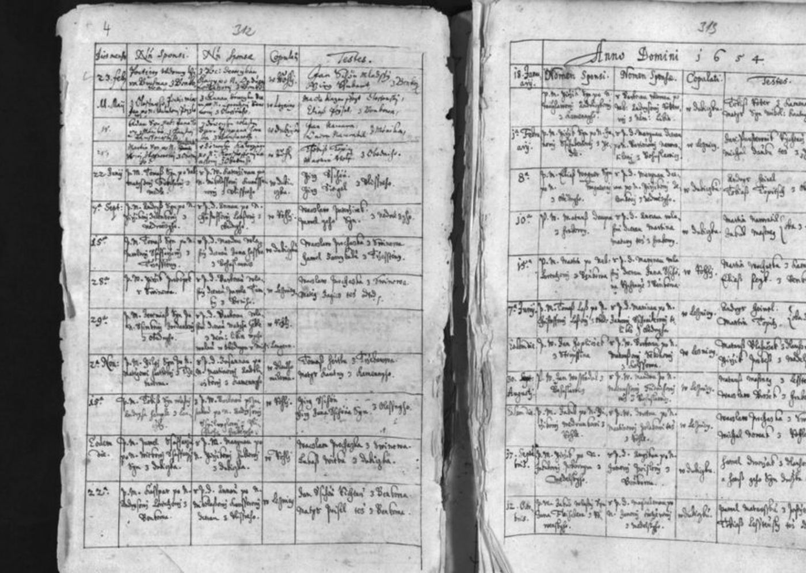
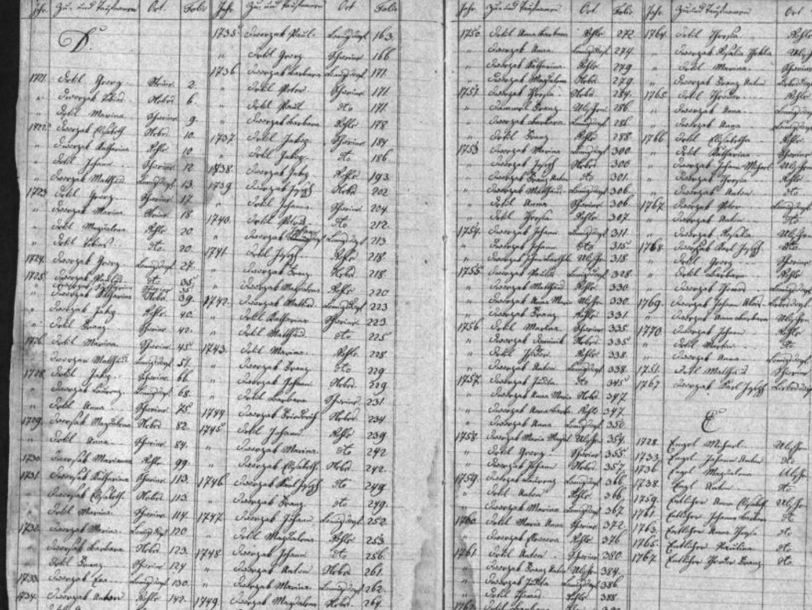
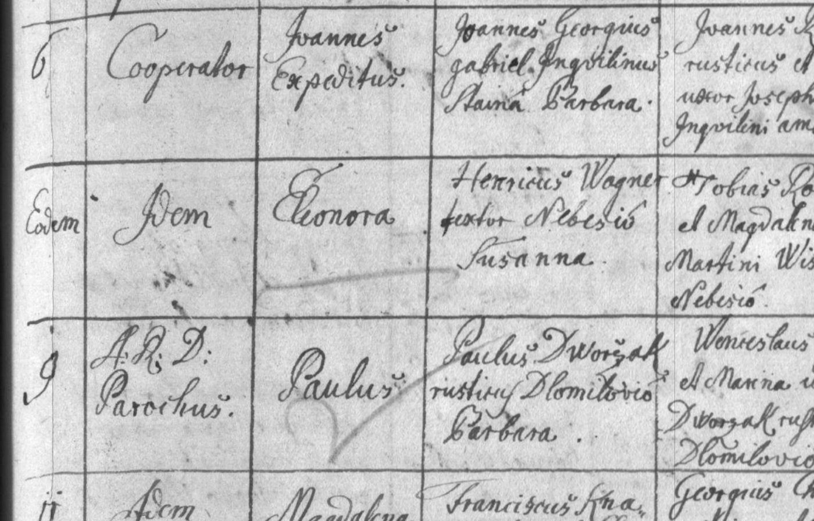
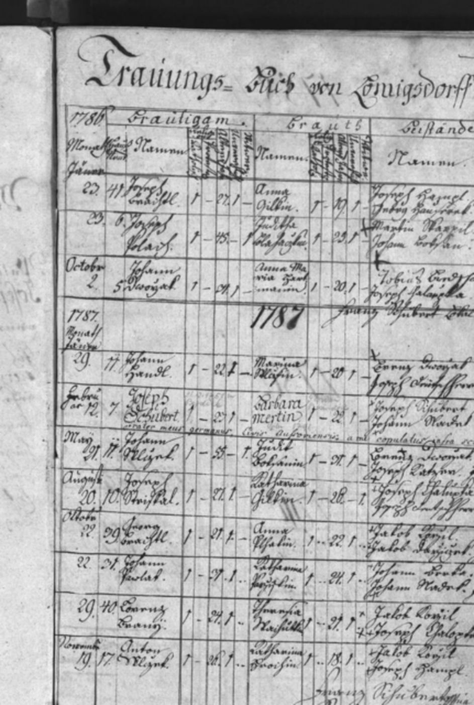
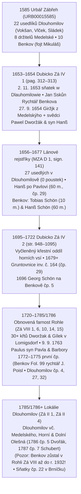

# Nejstarší matriky okolních farností Dubicko a Rohle (1650–1785) a přechod k Zá II
*Systematická excerpce matrik ZAO Opava (pobočka Olomouc) pro Dlouhomilov, Medelské a Benkov před zřízením samostatné lokálie roku 1785/1786*

---

## 1. Hlavní zjištění a opravy tradiční datace farností

Detailní revize archivních inventářů a originálních rukopisných skenů **Zemského archivu v Opavě – pobočky v Olomouci** (fond *Sbírka matrik Severomoravského kraje, NAD 165*) přinesla tři zásadní metodická upřesnění oproti zjednodušenému schématu tradovanému ve starších přehledech:

1. **Oprava přechodu z Dubicka do Rohle (kolem roku 1720/1722, nikoli až 1762):** Dlouhomilov (*Lomigsdorf*), osada Medelské (*Dreihöfen*) i Benkov (*Benke*) **nezůstaly** v dubické matrice až do roku 1762. Ve svazku `Dubicko Zá IV 2` (*inv. č. 8377*) mají pro Dlouhomilov, Benkov, Rohli, Obědné, Kamennou a obě Olešné vyčleněn oddíl křtů **`1695–1722`** až na konci knihy (`str. 948–1095`), zatímco hlavní část dubické matriky (`str. 1–944`) vede zápisy pro Dubicko, Třeštinu, Hrabovou a okolní vsi. Již od let **1720–1721** byly horní vsi přifařeny k obnovené farnosti **Rohle (`Zá VIII 1, 6, 10, 14, 15`)** – dubický svazek `Zá IV 3` (`N 1755–1784`) proto již Dlouhomilov ani Benkov vůbec neobsahuje.
2. **Benkov po roce 1786 nepřešel pod Dlouhomilov, ale zůstal v Rohli až do roku 1932:** Se zřízením samostatné lokálie při kostele Všech svatých v Dlouhomilově roku **1785** (průběžné matriky `Dlouhomilov Zá II` od ledna **1786**) přešly do nového obvodu pouze obce **Dlouhomilov (včetně osady Medelské), Dolní Olešná a Horní Olešná**. Sousední **Benkov (*Benke*)** zůstal i po roce 1786 přifařen ke kostelu v **Rohli** (`Zá VIII 2, 7, 11...` až `Zá VIII 18`, *inv. č. 11251*, do r. **1932**).
3. **Pravidlo sňatku ve farnosti nevěsty & genealogická oprava otce Pavla Dvořáka (* 9. 9. 1763):** Snoubenci byli oddáváni zpravidla ve farnosti nevěsty – proto sňatek **Pavla Dvořáka ml.** s **Marinou roz. Weinlichovou** v roce 1786 neleží v dlouhomilovské matrice `Zá II 4`, nýbrž v matrice **Brníčka (`Zá VI`)**, a ojedinělé záznamy z let `1649–1692` lze nalézt též v matrikách **Zábřeha (`Zá I 1`, inv. č. 8332)**, **Brníčka (`Zá VI 5`, od r. 1653)** a **Lesnice (`inv. č. 8399`, od r. 1676/1688)**. Křestní zápis z **9. září 1763** (`Rohle Zá VIII 1, pag. 405`) současně vyvrátil dřívější domněnku o otcovství Jiřího Dvořáka: pokřtěný *Paulus* z čp. 22 byl synem **sedláka Pavla Dvořáka st. a jeho choti Barbory** (`Paulus Dworžak rusticus Dlomilovio, Barbara`).

---

## 2. Katalog farních matrik a ověřené permalinky (1617–1949)

| Farnost & původce | Signatura & inv. č. | Obsah & časový rozsah | Rozsah stran / skeny pro Dlouhomilov, Medelské a Benkov | Ověřený permalink DigiArchiv ZAO |
| :--- | :--- | :--- | :--- | :--- |
| **Dubicko** *(18 vsí vč. Dlouhomilova, Medelského a Benkova)* | **`Zá IV 1`** (`inv. č. 8376`) | **N** `1617–1694` *(str. `71–78` chybí)*, **O** `1650–1694`, **Z** `1651–1694` | `N` str. `1–308`, `O` str. `311–422`, `Z` str. `423–575` (`290` skenů); společný chronologický zápis v češtině a latině, Medelské psáno *z Medelskýho* | [DigiArchiv Zá IV 1](https://digi.archives.cz/da/permalink?xid=be97a52e-f13c-102f-8255-0050568c0263) |
| **Dubicko** *(vyčleněný oddíl horních vsí)* | **`Zá IV 2`** (`inv. č. 8377`) | **N** `1695–1761`, **O** `1695–1762`, **Z** `1695–1762`, **oddíl N `1695–1722`** | Oddíl **N `1695–1722`** pro *Dlouhomilov, Benkov, Rohli, Nedvězí, Obědné, Kamennou a obě Olešné* leží na **str. `948–1095`** (`537` skenů celkem) | [DigiArchiv Zá IV 2](https://digi.archives.cz/da/permalink?xid=be97a5e2-f13c-102f-8255-0050568c0263) |
| **Rohle** *(obnovená farnost)* | **`Zá VIII 1`** (`inv. č. 8409`) | **N** `1720–1786` (`363` skenů) | Společný oddíl `1720–1771`: str. `1–495`; vesnické oddíly s čp. `1772–1786`: Obědné `496–533` (`sn. 301–312`), **Benkov `535–559`** (`sn. 313–325`, zač. `Fol. 99`), Horní Olešná `561–591`, Dolní Olešná `593–615`, **Dlouhomilov `617–632`** (`sn. 341–346`), Janoslavice `633–651`, nemanž. `653–669`, Kamenná `671–693` | [DigiArchiv Zá VIII 1](https://digi.archives.cz/da/permalink?xid=be97b69a-f13c-102f-8255-0050568c0263) |
| **Rohle** | **`Zá VIII 6`** (`inv. č. 8414`) | **O + I-O** `1721–1785` (`156` skenů) | Společný oddíl `1721–1771`: str. `1–151`; oddíly s čp. `1772–1785`: **Benkov str. `165–170`**, **Dlouhomilov str. `188–192`** | [DigiArchiv Zá VIII 6](https://digi.archives.cz/da/permalink?xid=be97b988-f13c-102f-8255-0050568c0263) |
| **Rohle** | **`Zá VIII 10`** (`inv. č. 8418`) | **Z** `1721–1786` (`204` skenů) | Společný oddíl `1721–1771`: str. `1–268`; oddíly s čp. `1772–1786`: **Benkov str. `287–300`**, **Dlouhomilov str. `331–340`** | [DigiArchiv Zá VIII 10](https://digi.archives.cz/da/permalink?xid=be9810c2-f13c-102f-8255-0050568c0263) |
| **Rohle** *(rejstřík N)* | **`Zá VIII 14`** (`inv. č. 8422`) | **Index N** `1720–1787` (`47` skenů) | Přestože v krátkém popisku ZAO není *Dlouhomilov* vypsán, rejstřík prokazatelně indexuje celou farnost včetně *Lomigsdorf* | [DigiArchiv Zá VIII 14](https://digi.archives.cz/da/permalink?xid=be981388-f13c-102f-8255-0050568c0263) |
| **Rohle** *(rejstřík Z)* | **`Zá VIII 15`** (`inv. č. 8423`) | **Index Z** `1721–1786` | Abecední index zemřelých pro celou farnost včetně Dlouhomilova a Benkova | [DigiArchiv Zá VIII 15](https://digi.archives.cz/da/permalink?xid=be98141e-f13c-102f-8255-0050568c0263) |
| **Dlouhomilov** *(nová lokálie)* | **`Zá II 1`** (`inv. č. 8359`) | **N** `1786–1855` (`231` skenů) | **Dlouhomilov (včetně osady Medelské)** str. `1–180`, Horní Olešná, Dolní Olešná *(Benkov zůstal v Rohli `Zá VIII 2+` až do r. 1932!)* | [DigiArchiv Zá II 1](https://digi.archives.cz/da/permalink?xid=be979c78-f13c-102f-8255-0050568c0263) |
| **Dlouhomilov** *(nová lokálie)* | **`Zá II 4`** (`inv. č. 8362`) | **O** `1786–1855` (`92` skenů) | **Dlouhomilov** str. `1–68` (`pag. 1` otevírá `Trauungs-Buch von Lomigsdorff 1786–1787`), Horní a Dolní Olešná | [DigiArchiv Zá II 4](https://digi.archives.cz/da/permalink?xid=be979dd6-f13c-102f-8255-0050568c0263) |

---

## 3. Systematická excerpce farnosti Dubicko (`Zá IV 1`, 1653–1683)

*Obr. 1: ZAO Opava – pobočka Olomouc, Dubicko `Zá IV 1` (`inv. č. 8376`), sn. `160` (`pag. 312–313`, sňatky `1653–1654`): doklady obřadů „w Dlauhomilowie“, benkovského rychtáře Jana Schöna (Sskůna), osady „z Medelskýho“ i svědectví Pavla Dvořáka a jeho syna Hanße dne 27. 9. 1654.*

### A. Sňatky 1653–1654 (`Zá IV 1`, sn. 160, `pag. 312–313`)

Na nejstarší dochované dvoustraně oddací matriky let **1653–1654** (česky psané sloupce `Dies mensis | Nomen Sponsi | Nomen Sponsae | Copulati | Testes`) se přímo pojí tři klíčové linie údolí:

* **`23. 2. 1653` (`pag. 312`, 1. zápis):** Ženich *Šimon(?) Búchnar z Benkowa* se žení *w Rohlj*; mezi benkovskými svědky stojí **`Jan Sskůn [Schön] mladssý`** a *`Giržý Kubart(?) z Benkowa`*.
* **`2. 11. 1653` (`pag. 312`, 9. zápis):** Ženich *`p. m. Gilgj [Jiljí] syn po n. Matiegowi Hertlowj(?) z Tržestiny`* & nevěsta *`p. d. Zuzanna po n. Martinowj Kadleczkowj(?) z Kamennyho`*, sloupec *Copulati*: **`w Dlauhomilowie`**, svědkové *`Tomasš Sstietka(?) z Tržesstiny, Matiey Kuntny(?) z Kamennyho`*. **Význam:** Bezprostřední důkaz, že dlouhomilovský filiální kostel Všech svatých sloužil k vysluhování sňatků farníků již pět let po konci třicetileté války.
* **`22. 11. 1653` (`pag. 312`, 12. zápis):** Ženich *`p. m. Kasspar po n. Ondržegowj Lonckowj(?) z Benkowa`* & nevěsta *`p. d. Anna po n. Mikolassowj Kancžkowj(?) dczerau z Olissnyho`* (`w Lesniczy`), svědkové **`Jan Sskůn Rychtář z Benkowa`** a **`Matyš Peisel [Pejzel] též z Benkowa`**.
* **`15. 2. 1654` (`pag. 313`, 5. zápis):** Ženich *`p. m. Matúš po Neb: Lorenczowj z Benkowa`* & nevěsta **`p. d. Marina wlastnj dczera Jana Sskůna Rychtáře z Benkowa`** (`w Rohlj`), svědkové *`Martin Wachetha(?)`* a **`Eliaš Pejgl/Pejzl z Benkowa`**. **Význam:** Zachytil rychtářskou generaci rodu Schönů v Benkově těsně před první lánovou vizitací `1656–1657` a Lánovým rejstříkem `1677` (*Tobias Schön*, *Hanß Schön st. a ml.*).
* **`27. 9. 1654` (`pag. 313`, 10. zápis — KLÍČOVÝ OBJEV PRO `čp. 29` A `Medelské`):**
  > **`27. Septembris [1654]`** | `Nomen Sponsi:` **`p. m. Giržjk [Jiřík] po n. Jakubowi Jůkorowj(?) z Medelskýho`** | `Nomen Sponsae:` **`s p. d. Angškau [Anežkou] po n. Janowj Geisslerowj(?) z Benkowa`** | `Copulati:` **`w Dubicžku`** | `Testes:` **`Pawel Dworžák z Dlauhomilowa a Hanß geho Syn [Odtudž]`**.
  * **Význam dvojí:** (1) Matrika dokládá české toponymum **`z Medelskýho`** souběžně s první lánovou vizitací (`1654–1657`), přestože v berním soupisu splývalo s Dlouhomilovem. (2) Společné svědectví **Pavla Dvořáka a jeho syna Hanße** roku `1654` přímo potvrzuje **pokrevní vazbu otec → syn**, kterou v Lánovém rejstříku (`MZA D 1, sign. 141, fol. 76v`, `1677`) zachycuje nástupnický zápis **`Hanß Dworzak (vor Pavel Dworzak, 60 měřic)`** na budoucím statku **čp. 29**!
* **`12. 10. 1654` (`pag. 313`, 11. zápis):** Ženich *`p. m. Jakub wlastnj syn Jana Fleischera ...`* & nevěsta **`p. d. Magdaléna po n. Janowj Sušerowj(?) z Medelskýho`** (`w dubicžku`; svědkové z Jestřebí).

### B. Křty podzimu 1683 (`Zá IV 1`, sn. 100, `pag. 194–195`)

* Na `pag. 195` nahoře stojí česká obecní marginálie **`Z dlúhomilowa`**: *`Dne 9 Novembris [1683]. Okržtien [...]na, a Barbory. Kmotrow[e ...] Jana Kochútkowa oba z dlú[homilowa].`* Hned pod tím následují zápisy `Z Rohle 1683` (`12. Dito`) a `Z nedwiezyho` (`16.` a `19. Dito`). Dokládá setrvalé české matriční zápisy farnosti Dubicko i v 80. letech 17. století před oddělením rohelského obvodu.

---

## 4. Excerpce farnosti Rohle (`Zá VIII 14` & `Zá VIII 1`, 1720–1786)

### A. Kompletní rejstřík křtů rodu *Dworžak* v Dlouhomilově (`Zá VIII 14`, sn. 5, `1721–1770`)

*Obr. 2: ZAO Opava – pobočka Olomouc, Rohle `Zá VIII 14` (`inv. č. 8422`), sn. `5` (Index narozených, písmeno `D` `1721–1770`): plynulá řada křtů rodu `Dworžak` z `Lomigsdorf` včetně klíčových let `1735` (`fol. 163`) a `1763` (`fol. 405`).*

Navzdory nepřesnosti v online rejstříku ZAO uvádí abecední index `Zá VIII 14` (písmeno `D`, sn. 5) dlouhou souvislou řadu křtů rodu **Dworžak** z lokality **`Lomigsdorf`** (mimo jiných větví v Rohli, Obědném, Dolní Olešné a Kamenné):

* **1722–1748:** `1722` *Mathias* (`fol. 13`), `1724` *Georg* (`27`), `1725` *Mathias* (`35`), `1726` *Mathias* (`51`), `1728` *Laurenz* (`68`), `1732` *Marina* (`120`), `1733` *Eva* (`130`), **`1735` *Paul* (`163`)**, `1736` *Barbara* (`171`), `1740` *Johann(?)* (`213`), `1742` *Mathias* (`223`), `1746` *Paul Joseph* (`249`) & *Franz* (`249`), `1747` *Johann* (`252`), `1748` *Johann* (`256`) & *Marina* (`262`).
* **1750–1770:** `1750` *Anna* (`274`), `1751` *Barbara* (`286`), `1753` *Mathias* (`306`), `1754` *Johann* (`311`, `315`), `1755` *Paulus(?)* (`328`), `1756` *Anton* (`338`), `1757` *Judita* (`345`) & *Anna* (`350`), `1759` *Laurenz* (`366`) & *Marina* (`367`), `1761` *Juditha* (`386`), `1763` *Anna Maria* (`402`), **`1763` *Paul* (`405`)**, `1765` *Anna* (`427`, `431`), `1767` *Peter*, *Anton*, `1768` *Karl Joseph*, *Thomas*, `1769` *Johann Alois*, `1770` *Anna*.
* Na sn. `7–8` (písmeno **`G`**) je v `Lomigsdorf` obdobně indexován starousedlý rod **`Gílek` (Jílek)**: `1750` *Aloisius* (`280`), *Paul* (`285`), `1759` *Johann* (`358`), `1760` *Joseph* (`363`), `1769` *Johann*, *Juditha*, `1771` *Georg*.

### B. Genealogická oprava křtu Pavla Dvořáka (`9. 9. 1763`, `Rohle Zá VIII 1`, sn. 207, `pag. 405`)

*Obr. 3: ZAO Opava – pobočka Olomouc, Rohle `Zá VIII 1` (`inv. č. 8409`), sn. `207`, `pag. 405`: originální křestní zápis Pavla Dvořáka ze dne `9. září 1763`.*

> **Doslovný přepis (`In Septembri 1763`, `pag. 405`):**  
> `Dies:` **`9`** | `Baptizans:` **`A. R. D. Parochus.`** | `Baptizatus:` **`Paulus`** | `Parentes:` **`Paulus Dworžak rusticus Dlomilovio, Barbara .`** | `Patrini:` **`Wenceslaus [...] et Marina uxor [Georgii(?)] Dworžak rustici Dlomilovio`**

**Důsledek pro rodokmen čp. 22:** Pavel Dvořák (* `9. 9. 1763`), pozdější sedlák na dlouhomilovském gruntě `čp. 22` a otec Petra Dvořáka (* `1793`), **nebyl synem Jiřího Dvořáka** (jak se dříve mylně uvádělo záměnou příjmení kmotry *Mariny choti Dworžakovy* v pravém sloupci), nýbrž přímým synem **sedláka Pavla Dvořáka staršího** (* zřejmě `1735`, `Zá VIII 14` fol. `163`) a jeho manželky **Barbory**!

### C. První zápisy po tereziánském číslování domů (`Rohle Zá VIII 1`, `1772–1775`)

Od roku **1772** rozčlenila rohelská matrika křestní záznamy do samostatných oddílů podle jednotlivých vsí a začala zapisovat nově zavedená **čísla popisná (`Nro. Domus / čp.`)**:

* **Benkov (`sn. 313`, `Fol. 99`, `Ex Pago Benke Anno 1772`):**
  * `11. 2. 1772`: *Anna Martha*, rodiče *`Georgius Körner rusticus et Magdalena`*, kmotři mlynář *`Joannes Körner molitor`* a *`Magdalena uxor Georgii Schön ambo Benka`*.
  * **`16. 2. 1772`:** *`Josephus`*, rodiče **`Antonius Schön Inquilinus, Anna Maria`**, kmotři **`Joannes Poisl p.t. Judex`** (úřadující rychtář benkovský!) a *`Rosalia uxor Gabrielis Körner ambo Benka`*.
  * `22. 3. 1772`: *Anna Clara* (*Florianus Schmidt Inquilinus, Barbara*); `15. 4. 1772`: *Anna Elisabetha* (*Laurentius Wieser Inquilinus, Susanna*, kmotr *Joannes Poisl Judex*); `2. 9. 1772`: *Johanna* (*Carolus Körner Inq., Magdalena*).
* **Dlouhomilov (`sn. 342`, `Fol. 149 / pag. 624–625`, `1774–1775`):**
  * Na `pag. 624` doložena čísla popisná **`čp. 4`** a **`čp. 27`** (*Lomnigsdorffio*).
  * `21. 1. 1775` (`pag. 625`): *Paulus*, syn *`Joannes Sladek, Anna`*, kmotři **`Franciscus Gílek rusticus et Catharina uxor Matthaei Pečka(?) ambo Lomnigsdorffio`**, **`čp. 32`**.
  * Únor `1775` (`pag. 625`): *Mathias*, syn zahradníka *`Nicolaus Schindler gazarius, Anna`*, kmotři **`Paulus Wlček gazarius et Anna uxor Ejusdem`**, **`čp. 32`**.

---

## 5. Vstup do samostatné lokálie Dlouhomilov (`Zá II 4`, `pag. 1`, `1786–1787`)

*Obr. 4: ZAO Opava – pobočka Olomouc, Dlouhomilov `Zá II 4` (`inv. č. 8362`), sn. `2` (`pag. 1`): první strana oddací knihy nové lokálie (`Trauungs-Buch von Lomigsdorff`, `1786–1787`) vedené lokalistou Franzem Schubertem.*

První samostatná oddací kniha lokálie v Dlouhomilově (`Zá II 4`, `inv. č. 8362`, sn. 2, `pag. 1`) zahajuje evidenci roku **1786** trojicí sňatků a v roce **1787** přidává dalších osm — všechny již s přesnými čísly popisnými a věkem snoubenců:

| Datum sňatku | čp. | Ženich (věk, stav) | Nevěsta (věk, stav) | Svědkové / Poznámka |
| :--- | :--- | :--- | :--- | :--- |
| **`23. 1. 1786`** | **`41`** | *Joseph Greißl* (`27` let, svob.) | *Anna Gilkin [Jílková]* (`19` let, svob.) | *Joseph Rangel, Georg Rauschek(?)* |
| **`23. 1. 1786`** | **`6`** | *Joseph Polach* (`45` let, vdovec) | *Judith Blahařkin [Blahařková]* (`23` let, svob.) | *Martin Mrazek(?), Johann Bokšan(?)* |
| **`2. 10. 1786`** | **`5`** | **`Johann Dworžak`** (`29` let, svob.) | **`Anna Maria Hartmännin`** (`20` let, svob.) | *Tobias Ondrža(?), Joseph Halaczka* — první dlouhomilovský sňatek rodu Dvořáků v `Zá II 4`! |
| `29. 1. 1787` | `17` | *Johann Handl(?)* (`22` let) | *Marina Blasin* (`20` let) | svědek **`Franz Dworžak`** |
| **`12. 2. 1787`** | **`7`** *(rychta!)* | **`Joseph Schubert`** (`27` let) | *Barbara Mertin* (`22` let) | přípis lokalisty: **`„frater meus germanus... a me copulatus“`** (vlastní bratr prvního lokalisty Franze Schuberta na dědičné rychtě čp. 7!) |
| `21. 5. 1787` | `17` | *Johann Klimek* (`55` let, vdovec) | *Judith Bokšanin* (`27` let) | *Konrad Dworžak(?)* aj. |
| **`20. 8. 1787`** | **`10`** | *Joseph Kristel* (`27` let) | vdova *Katharina Gilkin [Jílková]* (`28` let) | *Joseph Halaczka* aj. (kontinuita rodu Jílků na gruntu čp. 10) |
| **`22. 10. 1787`** | **`29`** | *Franz Greißl* (`27` let) | *Anna Schalin(?)* (`22` let) | svědek **`Jakob Kořil [Kouřil]`** |
| `22. 10. 1787` | `31` | *Johann Pawlat* (`27` let) | *Katharina Kořilin [Kouřilová]* (`24` let) | sňatek na gruntu čp. 31 téhož dne |
| `29. 10. 1787` | `40` | *Lorenz Franz* (`24` let) | *Theresia Weisütlin* (`21` let) | svědek *Jakob Kořil* |
| `19. 11. 1787` | `17` | *Anton Klimek* (`26` let) | *Katharina Kroisin* (`18` let) | svědek *Jakob Kořil* |

---

## 5B. Doplňková excerpce lokálních skenů předlokálních matrik (`1709–1757`)

Při revizi offline archiválií dne **23. 11. 2026** byly beze zbytku vytěženy také dochované snímky farností **Dubicko** a **Rohle** z let `1709–1757` (celkem `84` záznamů: **`11` plných oddacích zápisů a svědectví `doc`** + **`73` rejstříkových odkazů `I-O` `prob`**):

### A. Ověřené plné oddací zápisy a svědectví (`doc`, 11 záznamů)

| Fond & snímek | Datum | Obec | Snoubenci / Svědek | Klíčové poznámky |
| :--- | :--- | :--- | :--- | :--- |
| **`Zá IV 2` sn. `244`** | `27. 10. 1709` | **Dlouhomilov** (*Dluhomilow*) | **Mikuláš Boxan** × **Kateřina [Šulcová?]** *(ze Zborova)* | svědci Jan Merta z Dlouhomilova, Mikuláš Štegl(?) ze Zborova ([Permalink](https://digi.archives.cz/da/permalink/be97a5e2-f13c-102f-8255-0050568c0263/9646c0d3fac64d4ebb4cb1a3d3770d3e)) |
| **`Zá IV 2` sn. `244`** | `10. 11. 1709` | **Dlouhomilov** (*Dluhomilow*) | **Petr Dvořák** × **Anna Kouřilová** | svědci Jan Merta a Jiřík Jílek oba z Dlouhomilova |
| **`Zá IV 2` sn. `244`** | `26. 1. 1710` | **Dlouhomilov** (*Dluhomilow*) | **Martin Horníček** × **Anna Matho[…](?)** | svědek Jakub Kořil (Kouřil) z Dlouhomilova a Pavel Krofal(?) |
| **`Zá VIII 6` sn. `41`** | `24. 4. 1746` | **Dlouhomilov** (*Lomigsdorfio*) | **Mathias Adamek** × **Barbara Polák** *(z Rohle)* | svědci Mathias Gylek (Jílek) a Joannes Zawodny z Dlouhomilova ([Permalink](https://digi.archives.cz/da/permalink/be97b988-f13c-102f-8255-0050568c0263/b4a8866ad33849e8b01067afd9c82c82)) |
| **`Zá VIII 6` sn. `41`** | `2. 5. 1746` | **Dlouhomilov** (*Lomigsdorf*) | **Petrus Dworzak** × **Marina Schindlerin** | svědci Mathias Gylek (Jílek) a Antonius Kaurzil (Kouřil); nevěsta psána *Marina* |
| **`Zá VIII 6` sn. `41`** | `15. 7. 1746 (?)` | **Dlouhomilov** (*Lomigsdorf*) | **Joannes Weyrek (?)** × **Elisabetha Klenharin** | svědci Antonius Kaurzil a Joannes Klenhar z Dlouhomilova |
| **`Zá VIII 6` sn. `41`** | `30. 7. 1746 (?)` | **Dlouhomilov** (*Lomigsdorf*) | **Joannes Haschek** × **Catharina Karpilin (?)** | svědci Paulus Hampl a Franciscus Schindler z Dlouhomilova |
| **`Zá VIII 6` sn. `43`** | `10. 9. 1747` | **Dlouhomilov** *(svědek)* | **Joannes Zawodny** *(Lomigsdorffio)* | svědek u sňatku *Paulus Hadek × Anna Adamek* v Brníčku ([Permalink](https://digi.archives.cz/da/permalink/be97b988-f13c-102f-8255-0050568c0263/068ac64588874ddf9fecf27eaa3b71bb)) |
| **`Zá VIII 6` sn. `43`** | `17. 9. 1747` | **Benkov** (*Benkâ*) | **Joannes Kerner** × **Marina Boisl** *(Benkâ)* | svědci Joannes Kerner (*Benkâ*) a Joannes Schubert (*Steinâ* / Kamenná) |
| **`Zá VIII 6` sn. `43`** | `19. 11. 1747` | **Benkov** (*Benkâ*) | **Georgius Friml** *(Liebesdorffio/Libivá)* × **Joanna Wisner** *(Benkâ)* | svědci Tobias Boisl (*Benkâ*) a Georgius Zawodny (*Liebesdorffio*) |
| **`Zá VIII 6` sn. `43`** | `28. 1. 1748` | **Dlouhomilov** (*Lomigsdorf*) | **Paulus Dworzak** × **Barbara Buchsan (Boxan)** | s papežskou/církevní dispenzí ve 3. stupni pokrevnosti; svědci Mathias Gylek a Antonius Kaurzil |

### B. Abecední rejstřík oddaných `Zá VIII 14` (`sn. 3`, písmeno `B`, `1731–1757`, 73 odkazů `prob`)
- Z jednoho listu rohelského indexu `I-O` pro písmeno `B` bylo vypsáno všech **`73` odkazů** na oddavky obyvatel **Dlouhomilova (*Lomigsdorf*, `56` zápisů)** a **Benkova (*Benke*, `17` zápisů)** jako orientační klíč (`prob`) pro budoucí čtení kmenové knihy `Zá VIII 6`:
  - **Dlouhomilov (`56`):** *Berka* (`23`×), *Boxan* (`19`×), *Branny* (`11`×), *Blascheck* (`2`×), *Brautschädl* (`1`×).
  - **Benkov (`17`):** *Boisl / Poisl* (`15`×), *Bery* (`1`×), *Brey* (`1`×).

---

## 6. Syntéza: propojení rodových linií `1585 → 1653–1677 → 1720–1785 → Zá II`

Spojení předmatričních katastrů s excerpovanými farními matrikami poprvé uzavírá souvislý řetězec od konce 16. století do moderní éry samostatné farnosti:

---

> 💬 **Zpětná vazba & Náměty k excerpci matrik 1650–1785:**  
> Narazili jste na doplňující zápis z farností Dubicko, Rohle, Zábřeh, Brníčko či Lesnice nebo na jinou interpretaci čtení kurentu? [Založte issue na GitHubu](https://github.com/KarelBerka/Dlouhomilov/issues/new?title=%5BZp%C4%9Btn%C3%A1%20vazba%5D%3A%20Matriky%20Dubicko%20a%20Rohle%201650-1785&body=%23%23%23%20%F0%9F%93%9D%20Popis%20p%C5%99ipom%C3%ADnky%0A%3C%21--%20Popi%C5%A1te%20svou%20p%C5%99ipom%C3%ADnku%20k%20excerpci%20matrik%20--%3E%0A%0A---%0A%F0%9F%93%8D%20**Dokument%3A**%20docs%2Fmatriky_dubicko_a_rohle_1650_1785.md) s předvyplněnou lokalizací.
