<nav class="toc-box" aria-label="Obsah příběhu">

Kapitoly příběhu a zajímavosti z pramenů

 Krajina, farnost a tři osady

<ol class="toc-list">
<li><a href="#kap-0">Zakladatel Dlúhomil z Hané, vladykové z Dlouhomilova a zrod dědičné rychty (1275–1602)</a></li>
<li><a href="#kap-1">Údolí pod Brníčkem, Aretinova mapa a putování farnosti (1510–1793)</a></li>
<li><a href="#kap-2">Tři světy v jednom údolí: Dlouhomilov, Medelské a Benkov</a></li>
<li><a href="#kap-3">Znak obce: rýče, zlaté krojidlo a dva jabloňové květy</a></li>
</ol>

 Dědičná rychta a velké selské grunty

<ol class="toc-list" start="5">
<li><a href="#kap-4">Dědičná rychta čp. 7: správní srdce obce</a></li>
<li><a href="#kap-5">Statek čp. 29 u Dvořáků: od roku 1679 přes pražského právníka po bludovský požár</a></li>
<li><a href="#kap-6">Grunt čp. 22 a čp. 24: sto šedesát let na jednom čísle a dvojitá svatba roku 1878</a></li>
<li><a href="#kap-7">Grunty čp. 10 a čp. 6: láníci Jílkové a příchod Šafářů z Medelského</a></li>
</ol>

 Řemesla, továrny a 20. století

<ol class="toc-list" start="9">
<li><a href="#kap-8">Domkáři, kováři z čp. 110 a tkalci u Oberleithnerů</a></li>
<li><a href="#kap-9">Únor 1921: zrcadlo obce na prahu Československa</a></li>
<li><a href="#kap-10">Soužití na hranici, poválečná proměna a osudy obce ve 20. století (1938–2006)</a></li>
</ol>

 Zajímavosti z matrik a zemských desek

<ol class="toc-list" start="12">
<li><a href="#zajimavosti">18 vybraných zajímavostí („fun facts“) z archivních pramenů</a></li>
</ol>

</nav>

---

<h2 id="kap-0">1. Zakladatel Dlúhomil z Hané, družina Benedy z Dubicka, vladykové z Dlouhomilova a zrod dědičné rychty (1269–1602)</h2>

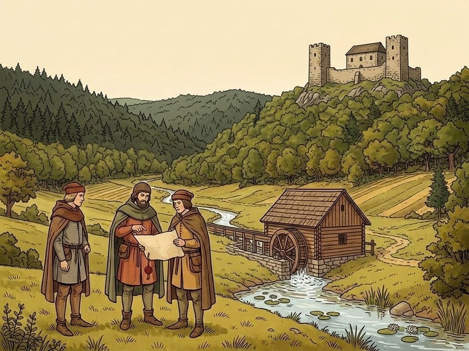

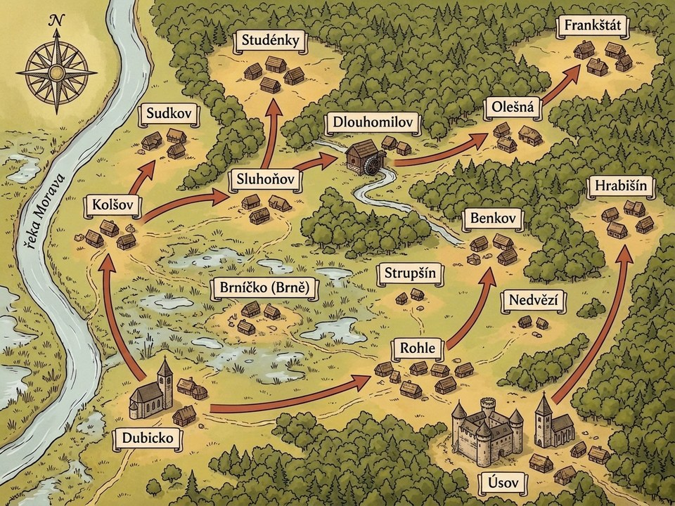

### Jak vznikaly lesní lánové vsi v údolí pod Brníčkem a kdo byl zakladatel Dlúhomil
Vznik Dlouhomilova, Benkova i Medelského spadá do vyvrcholení **velké (emfyteutické) kolonizace** v **poslední třetině 13. století – v primárním okně let `1270–1277` (nejpozději `1286–1295`, po válečném zmrazení regionu v letech `1278–1285`)**. Vrchnost tehdy držela rozlehlé podhorské hvozdy, z nichž bez osadníků neplynul žádný užitek, a proto pověřila založením vsi urozeného zakladatele či **lokátora** (*locator*, *scultetus* / šoltys) – středověkého organizátora, zeměměřiče a podnikatele v jedné osobě. Ten v údolí Dlouhomilovského potoka (Loučky) vytýčil osu vsi s cestou a mlýnským náhonem (doloženým později u **čp. 3**) a kolmo do obou strání rozměřil dlouhé rovnoběžné pásy půdy (**záhumenicové lány**). Každý osadník si postavil usedlost v nivě u potoka a přímo za stodolou si vzhůru k lesním hřebenům klučil a žďářil svůj lán (středověké žďáření připomíná i les *Silua Zdyar* uváděný roku 1447 u sousední Rohle a Benkova v *ZDO X, č. 560, 616*). Tento vějíř záhumenicových plužin zůstal v Dlouhomilově dokonale čitelný i na mapě stabilního katastru z roku 1834 a otiskl se přímo do obecního znaku se dvěma rýči a zlatým krojidlem.

Protože vymýcení pralesa, vykopání pařezů a první osev zabraly několik let, dostali kolonisté daňovou **lhůtu** (na sousedním mírovském zboží dle listiny z 26. 5. 1266, `RBM II, č. 517`, 13–20 let bez odvodů vrchnosti) a po jejím uplynutí přešli na dědičné **zákupní (emfyteutické) právo** s pevným peněžním úrokem a jen mírnou robotou. Samotný lokátor či zemanský zakladatel držel **svobodný dvůr a lány** bez poplatků, třetinu soudních pokut z nižšího vesnického soudu a výhradní hospodářská práva (**svobodná krčma, mlýn, jatky a kovárna**).

Zatímco originální pergamenová lokační smlouva Dlouhomilova se nedochovala, jazykovědný a diplomatický rozbor odhalil původ samotného zakladatele ([viz podrobná studie a regestář 32 vkladů ZDO](puvod_dluhomila_a_zdo_1356_1447.md)): dvoučlenné staročeské jméno **Dlúhomil** (*„dlouho, trvale milý“*, nar. cca **1240–1265**, † cca **1295–1320**) bylo ve 13. století na Moravě výsadním stavovským jménem domácí šlechty a zemanů (na rozdíl od domáckých jmen typu *Benek → Benkov*). Hláskový vývoj **`Dlúhomilov` → středomoravské (hanácké) `Dlóhomilov` → stažené `Dlómilov` → raně novověké německé `Lomigsdorf`** dokazuje, že zakladatel i osadníci mluvili hanáckým dialektem staré češtiny, a střídání tvarů *ves Dlúhomilov / dvuor Dlúhomiluov / za dvuor v Dluhomile* ukazuje, že jádrem lokace byl jeho svobodný zemanský dvůr. Olomoucká listina z roku **1269** (`CDM IV, s. 36` / `RBM II, č. 672`) spolu s mohelnickou listinou z **26. listopadu 1279** (`CDM IV, s. 232–233`) přitom zachycují bok po boku kolonizátory našeho podhůří přicházející z **jižní a střední Hané**: **Všebora a Hrabiše I. z Úsova** z rodu ze Švábenic (držitele Úsova pouze v úzkém okně `1269–1274/1275`, `CDM IV, s. 178`; srov. *Hrabišín*), jejich bratrance **Viléma z Náměště a Kojatu z Drnovic** (srov. *Kojišov = Kolšov*, ležící západně za hřbetem Bukovické hory, odkud vedl příčný kolonizační pás přes Studénky a Sluhoňov do Dlouhomilova a Hrabišína ještě před vznikem hradu Brníčka u ústí Loučky v Lesnici), lokátora **Sudka** (*Sudkov*) a královského vrchního lovčího **Benedu z Dubicka se syny**. Právě v jejich hanáckém zázemí (mezi Švábenicemi, Ivanovicemi na Hané, Soběbřichami a Olomoucí) se vzácné jméno *Dlúhomil* dědilo.

### Vrchní lovčí Beneda z Dubicka (1226–1269+) a čtyři patra středověké společnosti v názvech okolních vsí
Úplná excerpce listin `CDM II–VII a XV` odkryla jak detailní životopis hlavní organizátorské osobnosti našeho podhůří – **Benedy z Dubicka** –, tak pozoruhodnou **čtyřstupňovou hierarchii kolem jeho osoby**, která se přímo otiskla do sídelní sítě údolí Loučky:
* **Královský vrchní lovčí a vytyčovatel hranic (`1226–1269+`):** Již roku **1226** (`CDM II, s. 176`) svědčí za nejvyšším lovčím Častolovem *Beneda filius Stibor* (*syn Ctiborův* – jméno *Ctibor* pak nesou jak Benedův pravnuk *Ctibor Morava*, tak roku 1378 *Ctibor z Dlouhomilova*). V letech **1233/1235–1260** působil jako královský **vrchní lovčí (*magister venatorum*)**, doložený roku **1253** se staročeskou glosou *„quod vulgariter sonat Lowci“* (`CDM III, s. 172`) a roku **1239** (`CDM II, s. 361–362`) dokonce výslovně titulovaný ***„perambulator terrarum et assignator simul et metarum distinctor“*** (*královský vytyčovatel zemských hranic a přidělovatel lesní půdy ke kolonizaci*). Vedle raně gotické tvrze v **Dubicku** (kostel doložen 1297, patronátní matka Dlouhomilova až do let 1720/1722) vlastnil celou hanáckou ves **Krčmaň u Olomouce** (darovanou 1259 a 1266 pod vlastní pečetí olomouckému dómu za syna, kanovníka Markvarta) i **šlechtický dům přímo na Olomouckém hradě** (`27. 1. 1267`, `CDM III, s. 391`). Ze synů (*Markvart, Předbor, Vilém z Dubicka, Mikuláš z Otaslavic a Dubicka, Přešek*) vzešla stavební generace **hradu Otaslavice** (`1279–1287`) a v papežské bule Bonifáce VIII. z **31. března 1297** (*Velehradský kodex*, `MZA Brno, E 7, sign. G 191, fol. 107v–108r`) je vedle Benedova syna Mikuláše v Dubicku žalován i záhadný laik **`Lubominus de Dubich`** (*Lubomír* či zkomolený *Dluhomilus*).
* **Čtyři společensko-právní patra kolem Benedy otisknutá do okolních sídel:**
  1. **Velmoži a královští úředníci (*domini / barones*):** *Beneda z Dubicka*, *Hrabiše z Úsova* a *Kojata z Drnovic* dali jména panským vsím **Hrabišín**, **Kolšov** (*Kojišov*) a náhornímu **Benkovu** (*Benkow* od *Benek/Beneda*, stejně jako *Kojata → Kojišov*). Benkov na slunné suché plošině (`440–470 m n. m.`) měl z Dubicka po suchém hřebeni přes Rohli a vrcholovou křižovatku ***U Cikánského buku*** (`514–528 m n. m.`, trojmezí lesů *Silua Wenkowsky, Silua nigra* a *Žďár* v `ZDO X, č. 560`) ještě přímější přístup než Dlouhomilov – patrně vznikl souběžně již koncem 13. století, a do zemských desek vstoupil až roku **1385** (`ZDO IV, č. 543`) jen proto, že do té doby tvořil nedělenou přímou vrchnostenskou držbu rodu.
  2. **Nejvyšší patro družiny – plně urození zemané a mladší příbuzní (*nobiles minores / milites*):** Urození muži s prestižními dvoučlennými jmény, za něž u ordálu směl nastoupit zástupce a kteří drželi **svobodné alodní statky zapisované přímo do zemských desek (*Curia allodialis*)** → zakladatel **Dlúhomil (Dlouhomilov)**, jehož potomci se píší *z Dlouhomilova* a v letech 1356–1397 nesou stejných pět křestních jmen jako potomci Benedy z Dubicka (*Ondřej, Pešek/Přešek, Vilém, Ctibor, Mikšík*).
  3. **Střední patro družiny – osobně svobodní družiníci (*druho / druhones*):** Profesionální ozbrojení jezdci a klienti velmože na prahu nižší šlechty, vymezení moravskými zemskými statuty let **1229 a 1237** (`CDM II, s. 210, 326`: *„Si aliquis nobilis vir, et non druho…“*) a doložení přímo u Benedy dne **23. června 1263** jako **`Cunratecz, druho domini Benede`** (`CDM III, s. 353`) → líheň drobných panošů, biskupských manů i privilegovaných **dědičných rychtářů a fojtů**.
  4. **Spodní patro – vrchnostenští služebníci (*sluhoň / sluhones / zluhones*):** Neurození služební lidé pána (lovci, psáři, lesní hlídači) usazení na služebních lánech osvobozených od desátku bez alodního dvora podle listin biskupa Bruna z let **1263–1272** (`CDM III, s. 350, 363`: *„de allodio tuo, de zluhonibus et de manso iudicis nichil dabis“*) → sousední **Sluhoňov** (doložený už r. **1349** v `ZDO I, č. 126`, r. 1412 *Sluchunowek*, pouhých `6` poplatných usedlostí v urbáři r. 1585 bez jediného svobodného dvora či vladyckého predikátu).
* **Proč *hrad Brníčko* vznikl až dodatečně nad „lesní bažinou“ (*stč. brnie*):** Soutoková kotlina čtyř potoků pod Sluhoňovem a Dlouhomilovem tvořila ve 13. století zamokřenou nivu (*brnie / Brné = bláto, lesní bažina*), kterou plužinová kolonizace obcházela po suchých sedlech přes Bukovickou horu (*Kolšov – Studénky – Dlouhomilov*), přes Strupšín a po dubickém hřebeni přes *U Cikánského buku* k Benkovu. Teprve ve **30. až 40. letech 14. století** využil Benedův pravnuk **Ctibor Morava** ostroh nad bažinou ke stavbě nového **hradu Brníčka**, k němuž proto připadl jen vnější věnec osad – zatímco dávno vysazený zemanský **Dlouhomilov** zůstal samostatným deskovým alodem až do let **1437–1447**.

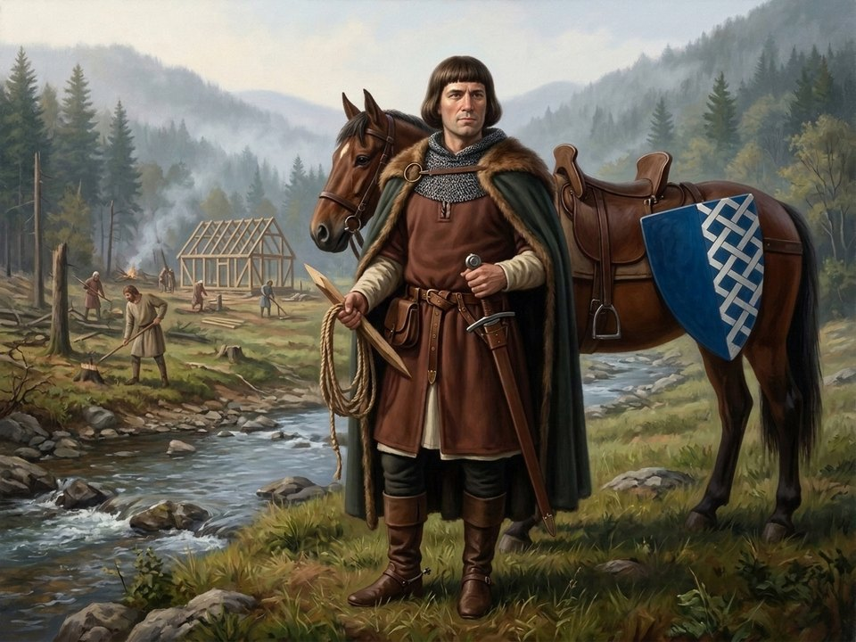

> **Jak mohl zakladatel Dlúhomil kolem roku 1275 vypadat? (Antropologická, archeologická a heraldická rekonstrukce):**  
> Z 13. ani 14. století se po Benedovi z Dubicka, Ctiboru Moravovi ani žádném členu jejich rodu nedochoval realistický portrét či hrob (individuální portrét přinesla až parléřovská huť kol. r. 1375 a hrady v Otaslavicích i Brníčku zanikly v letech 1423 a 1471). Podobu zemana **Dlúhomila** (ve věku `25–40 let` a výšce `~172–178 cm`, typické pro masitou stravou živenou moravskou jezdeckou šlechtu) však lze věrně zrekonstruovat podle dobové ikonografie dvora Přemysla Otakara II., archeologických nálezů z nedalekého hradu **Hoštejna († 1286)** a sfragistiky Benedova rodu: oproti vžité představě plnovousatých rytířů nosili aktivní zemané v letech `1260–1295` **hladce oholenou tvář** a polodlouhý účes s rovnou ofinou; oděni byli do barvené vlněné suknice (*cotte*), kroužkové kapuce (*brně* — plátová zbroj ještě neexistovala), pláště podšitého kožešinou sepnutého sponou na pravém rameni (pro volnou pravici s měřickým provazcem, kolíkem či jednoručním mečem s terčovou hlavicí) a jezdeckých škorní s **bodcovými ostruhami**. U sedla je vyobrazen rodový štít doložený na voskových pečetích potomků Benedy z Dubicka z Otaslavic a Brníčka z let `1353–1450` (*Sedláček, ČMH II, s. 310*): **svisle půlený trojhranný štít, jehož jedna polovina je kosodélně mřížovaná**, zatímco v pozadí za potokem Loučkou osadníci klučí les a vztyčují kostru prvního svobodného dvora (*dvuor Dlúhomiluov*).

### Rok 1356 doslova a všech 32 vkladů ZDO (1356–1447): ~25–30 usedlostí, tři vladycké dvorce, mlýn a 2–3 krčmy
Zcela unikátní pohled do vsi vzdálené dvě až tři generace od jejího založení otevírá nejstarší svazek **Moravských zemských desek – kraje olomouckého (*ZDO I–X*, celkem 32 vkladů z let 1356–1447)**. Původní Dlúhomilův statek byl tehdy již dědicky rozštěpen na **tři svobodné vladycké dvorce**, přičemž součet majetkových jednotek (`3` dvorce s čeledí a rataji, `~12–15` poplatných lánů, `9` chalupnických dvorků s `5` zahradami, vodní mlýn a `2–3` krčmy) ukazuje kolem roku 1356 na **`~25–30` samostatných usedlostí a zhruba `130–180` stálých obyvatel** – tedy stejnou plnou osedlost jako o 230–320 let později v urbáři (1585) a lánovém rejstříku (1677)! Přítomnost hned **dvou až tří krčem (*tabernae*)** přitom souvisela jak s potravinářskou rolí středověkého šenku (výroba každodenního slabého piva, pekárna, jatky), tak s právním rozdrobením vsi (*„co vladyka, to vlastní výčep“*) i se soumarským a hornickým provozem mezi Kolšovem/Dubickem a železnorudným revírem *Hrabišín – Oskava*:
- **První písemná zmínka z roku 1356 (*ZDO I, č. 482*, fol. XXV r.):** *„Andreas de Dluhomilow vendidit Arnoldo de Dluhomilow pro LX marcis grossorum vnam Curiam VI laneos vnam Tabernam hereditarie ibidem in Dluhomilow sibi et suis heredibus resignauit possidendam prout ipse tenuit et possedit.“* — **Ondřej z Dlouhomilova** prodal **Arnoštovi (Arnoldovi) z Dlouhomilova** za **60 hřiven grošů** **1 dvůr, 6 lánů a 1 krčmu** dědičně v Dlouhomilově.
- **Druhý zápis z téhož roku 1356 (*ZDO I, č. 484*):** *„Pesco de Dluhomilow Curiam et vnam marcam Census ac Molendinum cum omnibus suis iuribus et vtilitatibus pro LX marcis grossorum Bohunconi de Cogissow et fratri suo Dyethmaro vendidit et resignauit.“* — **Pešek z Dlouhomilova** prodal za dalších **60 hřiven grošů** **druhý dvůr, 1 hřivnu ročního úroku a vodní mlýn** bratřím **Bohunkovi a Dětmarovi z Kolšova** (*de Cogissow*).
- **Třetí dvorec a cesta hlavního alodního dvora k Vildenberkům (1358–1398):** Roku **1358** (*ZDO I, č. 493*) pojistil **Bohunek z Dlouhomilova** manželce **Gertrudě** věno **100 hřiven grošů** na dvoře se 2 poplatnými lány v Dlouhomilově a na lese v Kolšově. Samostatný **třetí dvorec s poplatným čtvrtlánem** sledovaly vklady let **1365–1378** od vdovy **Čáslavy z Dlouhomilova** (*ZDO I, č. 859–860*) přes **Viléma z Dlouhomilova** (*č. 1028*), **Ondřeje a Hyluše** a **Ondřejka Chylce** až po **Martina** a **Ctibora z Dlouhomilova** (*ZDO II, č. 23; III, č. 435*). Hlavní majetkový komplex mezitím roku **1368** (*ZDO I, č. 1124*) prodal **Bohunek z Kolšova** **Vokovi [ze Sovince] a jeho bratřím**: **1 dvůr, 5 lánů, 2 krčmy (*duas tabernas*), 9 dvorků/chalup (*nouem Curticulas*), 1,5 čtvrtlánu, 5 zahrad, vodní mlýn a les**; od Voka přešel dvůr na bratry **Domana, Svatobora a Výška ze Závořic řečené Ganzary** (*ZDO V, č. 48; VI, č. 706*) a roku **1398** (*ZDO VI, č. 879*) prodal **Doman ze Závořic** hlavní alodní dvůr přímo **Pročkovi z Bouzova (Vildenberka)** (zatímco další svobodný dvůr drželi *Mikšík z Dlouhomilova → Zvěst z Topolan → Ondřej Záhora*, *ZDO VI, č. 587, 876*).

### Benkov a Medelské pod hradem Brníčkem (1385)
Zatímco údolní Dlouhomilov tvořila mozaika zemanských podílů, sousední horské vsi **Benkov** a **Medelské** patřily od počátku přímo pod správu blízkého **hradu Brníčka**. Poprvé je společně zachycuje olomoucká zemská kniha roku **1385** (*ZDO IV, č. 543*, fol. XL v.): **Mikuláš z Brníčka zvaný Morava** (*Nicolaus de Brnyczkow dictus Moraua*, se souhlasem spoludržitelů bratrů Vojtěcha a Mikše z Otaslavic) tehdy pojistil manželce **Markétě** věno **24 kop grošů ročního úroku** na sedmi brníčských vesnicích – *Strupsyn* (Strupšíně), *Nedwesie* (Nedvězí), *Kamenne* (Kamenné), *Rochle* (Rohli), *Obgedne* (Obědném), **Benkow** (Benkově) a **Medilsk** (Medelském).

### Scelení pod Tunkly (1437–1447), svobodní dvořáci a dědičná rychta čp. 7
Rozdrobená zemanská držba v Dlouhomilově skončila až ve druhé čtvrtině 15. století nástupem dravého rodu **Tunklů z Brníčka**, jenž ves scelil ve dvou doložených krocích (*Sitta 2018*):
- Roku **1436** se **Jan Tunkl z Eichholze** oženil s **Eliškou z Lesnice**, čímž vyženil **první polovinu Dlouhomilova**; po znovuotevření desk roku **1437** proběhl vklad a spolek s příbuzným Janem Tunklem z Drahanovic (*ZDO X, č. 311, 348*), jenž tuto polovinu roku **1446** již jako **Jan st. Tunkl z Brníčka** odkoupil (*č. 449*).
- Roku **1447** (*ZDO X, č. 566*) vložili rukojmí zemřelého **Pročka z Vildenberka** **Janu st. Tunklovi** také **druhou polovinu vsi Dlouhomilova se svobodným poplužním dvorem a rybníky** (*villam mediam Dluhomil et Curiam allodialem... piscinis*). Téhož roku **1447** (*č. 560*) vložili poručníci **Jana ze Šumvaldu** Janu Tunklovi hrad **Brníčko**, **Medelské** (včetně *lesa u Medelského*) a **Benkov**. Tím Tunklové scelili celé údolí a připojili Dlouhomilov k **zábřežskému panství** (v témže roce 1447 získali i svobodnou rychtu v Rohli – *Judicium wlgariter Rychta liberam*, *ZDO X, č. 616*; při bratrském rozdělení r. **1466** připadlo celé údolí do dílu **Jana ml. Tunkla**).

Pod tvrdým hospodářským tlakem Tunklů v druhé polovině 15. století přibývalo majetkových i poddanských sporů. Olomoucké **knihy půhonné a nálezové (*Libri citationum*)** uchovaly nejprve z let **1463–1466** čtveřici žalob o **dvůr v Dlouhomilově (*dvuor Dluhomiluov*)** po vkladu z roku 1447, kdy dědička **Kateřina z Vildenberka a ze Lhoty** hnala **Jana Tunkla z Brníčka** (`KP IV/2, č. 543`), zatímco ručitel **Výšek ze Stříteže** a Tunkl se soudili o právní záruku prodeje (`č. 525, 547, 866`; dříve již v r. **1407** `KP I, č. 800` vymáhal *Jan Puška* 3 hřivny platu v Dlouhomilově na kolšovských vladycích). Roku **1490** (`ZDO XIII, fol. 12v, č. 84`) vložili Tunklové hrad Brníčko spolu se vsí Dlouhomilovem, Medelským a Venkovem **„se všemi rychtami zákupními v těch vsech“** strýci **Jiříkovi Tunklovi staršímu** — což je o 112 let starší výslovný doklad zákupní rychty než listinná zmínka z r. 1602. Tunklovská rybníkářská robota vyvolala v roce **1492** vlnu útěků poddaných (`KP VI`, zasedání od 18. 5. 1492): **Jiřík Tunkl st.** hnal Znatu ze Zvole, že neoprávněným výhostním listem (*odpuštění listem svým*) přijal jeho člověka **Jana rataje Števíka z Dlúhomilova** (`s. 294, č. 1775`), a jeho syn **Jindřich Tunkl** žaloval Jana z Dalčic na Šilperku, že ukryl na **mlýně u Šilperka** uprchlého **pochopa (= drába) Duchka z Dlúhomilova**, jehož *dědina* ve vsi *i podnes pusta stojí* (`s. 324, č. 1962`). Roku **1510** zadlužený **Jindřich Tunkl** panství prodal **Mikuláši ml. Trčkovi z Lípy** (`ZDO XVII, sn. 10/32, fol. 10r`: originální rukopis čte výslovně *„wes dluhomilow s kaplu, olessne, trzy lany w olessnem, wes medelske, wes wenkow“*, čímž opravuje zjednodušení novodobých edic spojujících tři lány s Hrabišínem), od něhož je dne **24. června 1513** získal **Ladislav z Boskovic na Moravské Třebové** (`ZDO XVII, fol. 21v–22r, č. 131`: *„hrad Brniczko zborzenj s Miesteczkem a s kaplu ... wes dluhomilow s kaplu, wes Medelsko, wes wenkow“*; podrobný rozbor viz [studie zemských desek a půhonů 1466–1622](zemske_desky_a_puhony_1466_1622.md)).

Přesto si ves uchovala pozoruhodné dědictví svých zemanských začátků: ze starých dvorců v Dlouhomilově i ze tří dvorů v osadě **Medelské** (v pramenech let 1605–1657 psané česky též **Tři lány**, německy *Dreihöfen*, spojené po třicetileté válce berně s Dlouhomilovem) vyrostla vrstva **osvobozených sedláků (*Befreytte Bauern*)** a dvořáků vykoupených z naturální roboty – a právě s ní souvisí i nejrozšířenější starousedlé příjmení v obci (**Dvořák**). Co přesně přitom přežilo až do raného novověku, odkryl **Urbář panství Zábřeh z roku 1585** (pořízený za **Jana z Boskovic na Moravské Třebové a Zábřehu**, † 1. 8. 1589, po němž panství zdědila jeho sestra **Kunhuta/Kunka z Boskovic** a její syn **Ladislav Velen ze Žerotína**): v Dlouhomilově zachytil **22 usedlíků** (*DAŠKU Jan, N. Michal, ZOKL Jíra, VOKSAN Jíra, MIEKÝ Jan, KÜBKU Martin, RAUSEK Kuba, NOVAK Jan, BILÝ Jan, VLČKU Šymek, PŘISTAUPIL Jan, VACHUTKU Pavel, SRNÝ Martin, KRUMHOLEC Jan, SLADEK Adam, POSPIŠIL Blaha, NĚMEC HORNÝ Jiří, HLAUŠEK Matouš, DUß Matěj, DUß Jan, MLINAŘ Tobias, KOPP Hans*; str. 82–84), v osadě **Medelské** **8 držitelů** na 5 položkách včetně sdílených spoludržeb (*VALAUCHU Vavra, VITKU Jan*, páry *HRABOVSKÝ Jan & ŠUMERDA Martin*, *HORNIČEK Martin & STEJSKAL Šymek*, *KOUŘIL Jíra & VIKAUKAL Matouš*; str. 80–81) a v sousedním **Benkově** (zapsán *Venkov*) **10 usedlíků** v čele s fojtem *Mikulášem* (*KNAUR Moc, HONSU Jan, FOHAN Matěj, KHAUR Hanzl, ŠMID Hanzl, TYLCAR Adam, FOJT Mikulaš, KHAURMON Georg, HAYNDL Gregor, TOMAN Pavel*; str. 47). Už roku 1585 tak existovala ostrá jazyková hranice mezi téměř čistě českým údolím Dlouhomilova s Medelským (28 z 30 jmen českých) a německo-českým Benkovem, zároveň s přímou kontinuitou příjmení do 20. století (*Vokšan/Bokšan, Vlček, Vachutka, Sládek, Pospíšil, Kouřil, Horníček, Kauer/Khaur, Šmíd/Schmid*). Navazují nejstarší pozemkové knihy – gruntovní kniha Dlouhomilova a Medelského od roku **1584** (*inv. č. 164, sign. 428*) a *Grundt und Waisen Register dess Dorffs Bencka* z let **1617–1879** (*ZAO Olomouc, fond Velkostatek Zábřeh, NAD 1549*). V čele samosprávy vsi stála **dědičná rychta (čp. 7)**, listinně doložená roku **1602** za Žerotínů a v **Lánovém rejstříku panství Zábřeh (MZA Brno, fond D 1, sign. 141, fol. 76r–77v)** vedená pod jmény **Jíra Blahařek(?)** (1657) a **Ilia Zaoralný** (*Erbrichter*, `90` měřic, 1677), spolu s dalšími 26 usedlými bez jediné poustky. Ještě při sčítáních lidu z let **1869 a 1890** fungoval přímo v areálu **rychty čp. 7** hostinec s řeznictvím (Antonín a Johanna Katzerovi) i samostatná kovárna (František Vlach).

---

<h2 id="kap-1">2. Údolí pod Brníčkem, Aretinova mapa a putování farnosti (1510–1793)</h2>

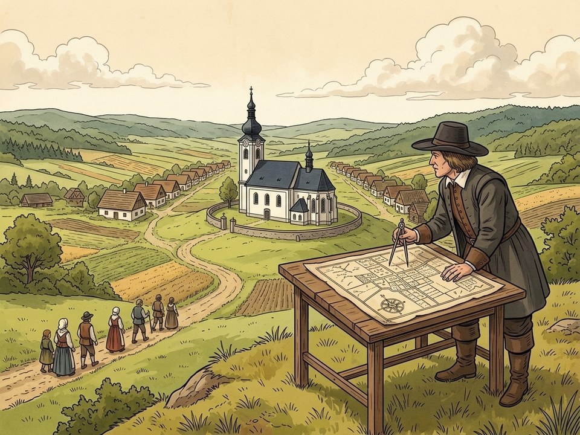

Dlouhomilov (*Lomigsdorf*, ve starších pramenech též *Dluhomilow*) vyrůstal od vrcholného středověku jako typická **lesní lánová ves** v sevřeném údolí Dlouhomilovského potoka pod Bukovickou horou (526 m n. m.) a zříceninou hradu Brníčka. První písemná zmínka z roku **1356** jej zachycuje jako vyspělou zemanskou ves se třemi dvorci, mlýnem a krčmami; po roce **1447** pak trvale náležel k **zábřežskému panství**. V **Lánovém rejstříku panství Zábřeh** (*MZA Brno, fond D 1, sign. 141, 1656–1677*) dosahoval Dlouhomilov plné osedlosti **27 hospodářů bez jediné poustky** (`1` dědičný rychtář, `18` sedláků a `8` domkařů bez polí na **`830` měřicích orné půdy** = `6` lánů `3 1/4` osminy), přičemž vedle rychtáře *Ilii Zaoralného* zde z první vizitace **1656–1657** navazovali mj. *Jan* (před ním *Pavel*) *Dvořák* s `60` měřicemi, *Jan Vlček*, *Jan Vokšan*, *Jiřík a Mikuláš Jílkovi* (předtím *Jan Jílek*) či *Martin* (před ním *Jan*) *Vachutka*. Následná **Rektifikační akta (MZA D 2, sign. 141, 1749–1756)** a **Dominikální fase (MZA D 3, sign. 172/1, 1750)** prokázaly, že v Dlouhomilově, Medelském ani Benkově neležel panský poplužní dvůr (*Meierhof*) a místní *Befreytte Bauern* vykupovali robotu peněžitým úrokem při chovu lnu a předení příze pro trhy v Šumperku; původní dvory **Medelského (*Dreihofen*)** pak přežívaly v pomístních tratích dlouhomilovských sedláků (*bey Medelsker grundt*, *u Medla gruntes mihle*, *w Medelsky Strani*) až do zavedení samostatného číslování domů v letech 1770–1771 (podrobný jmenný rozbor viz [studie lánových rejstříků a rektifikačních akt 1656–1756](lanove_rejstriky_a_rektifikace_1657_1756.md)). Už z roku **1510** pochází první zpráva o zdejší kapli a od roku **1623** krajinu pod Brníčkem zachycuje unikátní rukopisná **Aretinova mapa zábřežského panství** (ZAO Opava – pobočka Olomouc, fond *Velkostatek Zábřeh, NAD 1549, inv. č. 831, mapa č. 1*, prohlášená archivní kulturní památkou **AKP ČR č. 81**). Barevný rukopis o rozměrech **137 × 98 cm** (vnitřní zrcadlo 133 × 92 cm) v měřítku cca **1 : 20 800** vyhotovil kartograf **Pavel Aretin z Ehrenfeldu** při pobělohorské konfiskaci panství Ladislava Velena ze Žerotína pro Karla I. z Lichtenštejna – jde o **nejstarší dochovanou mapu velkostatku v českých zemích**, zachycující mimo jiné tunklovskou soustavu velkých rybníků v předpolí údolí (Závořický 107 ha, Dubický 82,5 ha, Hrabovský 51,2 ha, Vitošovský 11,5 ha).

Na nejstarších tištěných mapách Moravy – **Müllerově mapě z roku 1716** a **Wielandově mapě z roku 1726** – se v těsném sousedství objevují dvě sesterské vsi: údolní *Lomigsdorf / Dlohomilow* (zkomoleně *Bomigsdorf*) a výše v kopcích položený *Bentke* (Benkov). **I. vojenské (josefínské) mapování z let 1764–1768** již věrně vykresluje červeně vyznačený zděný kostel na vyvýšenině uprostřed Dlouhomilova, soustavu selských statků po obou březích potoka i luční cestu stoupající k severu do osady **Medelské** (*Dreihofen*).

Kdo hledá nejstarší obyvatele v matrikách, narazí na pozoruhodné **putování dlouhomilovské farnosti** ([viz samostatná studie matrik Dubicko a Rohle 1650–1785](matriky_dubicko_a_rohle_1650_1785.md)):
- **1585–1720/1722 (Dubicko a okolní farnosti):** Dlouhomilov je roku 1585 uváděn při kostele/kapli v duchovní správě panství, nejstarší dochované matriky pro údolí však leží u okolních farností – především **Dubicko** (*Zá IV 1* již od roku **1617** do 1694, včetně sňatků přímo *w Dlauhomilowie* r. 1653 a svědectví *Pavla Dvořáka a syna Hanße* 27. 9. 1654, a *Zá IV 2*, inv. č. 8377, s vyčleněným oddílem křtů Dlouhomilova, Medelského a Benkova pro léta **1695–1722** na str. `948–1095`), dále **Zábřeh** (*Zá I 1*, inv. č. 8332, 1649–1692; mj. křest *Pavla Dvořáka* z Dlouhomilova r. 1651 a *Martina Schöna* v Benkově r. 1658), **Brníčko** (od r. 1653, *Zá VI 5* — farnost řady sňatků vč. svatby Pavla Dvořáka ml. s Marinou Weinlichovou r. 1786) a **Lesnice** (inv. č. 8399, od r. 1676/1688).
- **1720–1785/1786 (obnovená farnost Rohle):** Již kolem roku **1720–1721** byly Dlouhomilov, Medelské i Benkov přifařeny do sousední **Rohle** (*Zá VIII 1, 6, 10, 14, 15*; přes třicet dlouhomilovských křtů rodu Dvořáků a první zápisy s čísly popisnými od r. 1772). Po předchozím kostele rozestavěném počátkem června **1707** (na nějž bylo dle starých účetních knih vypáleno **64 800 cihel**) vznikl v letech **1767–1770** stávající pozdně barokní **kostel Všech svatých (čp. 1)**, do něhož putovala i část vybavení ze zrušeného kláštera v Šumperku (roku 1864 rozšířen o presbytář).
- **Od let 1785/1786 (lokálie Dlouhomilov – ale Benkov nadále v Rohli!):** Teprve církevní reformy císaře Josefa II. přinesly roku **1785** zřízení vlastní lokálie a od ledna **1786** průběžné matriky *Zá II* přímo v Dlouhomilově pro **Dlouhomilov (vč. Medelského), Dolní Olešnou a Horní Olešnou**, zatímco **Benkov** zůstal církevně přifařen ke kostelu v **Rohli** až do roku **1932** (*Zá VIII 2–18*, inv. č. 11251). Středobodem obce se stal **kostel Všech svatých (čp. 1)** se hřbitovem a empírovým náhrobkem rodiny **Gromesů**, naproti němuž vyrostla patrová **fara (čp. 2)** (v letech 1786–1986 zde sloužilo celkem **26 duchovních správců**, mj. kněz-spisovatel **P. František Saleský Kužela / Adam Chlumecký**, 1891–1907, a **P. František Reichel**, 1934–1964; z obce vzešlo **7 kněží-rodáků**) a roku **1793** i první samostatná školní budova (**stará škola čp. 12**, dříve se vyučovalo po soukromých domech). V první polovině 19. století se navíc v okolních lesích v malém těžila **železná ruda** pro železárny v Alojzově u Rudy nad Moravou a v Mariánském údolí u Olomouce.

---

<h2 id="kap-2">3. Tři světy v jednom údolí: Dlouhomilov, Medelské a Benkov</h2>

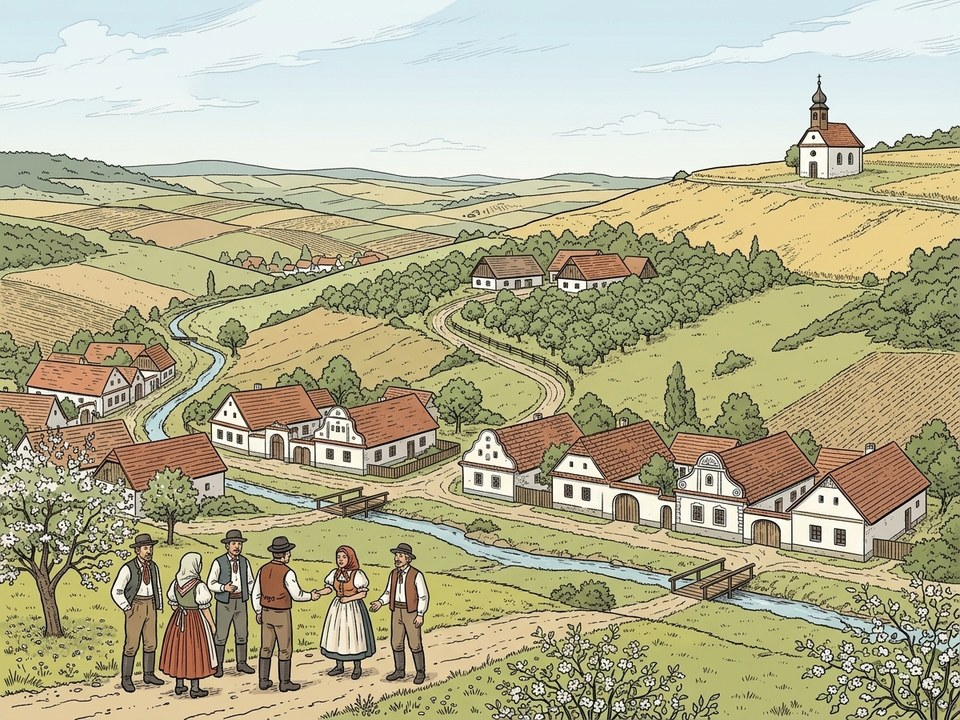

Dějiny Dlouhomilova nelze vyprávět jen jako příběh jedné vesnice. V matričních knihách farností **Rohle** (Benkov do r. 1932) a **Dlouhomilov** (*Zá II 1* až *Zá II 10* z let 1786–1949) i ve sčítacích operátech se neustále prolínají osudy **tří odlišných sídel**, z nichž každé mělo vlastní číslování domů, vlastní krajinný ráz a na přelomu 19. a 20. století i odlišnou národnostní tvář:

1. **Dlouhomilov (*Lomigsdorf*, čp. 1–133):** Bohatá česká selská a řemeslnická ves v údolí s mimořádně zachovaným souborem zděné lidové architektury severomoravského typu (dnes **vesnická památková zóna ÚSKP 2350**). Číslování domů zavedené za Marie Terezie v letech **1770–1771** (čp. 1–80) se zde na rozdíl od mnoha jiných moravských obcí nikdy nepřečíslovávalo – nové domky z druhé poloviny 19. a počátku 20. století prostě dostávaly další čísla na konec řady (roku 1900 měl Dlouhomilov 106 domů, roku 1910 již 115 domů a roku 1921 celkem 118 domů).
2. **Osada Medelské (*Dreihofen*, též *Tři Dvory*, vlastní řada čp. 1–10):** Malebná skupinka dvorů a chalup na jižním okraji katastru v místech, kde se údolí otevírá směrem k Brníčku. Osada nesla německé jméno *Dreihofen* podle tří původních dvorů, kolem nichž vyrostly chalupy rodů **Šafářů** (*Schafarz*), **Minářů** a **Nejedlých**. Protože mělo Medelské **vlastní řadu čísel popisných od čp. 1**, pletli si občas i faráři zápisy mezi Dlouhomilovem a Medelským – když se například 16. října 1948 v matrice objevila svatba v „čp. 2“ u rodiny Nejedlých, nešlo o dlouhomilovskou faru čp. 2, nýbrž o **Medelské čp. 2**, kde rod Nejedlých hospodařil už při sčítání roku 1921.
3. **Benkov (*Benke*, starší *Bentkow*, vlastní řada čp. 1–49):** Horská vesnice rozložená na náhorní plošině jihovýchodně nad Dlouhomilovem kolem **kaple sv. Antonína Paduánského** z druhé poloviny 19. století. Ačkoliv byl Benkov až do roku 1960 samostatnou obcí a církevně zůstával přifařen do **Rohle** až do roku **1932** (do roku 1949 přibyly v dlouhomilovských matrikách desítky benkovských záznamů a vzájemných sňatků), na **Chytilově národnostní mapě Moravy z roku 1906** ležel přesně mezi Dlouhomilovem a Benkovem ostrý jazykový předěl: zatímco Dlouhomilov s Medelským jsou vyznačeny červeným kroužkem jako **české obce**, Benkov nese zelený čtvereček **německé obce** (obdobně jako sousední Dolní a Horní Olešná, *Nieder-* a *Ober-Ullischen*).

Přes tuto jazykovou hranici nebyl Benkov izolovaným ostrovem. Matriky dokládají, že benkovští hospodáři a řemeslníci z rodů **Kauerů** (čp. 16 a 30), **hegerů** (čp. 2 a 8), **Rössnerů** (čp. 13 a 20), **Blaschkeů** (čp. 19), **Bischofů** (čp. 4 a 22), **Weiserů** (čp. 25), **Schmidů** (čp. 11) či **Steidlů** (čp. 9) se potkávali s dlouhomilovskými sousedy v kostele Všech svatých, chodili si navzájem za kmotry a svědky a v jejich domech žily i české rodiny (**Crhákovi** v čp. 12 a 15, **Halámkovi** v čp. 6 a 14 či **Krobotovi** v čp. 35).

---

<h2 id="kap-3">4. Znak obce: rýče, zlaté krojidlo a dva jabloňové květy</h2>

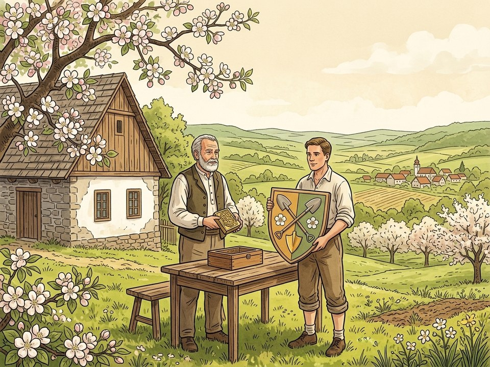

Spojení Dlouhomilova a Benkova dostalo dne **8. června 2004** (rozhodnutím předsedy Poslanecké sněmovny č. 37) výstižné heraldické vyjádření v oficiálním **znaku a vlajce obce**:

> *„Ve stříbrno-červeně polceném štítě dva zkřížené vztyčené rýče mezi dvěma pětilistými jabloňovými květy se zlatými středy, vše opačných barev, přeložené doleva obráceným zlatým krojidlem.“*

Každá z figur znaku přitom vypráví vlastní historickou kapitolu:
- **Dva zkřížené rýče a zlaté krojidlo (radlice)** odkazují na starou pečetní symboliku zemědělské obce **Dlouhomilov** a staletou práci selských i domkářských rodů, které v údolí pod Brníčkem proměnily lesní půdu v úrodné záhumenicové lány.
- **Dva pětilisté jabloňové květy se zlatými středy v opačných tinkturách** připomínají jednak proslulé ovocnářství a jabloňové sady obklopující selské grunty, jednak **spojení obou historických obcí – Dlouhomilova a Benkova** – do jednoho celku.
- **Stříbrno-červené polcení štítu** vychází z historických zemských a vrchnostenských barev severozápadní Moravy.

---

<h2 id="kap-4">5. Dědičná rychta čp. 7: správní srdce obce</h2>

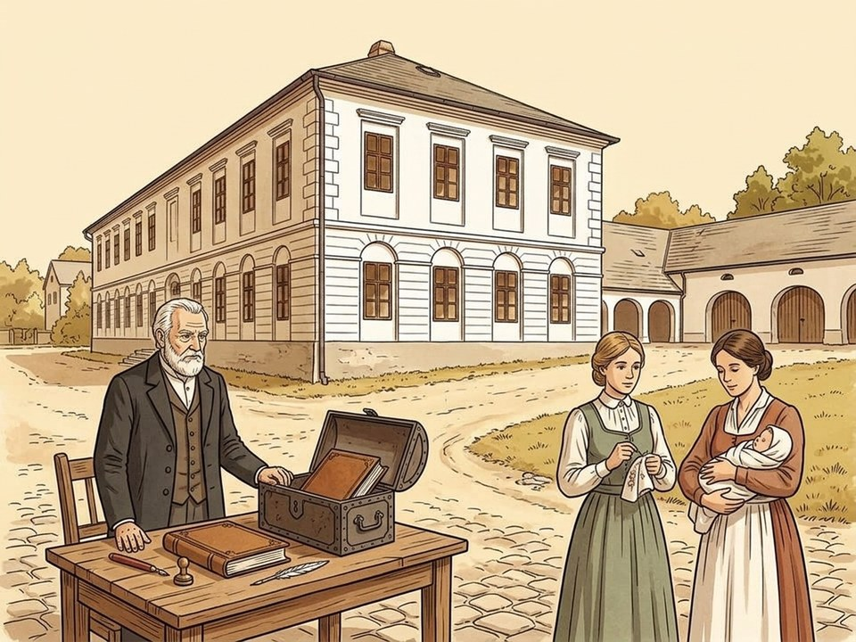

Nejvýstavnějším světským stavením v obci byla od 18. století **dědičná rychta (čp. 7)** na východní straně návsi – mohutný patrový dům s barokním jádrem a hospodářským dvorem (dnes kulturní památka ÚSKP 51795/9-103). Rychtář byl v poddanské vsi prodlouženou rukou vrchnosti i zástupcem sousedů: opatroval obecní truhlici, pečetidlo, dohlížel na robotní povinnosti, odvody rekrutů a urovnával sousedské spory.

Sčítací operáty z let **1857–1921** ukazují rychtu čp. 7 jako živý velkostatek, kde pod jednou střechou pobývalo v některých desetiletích až **23 osob** (roku 1869 a znovu 20 osob roku 1900):
- V polovině 19. století zde hospodařil rod **Mertů** (*Franz Merta*, *1804, s manželkou Marií a šesti dětmi), po němž se na rychtě vystřídali **Krobotové**, **Cinkové** a na přelomu století rolník **František Pavlík** (*1855) s manželkou Františkou (*1858).
- Při sčítání **15. února 1921** již rozlehlé stavení čp. 7 obývaly **tři samostatné domácnosti** (celkem 14 lidí): v hlavní části hospodařil rolník **František Hvížď** (*1879 z Třeštiny) s manželkou **Annou** (*1886, roz. v Šumperku), pěti dětmi a dvěma mladými čeledíny (osmnáctiletým **Janem Šafářem** a devatenáctiletou služkou **Marií Březinovou** z Hrabišína). Ve druhém bytě žila vdova **Mathilda Ptáčková** (*1863 z Rovenska) s dcerou **Eliškou Ptáčkovou** (*1889, industriální učitelkou na obecné škole v Dlouhomilově), provdanou dcerou **Marií Kvapilovou** (*1894) a sotva osmnáctidenní vnučkou **Jitřenkou Kvapilovou** (*28. 1. 1921 v Olomouci). Třetí domácnost tvořili výměnkáři **Jakub Navrátil** (*1852 z Klopiny) s manželkou **Annou** (*1845).

---

<h2 id="kap-5">6. Statek čp. 29 u Dvořáků: od roku 1679 přes pražského právníka po bludovský požár</h2>

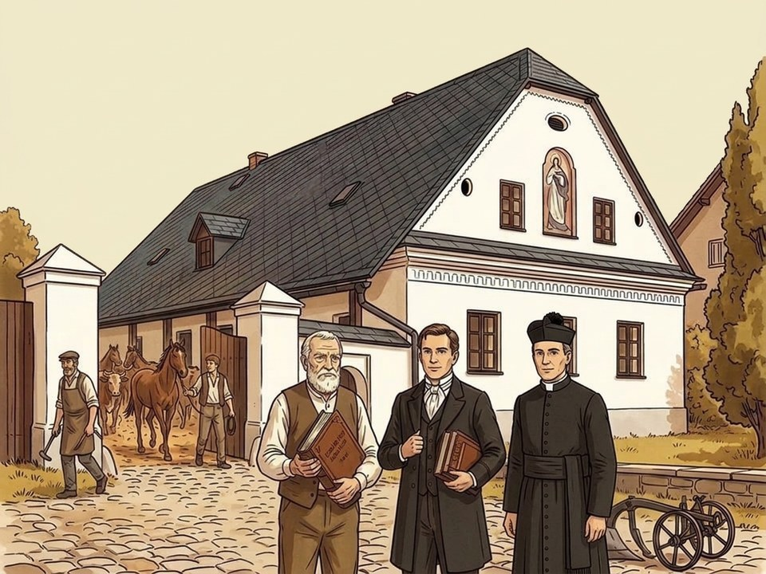

Mezi šesti památkově chráněnými selskými grunty v Dlouhomilově (čp. 5, 7, 8, 24, 29 a 43) zaujímá **usedlost čp. 29 (Grunt u Dvořáků)** mimořádné místo šíří dochovaných archivních pramenů. Zápisy v **gruntovní knize velkostatku Zábřeh (inv. č. 164, fol. 191)** vedou stopu zdejších hospodářů z rodu **Dvořáků** (*Dworzak*) až do pobělohorského roku **1679**, kdy statek držel **Jan Dvořák** a po něm od roku 1720 **Pavel Dvořák**.

V 19. století se na gruntě čp. 29 odehrála řada pozoruhodných příběhů:
- **Selský syn právníkem v Praze a doktorem práv:** V nejstarším dochovaném sčítacím archu z roku **1857** hospodařil na čp. 29 sedlák **Johann Dvořák** (*1795). Jeho starší syn **Jan Dvořák** (*1826) však grunt nepřevzal – odešel do Prahy studovat práva na Karlo-Ferdinandovu univerzitu a ve sčítacím operátu je u něj autenticky zapsáno: *„Jurist in Prag II“* (právník v Praze). Později získal titul doktora práv (ve sčítání roku 1869 je již uveden jako *Doktor* pobývající v Hrotovicích u bratra Karla). V době, kdy většina vesnických synů zůstávala na půdě nebo odcházela k pluku jako prostí pěšáci na osmiletou vojnu, představovala dráha univerzitního právníka mimořádný společenský a vzdělanostní vzestup.
- **Sedlák Alois Dvořák (*1830) a zábřežský farář P. Alois Dvořák:** Hospodářství převzal mladší bratr **Alois Dvořák** (*1830), který je na čp. 29 doložen v roce 1890 s manželkou **Annou** (*1829) a početnou čeledí. Z tohoto rodu vzešel také **P. Alois Dvořák**, farář v Zábřehu na odpočinku, který podle rodinné paměti i matričních zápisů držel nad gruntem čp. 29 ochrannou ruku a dne **15. července 1907** v dlouhomilovském kostele osobně oddal nového hospodáře **Josefa Dvořáka** (*3. 6. 1879 ze sousedního gruntu čp. 22) s devatenáctiletou **Amálií Motykovou** (*18. 7. 1888 z Bludova).
- **Tragédie v hořícím bludovském zámku:** Nevěsta **Amálie Motyková** přinesla na grunt čp. 29 silný rodinný příběh z vedlejšího Bludova. Její otec **Antonín Motyka**, kolářský mistr v Bludově čp. 113, zahynul hrdinskou smrtí, když se při velkém požáru bludovského zámku vrátil do plamenů, aby zachránil panský dobytek. Vdova **Františka Motyková** (*3. 3. 1844 v Chromeči, roz. Březinová) se poté s dcerou Amálií přestěhovala na dlouhomilovský statek čp. 29, kde je v letech 1910 i 1921 zapsána jako výměnkářka.
- **Narození ve stejný den (15. června 1920):** Josef a Amálie Dvořákovi vychovali na čp. 29 syna **Josefa** (*28. 6. 1913) a dceru **Marii** (*15. 6. 1920). Právě u Marie Dvořákové připravil osud neuvěřitelnou shodu: provdala se za magistra farmacie **PhMr. Jaroslava Berku** ze Zábřeha, který se narodil **přesně v tentýž den a rok – 15. června 1920**. Když se po válce 7. dubna 1947 na statku čp. 29 ženil její bratr Josef s **Márií Katarínou Zvonárovou**, stál mu švagr PhMr. Jaroslav Berka za prvního svědka.

---

<h2 id="kap-6">7. Grunt čp. 22 a čp. 24: sto šedesát let na jednom čísle a dvojitá svatba roku 1878</h2>

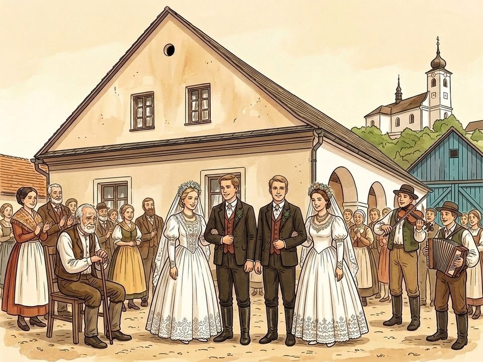

Jen o několik usedlostí níže po proudu potoka stojí **venkovská usedlost čp. 22 (u Dvořáků)** – mohutný zděný statek s klasicistním štítem z první třetiny 19. století (součást vesnické památkové zóny ÚSKP 2350). Právě tento dům přináší nejpevnější důkaz o tom, že se čísla popisná v Dlouhomilově od 18. století neměnila:
- Už roku **1786** si v sousedním Brníčku bral jedenadvacetiletý selský syn **Pavel Dvořák (*1763) „z Dlouhomilova č. 22“** nevěstu **Marinu Weinlichovou** z Brníčka.
- Jejich syn **Petr Dvořák** (*1793) prožil na čp. 22 celý život a zemřel zde jako selský výměnkář **9. prosince 1878** v úctyhodném věku **84 let**.

### Slavná dvojitá svatba 29. července 1878
V létě roku **1878** zažil Dlouhomilov událost, o níž se v údolí vyprávělo po generace. Na sousedním památkově chráněném **gruntě čp. 24** tehdy dožíval devětapadesátiletý sedlák **František Kouřil** (*1819, syn Jakuba Kouřila z Třeštiny a manžel Mariany roz. Vlčkové z čp. 24), těžce nemocný úbytěmi (tuberkulózou). Než však zemřel, stihl vypravit v jediný den – **29. července 1878** – v kostele Všech svatých **dvojitou svatbu svých dvou dcer s dvěma bratry Dvořákovými** (syny sedláka Josefa Dvořáka a Anny roz.Pavlíkové):
1. Dvacetiletá **Anna Kouřilová** (*9. 12. 1857 v čp. 24) si vzala jednadvacetiletého **Josefa Dvořáka** (*9. 2. 1857 v Temenici), který převzal rodový **grunt čp. 22**.
2. Její sestra **Ludmila Kouřilová** si v téže hodině před oltářem vzala ženichova bratra **Karla Dvořáka**.

Pouhých **třináct dní po dvojité svatbě**, dne **11. srpna 1878**, otec nevěst **František Kouřil** na čp. 24 zemřel – mohl však odejít s vědomím, že obě dcery jsou zaopatřeny na selských gruntech v rodné vsi.

Novomanželé **Josef a Anna Dvořákovi** z čp. 22 byli obdařeni železným zdravím: hospodařili spolu přes šedesát let! Josef zemřel na čp. 22 dne **10. července 1940** ve věku **83 let** a jeho žena **Anna roz. Kouřilová** jej přežila ještě o devět let – zemřela na čp. 22 dne **29. května 1949** ve věku **91 let a 5 měsíců** jako jedna z nejstarších obyvatelek v historii obce. Jejich syn **Josef Dvořák** (*1879) přešel roku 1907 na statek čp. 29, zatímco mladší syn **Karel Dvořák** (*7. 11. 1880, †5. 5. 1942) převzal po otci rodný grunt čp. 22, kde hospodařil s manželkou **Annou** (*1894 z Leštiny), dcerou **Ludmilou** (*24. 3. 1916 z prvního manželství s Ludmilou roz. Maulerovou) a synem **Františkem** (*12. 10. 1920).

---

<h2 id="kap-7">8. Grunty čp. 10 a čp. 6: láníci Jílkové a příchod Šafářů z Medelského</h2>

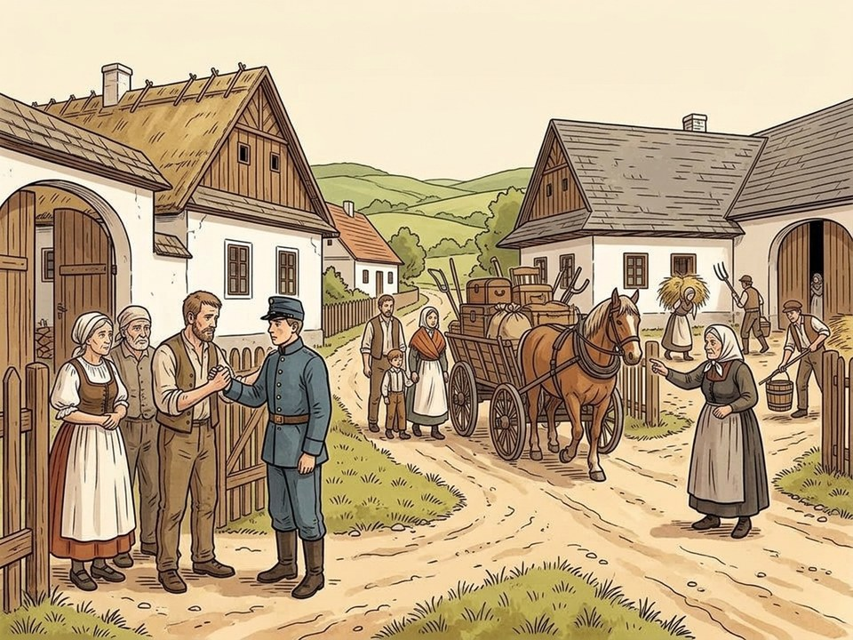

Podobně dramatické střídání generací zachycují sčítací archy na **selském gruntě čp. 10 (Grunt u Jílků a Šafářů)** v centrální části obce a na nedalekém **statku čp. 6**:
- Na **čp. 10** hospodařil od počátku 19. století láník **Josef Jílek** (*1815, v německých zápisech *Gilek*) s manželkou **Annou** (*1814). Roku 1869 převzal statek čtyřiadvacetiletý syn **Karel Jílek** (*1845) s manželkou **Františkou** (*1845), zatímco jeho devatenáctiletý bratr **Vincenc Jílek** (*1850) má v kolonce poznámek lakonický přípis: *„Beim Militär“* (u vojska).
- Protože Karel Jílek neměl mužského dědice, který by grunt na konci 19. století udržel, přichází na čp. 10 kolem roku 1900 starobylý rod **Šafářů** (*Schafarz*) z osady **Medelské čp. 1**. V letech 1910 a 1921 zde hospodaří rolník **František Šafář** (*12. 5. 1874 v Dlouhomilově) s manželkou **Aloisií** (*31. 12. 1881 z Klopiny), čtyřmi dětmi (**Františkem** *1902, **Marií** *1903, **Josefem** *1908 a **Annou** *1911) a výměnkáři **Janem Šafářem** (*24. 5. 1859 v Medelském) a **Marií Šafářovou** (*22. 2. 1869 v Rohli).
- Na sousedním **statku čp. 6** zase v roce 1921 pevně držela otěže hospodářství jednasedmdesátiletá vdova **Marie Jílková** (*1. 11. 1849 v Bratrušově), které se statkem pomáhala pětičlenná rodina polního pomocníka **Jana Šindlera** (*1863 z Horní Olešné) a tři svobodní čeledíni a služky z Pobučí, Kosovova a Dlouhomilova.

---

<h2 id="kap-8">9. Domkáři, kováři z čp. 110 a tkalci u Oberleithnerů</h2>

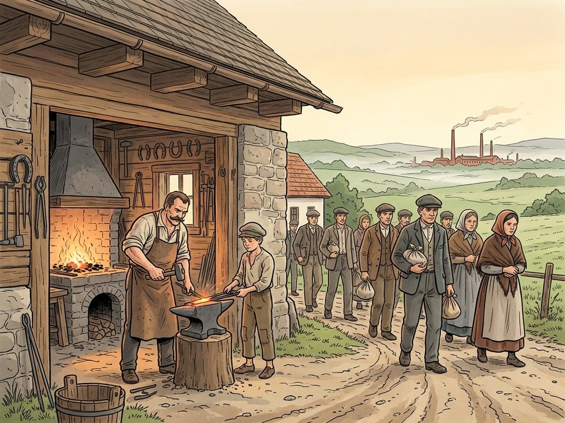

Zatímco velké grunty v údolní nivě si po staletí držely výměru polností, od poloviny 19. století začaly na svazích a na okrajích obce vyrůstat menší **domkářská a chalupnická stavení**. Lidé z těchto chalup se živili řemeslem, prací v lese nebo docházením do šumperských a zábřežských továren:

- **Kovárna a stavení čp. 110 (u Berkových a Podhorných):** V domě čp. 110 žil při sčítání roku 1910 venkovský kovář **František Berka** (*1866 z Leštiny) s manželkou **Marií** (*1864 z Hrabové), synem **Janem Berkou** (*1894, rovněž kovářským pomocníkem) a dcerou **Marií** (*1897). O jedenáct let později (1921) v domě bydlely tři domácnosti vedené sedmaosmdesátiletou výměnkářkou **Terezií Podhornou** (*1834) a tkadlenou **Annou Podhornou** (*1877), která docházela za prací do šumperské textilky.
- **Chalupa čp. 46 (rod Krobotů, Pavlíků, Dvořáků a Berkových):** Domkářské stavení čp. 46 s rysy jesenické lidové architektury (památkově chráněné v letech 1967–1982) je příkladem chalupy, kde se na malém prostoru střídali obuvníci, zedníci a výměnkáři. Roku 1910 zde žil sedmdesátiletý domkář **Alois Dvořák** (*1840) se synem zedníkem **Janem Dvořákem** (*1873) a pěti vnoučaty; v matričních zápisech z roku 1920 je dům spojen také se sňatkem **Jaroslava Berky** a rody **Krobotů** a **Hejtmanů**.
- **Práce pro textilní impérium Eduarda Oberleithnera v Šumperku:** Sčítací archy z roku **1921** ukazují, jak silně byl venkovský Dlouhomilov provázán s průmyslovým Šumperkem (*Mährisch Schönberg*). Celá řada obyvatel – zejména z menších domků v **Medelském čp. 1 a čp. 2**, v **čp. 4** či **čp. 110** – má v kolonce zaměstnání zapsaného téhož chlebodárce: **„Eduard Oberleithner a synové, tkalcovna a bělidlo v Šumperku“**. Například z **Medelského čp. 1** tam denně docházeli bělidlový dělník **Jan Minář** (*1861), jeho syn **Josef Minář** (*1886, bělič příze) i dcera **Pavlína Minářová** (*1894, tkadlena); ze sousedního **Medelského čp. 2** tam pracoval jako bělič příze **Josef Nejedlý** (*1861) a jeho dcera **Marie Nejedlá** (*1895).

---

<h2 id="kap-9">10. Únor 1921: zrcadlo obce na prahu Československa</h2>

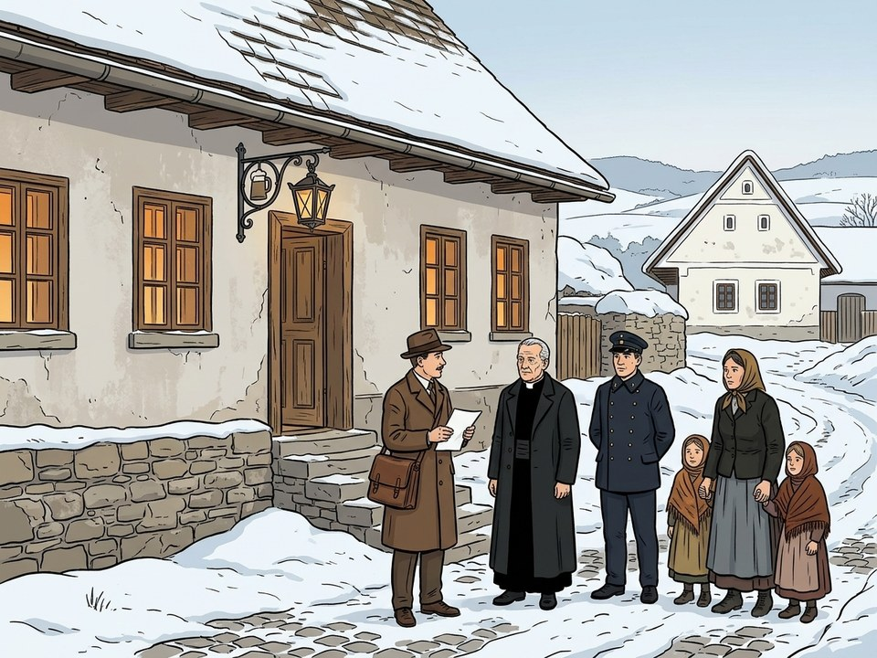

První československé sčítání lidu, provedené o půlnoci z **15. na 16. února 1921**, nám díky dochovaným originálním archům ze Státního okresního archivu v Šumperku umožňuje nahlédnout téměř do každé světnice v Dlouhomilově i Medelském. Každý dospělý obyvatel tehdy musel arch **vlastnoručně podepsat** – vidíme tak vedle sebe vypsaný krasopis faráře i nejisté tahy perem devadesátiletých výměnkářů.

Co nám tato únorová noc roku 1921 o obci prozrazuje?
1. **Duchovní a školní elita obce (čp. 2, čp. 7, čp. 12):** Na barokní faře **čp. 2** působil šedesátiletý farář a děkan **P. František Kožušníček** (*2. 12. 1860 v Tovačově), jemuž vedla domácnost hospodyně **Marie Faltusová** (*1876 z Výprachtic) s neteří **Marií Faltusovou** (*1901) a služkou **Annou Řehákovou** (*1904 z Hrabové). Na obecné škole vyučovala industriální učitelka **Eliška Ptáčková** (*1889, bytem na rychtě čp. 7) a z mladé generace dojížděl desetiletý **Josef Koš** (*1911 z čp. 5) jako student na reálku do Šumperka.
2. **Železnice, pošta a řemeslní učni (čp. 3, čp. 4, čp. 5, čp. 8):** V **čp. 4** bydlel zámečník **Josef Vénos** (*1877 z Nemile), zaměstnaný v **železniční výtopně Československých státních drah v Šumperku**, zatímco jeho čtrnáctiletý syn **Josef Vénos ml.** (*1906) se učil zámečníkem v nedaleké Lesnici a podnájemnice **Julie Janků** (*1879 z Bohuslavic) sloužila u **poštovního úřadu v Brníčku**. V **čp. 5** se šestnáctiletý **František Koš** (*1904) učil zámečníkem u mistra **Františkaunera v Dolní Olešné**.
3. **Šrámy první světové války:** V řadě domů připomínají sčítací archy nedávnou světovou válku (1914–1918). V **čp. 8** hospodařil čtyřiašedesátiletý vdovec **Josef Hošek** (*1856) se třemi neprovdanými dcerami, z nichž nejmladší **Anna Hošková** (*1900) byla od dětství němá (*„tělesná vada: němá“*). V témže domě žila pětatřicetiletá válečná vdova **Amálie Šafářová** (*1885 z Hrabové) se třemi sirotky (**Františkou** *1910, **Annou** *1913 a **Marií** *1914) a v další světnici svobodný rolník a válečný **invalida František Drlík** (*1876).
4. **Služebná čeleď z celého Zábřežska a Šumperska:** Téměř na každém větším statku (čp. 3, 5, 6, 7, 8, 9, 10, 11, 13, 22, 29) sloužili mladí čeledíni, kočí, pasáci a služky ve věku 14 až 25 let. Přicházeli nejen z Dlouhomilova, ale i z **Brníčka, Rohle, Klopiny, Lesnice, Leštiny, Hrabišína, Pobučí, Rovenska, Vyšehoří, Postřelmůku, Svébohova či Jedlí**. Selský grunt tak byl školou hospodaření pro celé okolní podhůří.

---

<h2 id="kap-10">11. Soužití na hranici, poválečná proměna a osudy obce ve 20. století (1938–2006)</h2>

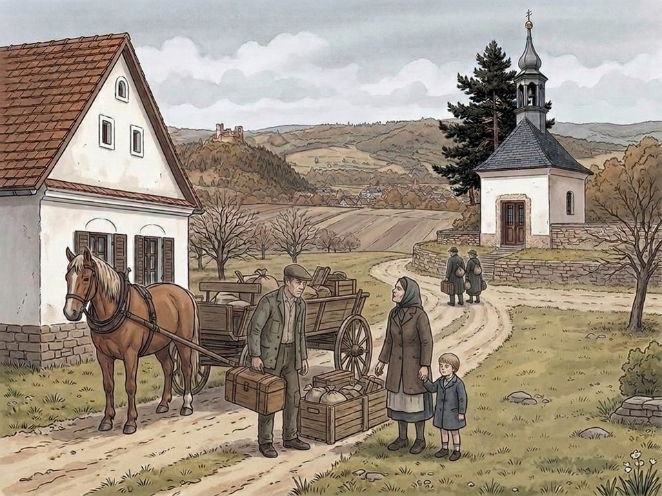

Podzim roku **1938** a Mnichovská dohoda zasáhly do života údolí s plnou silou. Jak ukazuje **německá mapa okresů Zábřeh a Šumperk z roku 1940** (*Kreis Hohenstadt und Mährisch Schönberg*), celé území obce bylo začleněno do říšské župy **Sudetenland** (*Landkreis Hohenstadt*, landrát Gerhard Hotop; vládní obvod Opava / *Regierungsbezirk Troppau*). Vědecká disertační rešerše (*Uhlíř 2006*) doložila, že **Tělocvičná jednota Sokol Dlouhomilov** (založená r. 1907, vlastní sokolovna od r. 1925) tehdy patřila ke **42 jednotám Župy Severomoravské** ztraceným v odstoupeném pohraničí. Český Dlouhomilov s osadou Medelské si přesto udržel svou rodovou kontinuitu na selských gruntech i během válečných let – na faře čp. 2 tehdy v nelehkých poměrech sloužil farář **P. František Reichel (Reichl)** (1934–1964). Osvobození regionu přinesl postup předvoje Rudé armády přes sousední **Strupšín** do **Brníčka** dne **7. května 1945** (*Stejskal 2010*).

V květnu **1945** a v následujících letech **1946–1960** prošlo nejhlubší proměnou sousední německé **Benkovsko**. Po poválečném odsunu většiny původních německých rodin (duben–září 1946 přes Mohelnici; Kauerů, Hegerů, Rössnerů, Bischofů, Weiserů a dalších) přicházeli do benkovských usedlostí noví osídlenci z českého vnitrozemí a Valašska – v matrice *Zá II 10* se v letech 1945–1949 v Benkově objevují nová jména jako **Zbranek** (čp. 49), **Mičulková** (čp. 21), **Chrastinová** (čp. 22), **Sitařová** (čp. 31), **Rýznar** (čp. 33) či **Krejčí** (čp. 37). Okres Zábřeh současně procházel retribučním řízením Trestní nalézací komise ONV Zábřeh (*Lukáč 2017*) a krizí rané kolektivizace JZD v letech 1952–1953 (*Mrňka 2013*). Statečný dlouhomilovský farář **P. František Reichel** – jmenovaný **11. září 1946** i prozatímním správcem sousední Rohle po odsunu německého faráře (*Skoumalová 2021*) – čelil na faře čp. 2 tlaku okresních církevních tajemníků a v roce **1959** prosadil konání veřejného průvodu Božího Těla jako jeden ze dvou posledních v celém šumperském okrese (*Snášelová 2012*; znovupovolen **16. 6. 1968**). Roku **1960** se pak Benkov s Dlouhomilovem a Medelským administrativně spojil v jednu obec (jejíž mluva byla zapsána jako bod č. **647 Českého jazykového atlasu** a v letech 1979–1980 zde při opravách kostela sloužil bývalý pétépák **Mons. Antonín Pospíšil**), a roku **2006** obec oslavila 650. výročí první písemné zmínky ([podrobněji viz syntéza kvalifikačních prací](kvalifikacni_prace_a_literatura.md)).

---

<h2 id="zajimavosti">12. Zajímavosti z matrik, gruntovních knih, zemských desek a sčítání lidu</h2>

> Následujících sedmnáct mikrohistorických příběhů (*„fun facts“*) vyrostlo přímo z rukopisných zápisů v Moravských zemských deskách (*ZDO I, IV, X*, 1356–1447, a *ZDO XIII, XVI, XVII, XXX*, 1490–1595) i knihách půhonných (*KP I, IV/2, VI*, 1407–1493), urbáři zábřežského panství z roku 1585 (*URB00015585*), matrikách farností Dubicko (*Zá IV 1–2*, 1617–1722), Zábřeh (*Zá I 1*, 1649–1692), Brníčko (*Zá VI 5*), Rohle (*Zá VIII 1, 6, 10, 14, 15*, 1720–1786) a Dlouhomilov (*Zá II 1–10*, 1786–1949), gruntovních knihách (Dlouhomilov a Medelské *inv. č. 164*, Benkov *1617–1879*), lánových rejstřících a rektifikačních aktech (*MZA Brno D 1, D 2, D 3*), sčítacích operátech z let 1857–1921, kvalifikačních pracích a odborné literatuře.

### 1. Sto šedesát let jednoho rodu na stejném čísle popisném (čp. 22)
Málokterá vesnice se může pochlubit tak neprůstřelnou kontinuitou číslování domů i selského rodu jako **usedlost čp. 22**. Když se v roce **1786** v Brníčku ženil jednadvacetiletý **Pavel Dvořák**, zapsal farář jeho původ slovy *„z Dlouhomilova č. 22“*. O **163 let později**, dne **29. května 1949**, umírá v témže domě **čp. 22** výměnkářka **Anna Dvořáková roz. Kouřilová**. Po více než pět generací se zde nezměnilo ani příjmení hospodáře, ani číslo na štítu statku.

### 2. Dvojitá svatba třináct dní před smrtí otce (29. července 1878)
Dne **29. července 1878** stáli před oltářem kostela Všech svatých v Dlouhomilově současně **dva bratři a dvě sestry**: **Josef a Karel Dvořákovi** si v jediné obřadní hodině brali **Annu a Ludmilu Kouřilovy** ze statku **čp. 24**. Svatba se chystala ve spěchu a s těžkým srdcem – otec obou nevěst, devětapadesátiletý sedlák **František Kouřil** z čp. 24, umíral na tuberkulózu (*úbytě*) a skonal pouhých **13 dní po svatbě**, dne **11. srpna 1878**.

### 3. Manželé narození v tentýž den a rok (15. června 1920)
Když se na statku **čp. 29** sedláku Josefu Dvořákovi a Amálii roz. Motykové narodila dne **15. června 1920** dcera **Marie Dvořáková**, nikdo netušil, že se v tentýž den – **15. června 1920** – narodil i její budoucí manžel, magistr farmacie **PhMr. Jaroslav Berka**. Jejich sňatek tak spojil dva lidi s naprosto totožným datem narození a zároveň propojil rod Berkových se statkem Dvořákových v čp. 29.

### 4. Které „čp. 2“? Záhada fary a osady Medelské
Při čtení dlouhomilovských matrik z 20. století narazil genealogický výzkum na zdánlivý hlavolam: dne **16. října 1948** byla v matrice *Zá II 10* zapsána svatba **Bohumila Nejedlého** a u rodiny Nejedlých (včetně předchozího úmrtí **Františka Nejedlého** 15. 3. 1938 a **Marie Nejedlé roz. Šafářové** 29. 3. 1941) stálo **„čp. 2“**. V Dlouhomilově je však **čp. 2 barokní fara**! Záhadu rozluštil teprve sčítací operát z roku 1921: nešlo o faru, nýbrž o **Medelské čp. 2**, kde rod Nejedlých (spřízněný se Šafářovými z Medelského čp. 1) po desetiletí hospodařil.

### 5. Selský syn z čp. 29 právníkem v Praze a doktorem práv (1857)
Ve sčítacím archu statku **čp. 29** z roku **1857** najdeme u jednadvacetiletého syna hospodáře **Jana Dvořáka (*1826)** na tehdejší vesnické poměry mimořádný záznam: *„Jurist in Prag II“* (právník v Praze). Jan odešel na studia práv na Karlo-Ferdinandovu univerzitu v Praze a získal akademický titul doktora práv – v operátu 1869 je již evidován jako *Doktor* pobývající v Hrotovicích u bratra Karla. Získání univerzitního doktorátu představovalo pro selského syna v polovině 19. století naprosto výjimečný vzdělanostní úspěch.

### 6. Dlouhověkost v údolí: 91 let Anny Dvořákové a 87 let Terezie Podhorné
Navzdory tvrdé polní práci a epidemiím 19. století se řada obyvatel Dlouhomilova dožívala mimořádného věku. Výměnkář **Petr Dvořák** z čp. 22 zemřel roku 1878 ve **84 letech**, jeho nástupce **Josef Dvořák** (*1857) se dožil **83 let** (†1940) a jeho manželka **Anna Dvořáková roz. Kouřilová** (*9. 12. 1857) zemřela na čp. 22 v květnu 1949 ve věku **91 let a 5 měsíců**. Při sčítání roku 1921 pak v domku **čp. 110** podepsala sčítací arch sedmaosmdesátiletá výměnkářka **Terezie Podhorná** (*1834).

### 7. Hrdinská smrt v plamenech bludovského zámku
Babička ze statku **čp. 29**, výměnkářka **Františka Motyková roz. Březinová** (*1844 v Chromeči), ovdověla za tragických okolností. Její manžel **Antonín Motyka**, kolář v Bludově čp. 113, vběhl při ničivém požáru bludovského zámku do hořících chlévů, aby odtud vyvedl panský dobytek, a v plamenech zahynul. Jeho dcera **Amálie** (*1888) se roku 1907 provdala na dlouhomilovský statek čp. 29 a vzala si ovdovělou matku k sobě na výměnek.

### 8. Tři generace učitelek a osmnáctidenní Jitřenka na rychtě čp. 7 (1921)
Sčítací arch **bývalé dědičné rychty čp. 7** z 15. února 1921 zachycuje vedle sedláka Františka Hvíždě i čistě ženskou domácnost vdovy **Mathildy Ptáčkové** (*1863). Spolu s ní zde bydlela její svobodná dcera **Eliška Ptáčková** (*1889), která na obecné škole v Dlouhomilově vyučovala dívky ručním pracím jako **industriální učitelka**, mladší dcera **Marie Kvapilová** (*1894) a sotva **osmnáctidenní vnučka Jitřenka Kvapilová**, narozená 28. ledna 1921 v Olomouci – nejmladší obyvatelka Dlouhomilova v den sčítání.

### 9. Čeledín Jan Kamler (*1861) – věrný pomocník na statku čp. 29 až do smrti
Sčítací operáty a matriky připomínají i osudy svobodných čeledínů, kteří neměli vlastní rodinu a celý život zasvětili práci na jednom selském gruntě. Na statku **čp. 29** sloužil v roce 1921 šedesátiletý čeledín **Jan Kamler** (*20. 2. 1861 v Rovensku). Na statku u Dvořákových zůstal i ve stáří a zemřel v Dlouhomilově roku **1940** ve věku **79 let** – právě jeho úmrtní zápis v matrice *Zá II 10* pomohl po sto letech přesně rozluštit jeho těžko čitelné příjmení ze sčítacího archu roku 1921.

### 10. Kam sahaly sňatky a služba: spádové území dlouhomilovských statků
Analýza **928 matričních zápisů** z let 1889–1949 a sčítacích archů z roku 1921 ukazuje, že ačkoliv Dlouhomilov ležel v sevřeném údolí, jeho obyvatelé byli hustě propojeni s celým podhůřím. Nejčastěji si nevěsty, ženichy a čeleď brali ze sousedního **Brníčka, Rohle, Benkova, Dolní a Horní Olešné, Hrabišína, Leštiny, Lesnice, Klopiny, Bludova, Chromeče, Rovenska a Postřelmůku**, zatímco za průmyslovou prací a středními školami směřovali do **Šumperka** a **Zábřeha**.

### 11. Původ jmen obcí: Dlouhomilov, Benkov, Medelské, Brníčko a kopec Šebená
Podle klasického toponomastického díla **Ladislava Hosáka a Rudolfa Šrámka (*Místní jména na Moravě a ve Slezsku*)** mají všechna sídla v údolí středověký český původ ze 13.–14. století a jejich německé názvy vznikly až druhotným hláskovým přizpůsobením:
- **Dlouhomilov** (1356 *Dluhomilow*, nářečně *Dlóhomilov / Dlómilov*, něm. *Lomigsdorf*): přivlastňovací jméno od staročeského složeného osobního jména **Dlúhomil** („Dlúhomilův dvůr / ves“). Německé *Lomigsdorf* vzniklo fonetickým zkomolením českého *Dlóhomilov* a připojením koncovky *-dorf*.
- **Benkov** (1385 *Benkow*, něm. *Benke*): „Benkův majetek / ves“ od osobního jména **Benek** (domácká podoba jména **Benedikt** či *Beneš*).
- **Medelské** (1385 *Medilsk*, 1447 *les u Medelského*, něm. *Dreihöfen*): český název středního rodu (*to Medelské*) vychází buď ze staročeského přídavného jména **medlý / mdlý** (chudší, kamenitá půda), nebo z osobního jména **Medel**, zatímco německé *Dreihöfen* („Tři Dvory“) popisovalo tři původní selské dvory tvořící jádro osady.
- **Brníčko** (1350 *Brnieczko*, něm. *Brünnles*): zdrobnělina ze staročeského **brn / brnie** = *hlína, kal, bahno, jílovité místo* (německé *Brünnles* je doloženo až od 17. století).
- **Šebená** (kopec nad údolím): nářeční podoba názvu **Šibenná (Šibeniční) hora**, připomínající vrch na pomezí panství, kde stávalo hrdelní popraviště.
- **Hrabišín** (1353, od osobního jména *Hrabiše*), **Dolní a Horní Olešná** (1385 *Olessna*, něm. *Ullischen*, podle porostu *olší*) a **Rohle** (1349 *Rochle*, z osobního jména *Rochla* nebo označení *rokle*).

### 12. 60 hřiven grošů za dvůr, šest lánů a krčmu: co přesně stojí v první zmínce z roku 1356?
První písemný záznam o Dlouhomilově z roku **1356** (*ZDO I, č. 482*) není jen suchým názvem vsi, ale doslovnou kupní smlouvou mezi dvěma zdejšími vladyky: **Ondřej z Dlouhomilova** (*Andreas de Dluhomilow*) v ní prodal **Arnoštovi z Dlouhomilova** za **60 hřiven grošů** **1 dvůr, 6 lánů a 1 krčmu** (*vnam Curiam VI laneos vnam Tabernam*). Hned o dva zápisy dále (*č. 484*) prodal **Pešek z Dlouhomilova** za dalších **60 hřiven grošů** druhý dvůr s ročním úrokem a **vodním mlýnem** (*Molendinum*) bratřím Bohunkovi a Dětmarovi z Kolšova. Roku **1385** (*ZDO IV, č. 543*) pak společně vstupují do dějin **Benkov (*Benkow*)** a **Medelské (*Medilsk*)**, když Mikuláš z Brníčka zvaný Morava na nich pojistil věno své choti Markétě. A o pět století později – při sčítáních v letech **1869 a 1890** – stál na **dědičné rychtě čp. 7** stále hostinec s řeznictvím (u Katzerových) i samostatná kovárna (u Františka Vlacha) jako živý otisk původních středověkých lokátorských privilegií.

### 13. Jazyková hranice roku 1585 a sedm generací Schönů na gruntě v Benkově (1669–1946)
Výpis ze **zábřežského urbáře z roku 1585** (*URB00015585*) odhalil nečekanou hloubku národnostní i rodové stability údolí: zatímco v Dlouhomilově (*str. 82–84*, 22 usedlíků) a v osadě Medelské (*str. 80–81*, 8 držitelů na 5 položkách včetně sdílených spoludržeb) zněla již za Jana z Boskovic (na Moravské Třebové a Zábřehu, † 1589) téměř všechna jména česky (28 z 30; mj. *Vokšan, Vlček, Vachutka, Sládek, Pospíšil, Kouřil, Horníček*), v sousedním **Benkově** (zapsán *Venkov*, *str. 47*, 10 usedlíků v čele s fojtem *Mikulášem*) již žili sousedé německých i českých jmen (*Knaur, Khaur/Kauer, Šmid/Schmid, Hayndl, Tylcar, Toman*). Na tento horizont přímo navazují nejstarší pozemkové knihy: benkovský *Grundt und Waisen Register* z let **1617–1879**, dubické matriky od roku **1617** (*Zá IV 1*), zábřežská matrika *Zá I 1* (mj. křest *Pavla Dvořáka* r. 1651 v Dlouhomilově a *Martina Schöna* r. 1658 v Benkově) a lánový rejstřík let **1669–1677** (*MZA Brno, D 1, sign. 141, fol. 79r*), kde je na Benkově zapsán **Tobias Schön** (*vor Georg Puchmann*, 1 kůň, 10 měřic) s chotí Judith roz. Schintzlovou (vedle *Hanße Schöna ml.* se 60 m. a *Hanße Schöna st.* se 35 m.). Odtud se v gruntovní knize odvíjí nepřerušená řada **sedmi generací rodu Schönů** na **usedlosti čp. 5 v Benkově**: přes **Georga Schöna** (koupě 5. 2. 1696 za 175 hřiven, *fol. 210*), Georga ml. (1738), Johanna Georga (*1742), Josefa (*1771), Johanna (*1814, sňatek 21. 8. 1837 s Eleonorou Dvořákovou z Dlouhomilova*) a Adolfa st. (†1906) až k **Adolfu Schönu** (*1878), zachycenému na čp. 5 při sčítání lidu 1921 před poválečným odsunem 11. července 1946.

### 14. 27 hospodářů z roku 1677, nula poustek a ztracené „Dreihöfen“ v tereziánských fasích (1657–1756)
Úplný přepis **Lánového rejstříku panství Zábřeh z 13. 10. 1677** (*MZA Brno, D 1, sign. 141, fol. 76r–77v*) přinesl překvapivé zjištění: po třicetileté válce nestála v Dlouhomilově ani v Benkově **jediná pustá usedlost (`0` Ödungen)** – oproti sousednímu Strupšínu (`fol. 78r`) s řadou obnovených poustek obdělávalo všech **27 dlouhomilovských usedlíků** plných **`830` měřic** orné půdy (`6` lánů `3 1/4` osminy), přičemž 18 z 27 gruntů změnilo mezi první vizitací **1656–1657** a rokem **1677** jméno hospodáře (mj. rychtář *Jíra Blahařek → Ilia Zaoralný* 90 m., *Pavel Dvořák → Jan Dvořák* 60 m., *Jan Jílek → Mikuláš Jílek* 40 m., *Baltazar Vítek → Matouš Brauner* 30 m.). A kde bylo mezitím **Medelské (*Dreihöfen*)**? Jak potvrdila **Dominikální fase 1750** (*MZA D 3, sign. 172/1*) i **Rektifikační akta 1749–1756** (*MZA D 2, sign. 141*), v Medelském neležel panský dvůr, osada splynula berně s Dlouhomilovem a její tři původní dvorce přežívaly přímo uvnitř dlouhomilovských fasí v traťových jménech *„ein stückl bey Medelsker grundt“* (*č. 2*), *„u Medla gruntes mihle“* (*č. 12*), *„u Medelsk. gruntu“* (*č. 13*) a *„w Medelsky Strani“* (*č. 5, č. 10*) – až jim tereziánské číslování 1770–1771 vrátilo samostatnou domovní řadu, zatímco místní *Befreytte Bauern* v létě **1756** vypověděli, že robotu vykupují penězi a na zimu předou lněnou přízi pro trhy v Šumperku ([viz podrobná studie](lanove_rejstriky_a_rektifikace_1657_1756.md)).

### 15. Pochop Duchek na mlýně pod Šilperkem, rataj Števík a „hrad Brníčko zbořený“: co odhalily půhonné knihy a zemské desky (1463–1589)
Badatelský ponor do **Knih půhonných a nálezových** a rukopisných svazků **Moravských zemských desek (`MZA Brno, fond A 3`)** odkryl jmenovité příběhy lidí z údolí dávno před vznikem matrik: již v letech **1463–1466** (`KP IV/2, č. 525, 543, 547, 866`) se dědička **Kateřina z Vildenberka**, ručitel **Výšek ze Stříteže** a **Jan Tunkl** soudili o *dvuor Dluhomiluov* (`200` hř. gr.), a roku **1490** (`ZDO XIII, č. 84`) zajistil vklad Brníčka výslovně *ves Dlúhomilov, ves Medelské, ves Venkov ... se všemi rychtami zákupními*. Za tvrdé tunklovské rybníkářské éry pak roku **1492** (`KP VI`, zasedání od 18. 5. 1492) zapsal soud dva autentické útěky z obce: **Jiřík Tunkl st.** žaloval Znatu ze Zvole, že přijal vlastním výhostním listem *Jana rataje Števíka z Dlúhomilova* (`s. 294, č. 1775`), a jeho syn **Jindřich Tunkl** hnal Jana z Dalčic na Šilperku, že k němu na **mlýn u Šilperka** utekl dlouhomilovský **pochop (= dráb) Duchek z Dlúhomilova** – přestože jej starý pán Tunkl právně obstavil, Šilperský ho nevydal a *„ta dědina i podnes pusta stojí“* (`s. 324, č. 1962`). Nedlouho poté roku **1510** (`ZDO XVII, sn. 10/32`) zadlužený Jindřich Tunkl vložil Mikuláši Trčkovi *„wes dluhomilow s kaplu, wes medelske, wes wenkow“* a **24. 6. 1513** (`sn. 22/32`) přebíral Ladislav z Boskovic Zábřeh spolu s již rozbořeným hradem (*hrad Brniczko zborzenj*). Teprve bezdětná smrt **Jana z Boskovic na Třebové a Zábřehu** dne **1. 8. 1589** otevřela dědictví přes sestru Kunku z Boskovic **Ladislavu Velenovi ze Žerotína** ([viz samostatná studie ZDO & půhonů 1466–1622](zemske_desky_a_puhony_1466_1622.md)).

### 16. Svědek Pavel Dvořák se synem Hanßem (1654), omyl otce z r. 1763 a benkovský rychtář Jan Schön
Systematická excerpce předlokálních matrik farností **Dubicko** (`Zá IV 1–2`) a **Rohle** (`Zá VIII 1, 6, 10, 14, 15`) opravila hned tři starší představy: (1) Dne **27. září 1654** (`Dubicko Zá IV 1`, sn. 160, `pag. 313`) svědčili na sňatku Jiříka z Medelského (*„z Medelskýho“*) s Anežkou z Benkova společně **`Pawel Dworžák z Dlauhomilowa a Hanß geho Syn`** – přímý matriční doklad otcovsko-synovské vazby před Lánovým rejstříkem 1657/1677 na čp. 29! Již **2. 11. 1653** probíhaly obřady přímo *„w Dlauhomilowie“* a v letech **1653–1654** je doložen **`Jan Sskůn [Schön] Rychtář z Benkowa`**. (2) Křty Dlouhomilova a Benkova nekončily v Dubicku roku 1762, nýbrž vyčleněným oddílem `1695–1722` (`Zá IV 2`, str. `948–1095`), a již roku **1720** přešly do obnovené farnosti **Rohle**, kde index `Zá VIII 14` uvádí přes třicet dlouhomilovských Dvořáků. (3) Originál křtu Pavla Dvořáka ze dne **9. 9. 1763** (`Rohle Zá VIII 1`, sn. 207, `pag. 405`) vyvrátil dřívější omyl: nebyl synem Jiřího, nýbrž **sedláka Pavla Dvořáka st. a Barbory**, jehož jméno zmátlo starší čtení sloupce kmotrů. A zatímco Dlouhomilov s Medelským přešly roku **1786** do samostatné lokálie `Zá II 1–10` (prvních 11 sňatků v `Zá II 4` včetně sňatku bratra lokalisty Josepha Schuberta na rychtě čp. 7), **Benkov zůstal v Rohli až do roku 1932** ([viz podrobná studie matrik Dubicko a Rohle 1650–1785](matriky_dubicko_a_rohle_1650_1785.md)).

### 17. Dopis od Émila Zoly na dlouhomilovskou faru, 64 800 cihel na kostel a poslední průvod Božího Těla v okrese
Vytěžení 15 otevřených vysokoškolských kvalifikačních prací (UPOL Olomouc, UK Praha), studie Š. Kohouta (2009) a církevních pramenů odhalilo pozoruhodné osudy kostela Všech svatých (**čp. 1**) a sousední fary (**čp. 2**): na stavbu staršího barokního chrámu zahájenou v červnu **1707** bylo podle účetních knih vypáleno **64 800 cihel**; ze čtyř zvonů z r. 1910 přežil válečné rekvizice let 1916–1917 jen zvon z r. **1752** (*28. 2. 1918* navíc úřady odebraly **21 varhanních píšťal** po požáru sakristie *6. 2. 1918*) a farnost dala církvi **7 kněží-rodáků** včetně P. Aloise Dvořáka (1830–1908). V letech **1891–1907** pak na studené faře s 24m studnou vylámanou ve skále působil kněz a spisovatel Katolické moderny **P. František Saleský Kužela** (*Adam Chlumecký*): roku **1897** založil po vizitaci arcibiskupa Kohna *Spolek sv. Rocha*, roku **1899** otevřel česky psanou *Pamětní knihu farnosti dlouhoveské* (vedenou do r. 1986, dnes v SOkA Šumperk), obdržel přímo do Dlouhomilova blahopřejný dopis od **Émila Zoly** a čelil národnostním třenicím mezi českým Dlouhomilovem a německou Olešnou o pronájem kostelních lavic (1900). Jeho nástupce **P. František Reichel / Reichl** (1934–1964) zase v době komunismu prokázal mimořádnou statečnost: v roce 1957 debatoval s tajemníkem o Sputniku (*„hmota bez ducha by neznamenala nic“*), v dubnu 1958 odbyl předsedu ONV lakonickým tvrzením, že na míru pracuje *„na poli“*, a roku **1959** udržel veřejný průvod Božího Těla v Dlouhomilově jako **jedné ze dvou posledních farností** v celém šumperském okrese (znovu povolen 16. 6. 1968; [viz studie kvalifikačních prací a literatury](kvalifikacni_prace_a_literatura.md)).

### 18. Kdo byl zakladatel Dlúhomil a jak družina lovčího Benedy z Dubicka (zeman – druho – sluhoň) otiskla jména vsí do krajiny
Kombinace historického hláskosloví a excerpce moravských diplomatářů (`CDM II–VII, XV`, `RBM II`) i všech **32 vkladů** prvního svazku zemských desek (`ZDO I–X`, 1356–1447) zúžila založení Dlouhomilova do **primárního okna let `1270–1277` (nejpozději `1286–1295`, po válečném zmrazení `1278–1285`)**: dvoučlenné staročeské jméno **Dlúhomil** (*„dlouho/trvale milý“*) bylo ve 13. století výsadním stavovským jménem domácí šlechty a zemanů (`0` poddanských nositelů v celém `CDM` a `RBM`), hláskový řetězec **`Dlúhomilov` → `Dlóhomilov` → `Dlómilov` → `Lomigsdorf`** dokazuje středomoravské (hanácké) nářečí osadníků a střídání *dvuor Dlúhomiluov / za dvuor v Dluhomile* potvrzuje svobodný zemanský alod. Ústřední osobností kolonizace z Hané byl královský vrchní lovčí **Beneda z Dubicka (`1226–1269+`)** — v r. **1239** výslovně titulovaný ***„perambulator terrarum et assignator simul et metarum distinctor“*** (`CDM II, s. 361–362`), majitel tvrze v Dubicku, Krčmaně i domu na Olomouckém hradě (`1267`). Okruh kolem něj tvořil přesnou čtyřstupňovou hierarchii otisknutou do názvů okolních vsí: **(1) velmoži** *Beneda z Dubicka*, *Hrabiše z Úsova* (`1269–1275`) a *Kojata z Drnovic* → **Benkov** (*Benkow* < *Benek/Beneda* po suchém hřebeni přes Rohli a křižovatku *U Cikánského buku*, patrně souběžně již koncem 13. st. v neděleném panství), **Hrabišín** a **Kolšov** (*Kojišov*); **(2) plně urození zemané s deskovým alodem (*nobiles minores*)** → zakladatel **Dlúhomil** (**Dlouhomilov**, jehož vladykové let 1356–1397 sdílejí s potomky Benedy pět rodových jmen *Ondřej, Pešek/Přešek, Vilém, Ctibor, Mikšík*; srov. též r. 1297 *Lubominus de Dubich* ve *Velehradském kodexu* `MZA Brno E 7, sign. G 191, fol. 107v–108r`); **(3) osobně svobodní družiníci – *druho*** (moravská statuta `1229/1237` *„nobilis vir, et non druho“*; u Benedy r. `1263` doložen `Cunratecz, druho domini Benede`, `CDM III, s. 353`) → líheň panošů a **dědičných rychtářů**; **(4) vrchnostenští služebníci – *sluhoni*** (listiny biskupa Bruna `1263–1272` *„de zluhonibus“*) → sousední **Sluhoňov** (`1349`) bez jediného svobodného dvora ([viz samostatná studie původu Dlúhomila & 32 vkladů ZDO](puvod_dluhomila_a_zdo_1356_1447.md)).

### 19. V jakých fabrikách pracovali naši předci a co z nich postupem času vzniklo (1864–dnes)
Systematický rozbor socio-profesní struktury všech sedmi sčítání lidu (1857–1921, celkem 4 712 operátních záznamů) odhalil, že Dlouhomilov, osada Medelské a Benkov nebyly od sklonku 19. století pouze zemědělským údolím. Staly se bezprostředním dělnickým zázemím šumperského a zábřežského průmyslového distriktu:
- **Šumperská bělidla Eduarda Oberleithnera → národní podnik MORAVOLEN:** Vůbec největším externím zaměstnavatelem byla rodinná firma *Eduard Oberleithner a synové v Šumperku* (*Ed. Oberleithner's Söhne*). V obci žilo přes 100 dělníků bělidel (v Temenici a na Bratrušovském potoce), běličů příze, přadlen a tkadlen. Po roce 1945 byly Oberleithnerovy provozy znárodněny a staly se ředitelstvím a základním závodem 01 národního podniku **MORAVOLEN Šumperk** – největšího lnářského kombinátu v Československu. Po privatizaci na Moravolen a.s. v 90. letech tradiční lnářství ustoupilo a areál dnes slouží obchodně-průmyslovým účelům.
- **Přádelna lnu Ignáce Seidla v Sudkově → závod 04 Moravolen & SITEX:** Pro dělníky z Medelského a dolního konce Dlouhomilova byla nejbližší fabrikou mechanická přádelna lnu a bavlny v Sudkově (založená 1860–1864 Ignácem Seidlem), vzdálená jen 3 km pěšky přes kopec. Po válce byla přádelna začleněna do Moravolenu jako **závod 04 Sudkov** a v 90. letech privatizována na **Sudkovskou textilní a.s.** a **SITEX s.r.o.** (výroba technických tkanin a geotextilií).
- **Šumperské hedvábnictví („Malá Vídeň“) → národní podnik HEDVA:** Tkalci a niťařky z Dlouhomilova nacházeli práci i v luxusních hedvábnických tkalcovnách v Šumperku: *Vinciguerra* (čp. 99), *Frybyc a syn* (čp. 17) či provozy Siebera a Trebitsche. Po roce 1948 byly sloučeny do legendárního národního podniku **HEDVA Šumperk**, světoznámého producenta žakárových brokátů a kravat.
- **Strojírenství v Postřelmově – Josef Vítek a Viktor Jossa → MEZ Postřelmov (dnes MEP Postřelmov & MEP Slévárna):** Na počátku 20. století se zrodil strojírenský uzel u nádraží v Postřelmově: Josef Vítek založil roku 1901 továrnu na secí stroje a stavy na hedvábí (učili se zde zámečníci z čp. 79 a čp. 97) a Viktor Jossa provozoval slévárnu kovů (slévač Karel Matějček na Medelském čp. 4). Po roce 1948 daly tyto závody vzniknout elektrotechnickému gigantu **MEZ Postřelmov n. p.** (spínací přístroje pro lokomotivy a energetiku), z něhož po privatizaci vznikla akciová společnost **MEP Postřelmov** (součást skupiny *Slovácké strojírny, a.s.*) s přímou dceřinou firmou **MEP Slévárna, a.s.**
- **Další zaměstnavatelé:** *C. k. státní dráha (kkStB)* a výtopna ČSD v Šumperku a Zábřehu, *Rolnický akciový cukrovar v Zábřehu*, stavební firma architekta *Ing. Huberta Gässingera* v Šumperku i přádelny bankovní rodiny *Primavesi*.

---

## Přehled pramenů, z nichž příběh vychází
- **Listiny 13. století, Moravské zemské desky – kraj olomoucký & Knihy půhonné (`1226–1623`):** *Codex diplomaticus et epistolaris Moraviae II–IX, XV* (`CDM II, s. 176, 210, 326, 361–362`; `CDM III, s. 172, 350, 353, 363, 382–384, 391`; `CDM IV, s. 36, 178, 232`; `CDM XV, č. 21` = *Velehradský kodex* `MZA Brno, E 7 Cisterciáci Velehrad, sign. G 191, kart. 6, fol. 107v–108r`) & *Regesta diplomatica Bohemiae et Moraviae II* (`č. 517, 518, 537, 556, 672, 1466`); edice *Die Landtafel des Markgrafthumes Mähren I* (1348–1466, všech 32 vkladů `ZDO I–X`, [RBM](https://www.rbmonline.cz/portal/book/301)), *Moravské zemské desky II–III* (ed. F. Matějek, 1948 & 1953) a *Libri citationum et sententiarum I–VII* ([CMS online](https://sources.cms.flu.cas.cz/)); originální rukopisy v **MZA Brno (`fond A 3 Stavovské rukopisy`)**: NKP Moravské zemské desky ([ARON](https://www.mza.cz/aron/apu/56721cb4-2dd1-41cd-9e31-b4416c2037ca), mj. `Kniha XVII` [1506–1515, sn. 10/32 & 22/32], `Kniha XXX–XXXII` [1588–1603]), `ZDO I–X, XIII, XVI, XVII` a `KP I (č. 800), IV/2 (č. 525, 543, 547, 866), VI (č. 1775, 1962)` — [studie původu Dlúhomila & 32 vkladů ZDO 1226–1447](puvod_dluhomila_a_zdo_1356_1447.md) a [studie ZDO & půhonů 1466–1622](zemske_desky_a_puhony_1466_1622.md).
- **Urbář, gruntovní knihy, lánové rejstříky a rektifikační akta panství Zábřeh (1584–1880):** **Urbář panství Zábřeh 1585** (*URB00015585*, str. 47 Benkov/*Venkov*, str. 80–81 Medelské, str. 82–84 Dlouhomilov); **Gruntovní kniha pro Dlouhomilov a Medelské** (*1584–1880*, ZAO Olomouc, fond *Velkostatek Zábřeh, NAD 1549*, inv. č. 164, sign. 428, fol. 191–212 pro čp. 29 od r. 1679); **Grundt und Waisen Register dess Dorffs Bencka** (*1617–1879*, fol. 210–215f pro čp. 5); písemná zmínka dědičné rychty (1602, čp. 7); **Lánové rejstříky** (*MZA Brno, fond D 1, sign. 141*, [ARON](https://www.mza.cz/aron/apu/d4a61780-da2e-4276-89f2-5d47d83230ba), 1656–1677, `fol. 76r–79v` – všech 27 usedlých v Dlouhomilově a 10 v Benkově); **Rektifikační akta** (*MZA D 2, sign. 141, Část 1 [1749]* a *Část 2 [17. 8. 1756]*) a **Dominikální fase** (*MZA D 3, sign. 172/1, 1750*); viz [podrobný přepis v samostatné studii](lanove_rejstriky_a_rektifikace_1657_1756.md).
- **Matriky farního úřadu Dlouhomilov a předchozích farností (ZAO Opava – pobočka Olomouc):** svazky *Zá II 1* až *Zá II 10* (1786–1949 pro Dlouhomilov vč. Medelského a obě Olešné), pro předlokální období **Dubicko** (*Zá IV 1* z let **1617–1694** a *Zá IV 2*, inv. č. 8377 s oddílem N `1695–1722` na str. `948–1095`), **Zábřeh** (*Zá I 1*, inv. č. 8332, 1649–1692), **Brníčko** (od r. 1653, *Zá VI 5*), **Lesnice** (inv. č. 8399, od r. 1676/1688) a **Rohle** (*Zá VIII 1, 6, 10, 14, 15* z let **1720–1786**, přičemž Benkov zůstal v Rohli až do r. **1932**) — [samostatná studie matrik Dubicko a Rohle 1650–1785](matriky_dubicko_a_rohle_1650_1785.md).
- **Sčítací operáty obce Dlouhomilov, osady Medelské a Benkova (SOkA Šumperk / ZAO Opava):** Dlouhomilov & Medelské ve fondu *Okresní úřad Zábřeh (NAD 1000, pom. 411)*: ročníky **1857** (`kart. 253`), **1869** (`kart. 300`), **1880** (`kart. 330`), **1890** (`kart. 356`), **1900** (`kart. 397`), **1910** (`kart. 436, inv. č. 1765` – kompletně přepsáno) a **1921** (`fascikl 3, inv. č. 1863` – čp. 1–118 + Medelské); samostatný Benkov ve fondu *Okresní úřad Šumperk – I (NAD 999, pom. 409)*: ročníky **1857–1900** (`inv. č. 1010, kart. 326` – staženo a zmapováno všech 120 snímků), **1910** (`inv. č. 1086, kart. 365` – všech 45 domů a 275 obyvatel kompletně přepsáno) a **1921** (`inv. č. 1163, fascikl 2` – ověřeno všech 219/219 snímků včetně všech 45 sběrných archů domovních a 211 obyvatel).
- **Kvalifikační práce, církevní fondy a odborná literatura (2006–2025):** Souborná syntéza 15 otevřených vysokoškolských prací z UPOL a UK Praha (J. Sitta 2018, J. Snášelová 2012, J. Mrňa 2017, J. B. Uhlíř 2006, K./G. Sittová 2006, A. Skoumalová 2021, J. Mrňka 2013–2017, J. Stejskal 2010–2013, D. T. Haman 2025 aj.), odborných studií (Š. Kohout 2009, S. Balík 2010, J. Lukáč 2017), farní historie a *Paměti národa* — [samostatný přehled kvalifikačních prací a literatury](kvalifikacni_prace_a_literatura.md).
- **Historické mapy (1623–1940):** rukopisná **Aretinova mapa zábřežského panství (1623)** (ZAO pobočka Olomouc, fond *Velkostatek Zábřeh, NAD 1549*, inv. č. 831, mapa č. 1 – archivní kulturní památka **AKP ČR č. 81**, 137 × 98 cm, 1 : 20 800), Müllerova mapa Moravy (1716), Wielandova mapa (1726), I., II. a III. vojenské mapování (1764–1880), Císařský povinný otisk stabilního katastru obce *Lomigsdorf* (1834), Chytilova národnostní mapa Moravy (1906) a mapa okresů Zábřeh a Šumperk (1940).
