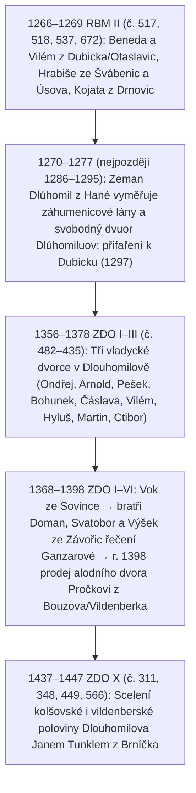

# Původ zakladatele Dlúhomila a kompletní regestář Olomouckých zemských desek (1266–1447)
*Jazykovědná (onomastická a dialektologická) analýza, diplomatické kořeny kolonizace Zábřežska a Dubicka ve 13. století a všech 32 zápisů o Dlouhomilově v prvním svazku Moravských zemských desek (`ZDO I–X`, 1356–1447)*

---

## 1. Otázka zakladatele: Kdo byl Dlúhomil, odkud přišel a kdy žil?

Originální zakládací (lokační) listina Dlouhomilova se – podobně jako u většiny zemanských lesních lánových vsí severomoravského podhůří – nedochovala. Přesto kombinace **historické jazykovědy (antroponomastiky, toponomastiky a dialektologie)** s digitální excerpcí celého korpusu **Codex diplomaticus et epistolaris Moraviae (`CDM I–IX, XV`)**, **Regesta diplomatica nec non epistolaria Bohemiae et Moraviae (`RBM I–IV`)** a **Moravských zemských desek (`ZDO I–X`, `ZDB`)** umožňuje osobnost zakladatele **Dlúhomila** vymezit s mimořádnou přesností.

### 1.1 Jazykový „rodný list“ jména *Dlúhomil* a názvu *Dlouhomilov*

1. **Stavovská výlučnost dvoučlenného jména *Dlúhomil* (`*Dl̥gomilъ`):**
   - Praslovanské a staročeské složené jméno **`Dlúhomil`** spojuje první člen *dlúho-* („dlouho, trvale, vytrvale“) s druhým členem *-mil* („milý, drahý“) ve významu rodového přání **„nechť je dlouho (trvale) milý a milován“** (stejný slovotvorný typ jako *Bohumil*, *Drahomil*, *Dalimil* či sousední *Radomil → Radomilov* u Rudy nad Moravou, doložený roku 1371).
   - Ve druhé polovině 13. a ve 14. století již selské a poddanské vrstvy na Moravě užívaly takřka výhradně domácké zkráceniny (**hypokoristika**, srov. okolní názvy *Benek → Benkov*, *Kojiš → Kojišov/Kolšov*, *Sluhoň → Sluhoňov*, *Sudek → Sudkov*) nebo křestní jména světců (*Jan, Mikuláš, Martin, Petr*). **Plné, nezkrácené slovanské kompozitum `Dlúhomil` bylo ve 13.–14. století na Moravě i v Čechách výsadním stavovským znakem domácí nižší a vyšší šlechty (velmožů, vladyků, zemanů a kapitulních hodnostářů).** V celém diplomatickém korpusu *CDM* a *RBM* do roku 1400 nenajdeme jediného neurozeného nositele tohoto jména.

2. **Hláskoslovné a dialektologické určení původu mluvčího:**
   - **Provedená změna `g > h` a dlouhé `dlúh-`:** V sousedním Opolském a Kozelském Slezsku se praslovanské `*dl̥g-` vyvinulo v polské *dług-* se zachovaným explozivním `-g-` (srov. patronymické *Dlugomilovici* z roku **1217**, dnes *Długomiłowice* u Kozlí); na východní Moravě a Slovensku pak zůstalo krátké slabičné *dlh-* (*dlhý*). Dlouhomilov má naproti tomu od nejstarších zápisů z roku **1356** dlouhý česko-středomoravský kmen **`Dlúho-`** (`Dluhomilow` 1356, `v Dlúhomilově` 1407, `ves Dlúhomilov` 1490; pouze dvakrát písař v letech 1360 a 1368 v nepřízvučné slabice zapsal grafickou redukci `Dylhomilow` v `ZDO I, č. 742` a `Dlhomyelow` v `č. 1158`).
   - **Středomoravský (hanácký) vývoj `Dlúhomilov > Dlóhomilov > Dlómilov`:** V místním severohanáckém nářečí přešlo staročeské `ú > ó` (*Dlóhomilov*) a po zániku intervokalického `-h-` došlo ke stažení samohlásek do podoby **`Dlómilov`** (stejně jako u hanáckého *Bohuslavice > Bóslavice*; viz *Hosák–Šrámek I*, s. 180).
   - **Druhotný a pozdní vznik německého *Lomigsdorf*:** Německé jméno *Lomigsdorf* (řidčeji *Lommersdorf*) prokazatelně nevzniklo při založení vsi ve 13. století – tehdy by buď neslo souběžné německé jméno lokátora, nebo by adaptovalo plný kmen *Dluhomil-*. Tvar **`Lōmigsdorf`** mohl vzniknout **až v raném novověku z hotového hanáckého staženého tvaru `Dlómilov`**: němčina odsunula pro ni nevyslovitelnou počáteční skupinu `dl- > l-` (*Dlómil- > Lōmil-*) a nahradila koncovku *-milov* členem *-migs-dorf*. Ještě v zemských deskách let 1490–1513 vystupuje ves jen česky a v urbáři roku 1585 má 20 z 22 hospodářů české jméno. **Zakladatel i první kolonisté byli nepochybně rodilí mluvčí staré češtiny středomoravského (hanáckého) typu.**

3. **Střídání *ves Dlúhomilov* ↔ *dvuor v Dlúhomile*:**
   - Zatímco staré říční osídlení v úvalu Moravy do počátku 13. století neslo čelední příponu `-ici > -ice` (*Bohuslavice* u Dubicka, *Lukavice*), podhorský věnec lesních lánových vsí s přivlastňovací příponou **`-ov` / `-ín`** (*Dlúhomil-ov, Kojiš-ov, Sluhoň-ov, Benk-ov, Radomil-ov, Hrabiš-ín*) vymezuje vnitřní emfyteutickou kolonizaci **2. poloviny 13. století**.
   - V zápisech *ZDO I–X* a *Knih půhonných* se vedle *Dlúhomilov* opakovaně objevuje i bezpříponový tvar **`Dlúhomil`**: `ZDO I, č. 1012` (1368 *Bohuncone de Dluhomil*), `ZDO II, č. 294` (1373 *in villa Dluhomyl*), `ZDO V, č. 12` (1386 *Wockonis de Dluhomyl*), `ZDO VI, č. 587` (1397 *In Dluhomyl Curiam allodialem*), `ZDO X, č. 566` (1447 *villam mediam Dluhomil*) a `KP IV/2, č. 525` (1463 *za dvuor v Dluhomile* vedle `č. 543` *dvuor Dluhomiluov*). Jádrem lokace byl tedy **svobodný zemanský dvůr samotného Dlúhomila (*dvuor Dlúhomiluov*)**, kolem něhož nechal vyměřit záhumenicové lány.

---

## 2. Odkud a kdy Dlúhomil přišel? Listinné stopy let 1266–1310

### 2.1 Kdy přesně vznikl Dlouhomilov? Zpětný výpočet z r. 1356, rychlost moravské kolonizace po r. 1269 a dvě úzká historická okna

Když Dlouhomilov po sv. Janu Křtiteli roku **1356** (`ZDO I, č. 482, 484`) vstupuje do zemských desek, nestojí zde již jediný lokátorský statek, nýbrž **tři samostatné svobodné vladycké dvorce (*Curiae*)**, vodní mlýn, dvě krčmy, devět chalupnických dvorků (*curticulae*), pět zahrad a přibližně 13 až 15 poplatných lánů rozdělených mezi početné příbuzenstvo (*Ondřej, Arnold, Pešek, Bohunek, vdova Čáslava, Vilém, Hyluš*). Aby byla lesní ves plně vyklučena, prošla 14–20letou daňovou lhůtou a dědickým dělením mezi syny a vnuky zakladatele se rozštěpila na tři dvorce (přičemž již r. 1365 vdova Čáslava prodává věno po zemřelém držiteli třetího dvorce a živé patronymum *syn Dlúhomilův* již vymizelo), musely od založení uplynout **nejméně dvě a půl až tři dospělé generace (cca 60–85 let)**.

Srovnání se známou **rychlostí osídlování srovnatelných severomoravských dominií ve 2. polovině 13. století** (lenní kolonizace biskupa Bruna ze Schauenburku na sousedním **Mírovsku a Mohelnicku** v letech `1266–1273`, `RBM II, č. 517` a Brunova závěť z r. 1267 `CDM III, s. 402`; kolonizace Boreše z Rýzmburka na **Moravskotřebovsku, Krasíkovsku a Zábřežsku** `1258–1275`; vysazení sousedního **Šumperka** `kol. 1269–1276`, doloženého 1281) spolu s nově dohledanými listinami `CDM IV` dovoluje široký odhad zúžit mnohem přesněji:

1. **Tři výšková a časová pásma kolonizace Zábřežské vrchoviny (tempo postupu do hor):**
   Středověká kolonizace nepostupovala dům od domu, nýbrž **skokově po ucelených údolních stupních** (vždy `3–6 km` přes sedlo do nejbližší široké kotliny, přičemž od rozhraničení hvozdu po vyměření lánů lokátorem v mírových letech uplynulo zpravidla **`2 až 7 let`**, následovaných **`14–20 lety` klučební daňové lhůty**):
   - **1. stupeň – okraj říční nivy (`260–310 m n. m.`, před r. 1265):** stará sídla při Moravě a ústí potoků (*Dubicko* 1253, *Zábřeh* 1254, *Lesnice*, *Postřelmov*, *Kolšov* `285 m`).
   - **2. stupeň – první široké podhorské kotliny za suchým sedlem (`310–380 m n. m.`, 60.–80. léta 13. století):** *Sudkov* (`310 m`), *Dolní Studénky* (`325 m`), *Sluhoňov* (`330 m`), *Rohle* (`345 m`), *Hrabišín* (`360–400 m`) a **Dlouhomilov (`340–375 m n. m.`, pouhých `3,2 km` přes suché sedlo z Kolšova!)**.
   - **3. stupeň – náhorní plošiny a mladší žďárové doosídlování (`400–530 m n. m.`):** Zde je třeba rozlišit **slunnou hřebenovou plošinu Benkova (`440–470 m n. m.`)**, která nese starobylé přivlastňovací jméno na **`-ov`** typické ještě pro **2. polovinu 13. století** (a mohla vzniknout po suchém hřebeni z Dubicka téměř souběžně s Dlouhomilovem, viz níže bod `2.4.6`), od skutečně mladších doosídlovacích a žďárových osad s popisnými přírodními jmény — **Medelské / *Tři lány*** (`400 m`), *Obědné* (`415 m`), *Nedvězí* (`420 m`) a *Kamenná* (`470 m`), obklopených lesy *Žďár* a *Černý les* (`Silua Zdyar, Silua nigra`).

2. **Dvě klíčové listinné kotvy v `CDM IV` zužující dobu po roce 1269:**
   - **`4. července 1276`, Olomouc (`CDM IV, č. CXXIX, s. 178–179`):** Mezi svědky vystupuje královský lesník na Úsově **`Wilchko, forestarius Regis de Usow`** (vedle královského purkrabího Kuny z Kunštátu, doloženého na Úsově v letech 1275–1277). To dokazuje, že **Hrabiše I. ze Švábenic držel hrad Úsov pouze v úzkém šestiletém okně `1269 – cca 1274/1275`!** Sousední **Hrabišín** u pramene potoka Loučky (3 km severovýchodně nad Dlouhomilovem) tedy musel být založen a pojmenován **přímo mezi lety `1269 a 1275`**.
   - **`26. listopadu 1279`, přímo v sousední Mohelnici (`CDM IV, č. CLXX, s. 232–233`):** V listině biskupa Bruna svědčí v jediné řadě pět přímých aktérů našeho mikroregionu: **`Wssieborius de Namyessz, Coiata de Drnowitz [držitel Kolšova!], Wilhelmus de Dubczisk [syn Benedy z Dubicka!], Nicolaus de Ottazlawitz`** a hned za nimi **`Sudek`** – s nejvyšší pravděpodobností samotný **eponymní lokátor/držitel sousedního Sudkova** (`3,5 km` západně od Dlouhomilova)! Samotný text listiny navíc živě popisuje, jak královští lesníci (*ex inductu forestariorum*) a páni za Přemysla Otakara II. (tj. **před srpnem 1278**) překračovali hřebenové hranice a čerstvě vyměřovali a osazovali podhorské lesní vsi (*adiacentes campos et siluas … occupat, locat et plantat*).

3. **Dvě ostrá historická okna založení Dlouhomilova (oddělená válečným zmrazením `1278–1285`):**
   - **Primární (nejpravděpodobnější) okno: `1270–1277` (pravděpodobnost ~65–70 %):** Bezprostřední realizace olomoucké kolonizační dohody z roku **1269** v době vrcholné konjunktury Přemysla Otakara II., souběžně se založením sousedního **Hrabišína** (`1269–1275`), aktivitou **Kojaty z Drnovic** (Kolšov), **Benedy a Viléma z Dubicka** a lokátora **Sudka** (`před 1279`). Odstup `80–85 let` do roku 1356 dokonale odpovídá `16–18` letům daňové lhůty (první platby z lánů kol. `1288–1293`) a přesně **třem generacím** potřebným k rozpadu původního *dvora Dlúhomilova* na tři samostatné vladycké dvorce a devět chalup.
   - **Kolonizační „mrtvé okno“: `srpen 1278 – 1285/1286` (pravděpodobnost blízká nule):** Po pádu Přemysla Otakara II. na Moravském poli (`26. 8. 1278`), vpádu Rudolfa Habsburského, smrti biskupa Bruna (`1281`) a katastrofálním moravském hladomoru (`1281–1282`) se severní Morava stala válečným bojištěm: pouhých **10 km západně od Dlouhomilova** opanoval hrad **Hoštejn** loupeživý Fridrich ze Šumburka, dokud jej královské vojsko v letech `1285–1286` nedobylo. V těchto sedmi letech se nové lesní vsi na Zábřežsku nevysazovaly, nýbrž pustly.
   - **Sekundární (pozdnější možné) okno: `1286–1295` (pravděpodobnost ~25–30 %):** Obnovená stabilizace na počátku vlády Václava II., kdy v roce **1287** vystupují společně tři bratři **Vilém, Mikuláš a Přešek z Dubicka a Otaslavic** (`CDM IV, s. 327` – nositelé týchž jmen *Vilém* a *Pešek/Přešek*, jaká nesou vladykové v Dlouhomilově r. 1356–1368!) a stabilizují farní organizaci v **Dubicku** (doloženou **1297**). Založení po roce `~1296–1300` je již demograficky i majetkově stěží slučitelné s pokročilou trojdvorcovou fragmentací v červnu 1356.
   - **Pravděpodobná doba života zakladatele Dlúhomila:** narozen **cca 1240–1255** (při okně `1270–1277`) nebo **cca 1255–1265** (při okně `1286–1295`), zemřel **cca 1295–1320**.

4. **Jaké reálné vědecké metody mohou v budoucnu určit rok založení ještě přesněji?**
   - **Dubová dendrochronologie s přesností na 1 kalendářní rok (nejvyšší šance na exaktní letopočet):** Jílovité zamokřené dno nivy potoka Loučky u středověkého **vodního mlýna čp. 3** (doloženého již r. **1356** v `ZDO I, č. 484`!), u sousední **dědičné rychty čp. 7** nebo v patách hrází zaniklých středověkých rybníků (`1397/1447`) dokáže bez přístupu vzduchu po 750 let konzervovat **dubové základové piloty, prahy mlýnského náhonu, vantroky či roubené jímky a studny**. Porovnáním letokruhů s moravskou standardní dubovou chronologií (MENDELU Brno – stejná metoda zpřesnila počátky Šumperka a Uničova) lze určit **přesný rok a roční období pokácení stromů při lokaci**.
   - **Archeologická typologie keramiky rozlišující obě okna (`±10–15 let`):** Právě kolem přelomu **70. a 80. let 13. století (`cca 1275–1285`)** probíhá na severní Moravě ostrý technologický přelom mezi pozdně hradištní/raně kolonizační písčitou a tuhovou keramikou (*horizont zániku Hoštejna 1286 a nejstarší vrstvy Šumperka*) a klasickou tenkostěnnou redukčně pálenou černošedou vrcholně středověkou keramikou (*po r. 1285–1300*). Záchranný archeologický výzkum při jakýchkoli zemních pracích ve dvorech nejstaršího jádra obce (`čp. 7`, `čp. 3`, `čp. 22`, `čp. 29`, `čp. 1`) by spolehlivě rozhodl mezi primárním oknem **`1270–1277`** a sekundárním oknem **`1286–1295`**.
   - **Pylová a uhlíková analýza sedimentů (*palynologie + ¹⁴C AMS*):** Vrtný profil z trvale zamokřených nivních sedimentů potoka Loučky (zejména v kotlině *Brné* pod Dlouhomilovem a Sluhoňovem) by zachytil první masivní **žďárový horizont mikroskopických uhlíků** z klučení jedlobukového pralesa doprovázený prvním výskytem pylu obilnin (*Cerealia*) a lnu (*Linum*).
   - **Needitované rukopisné zlomky v ZAO – pobočka Olomouc (malá, ale nenulová šance < 5 %):** Ačkoliv souvislé olomoucké zemské desky začínají až rokem **1348** a konzistoriální akta až v 15. století, ve fondech *Metropolitní kapitula Olomouc* a *Arcibiskupství Olomouc* dosud existují plně nezkatalogizované pergamenové předsádky a zlomky desátkových a soudních zápisů ze staré farnosti **Dubicko** z 1. poloviny 14. století.

5. **Kolik lidí v Dlouhomilově skutečně žilo kolem roku 1356 a proč zde fungovaly hned dvě až tři krčmy (*tabernae*)?**
   - **Nikoli 25 obyvatel, nýbrž `~25 až 30 samostatných usedlostí` = `~130 až 180 obyvatel`:** Součet nepřekrývajících se majetkových jednotek v `ZDO I–II` (`1356–1371`: **3 vladycké dvorce** s čeledí a rataji, **~12–15 poplatných selských lánů**, **9 chalupnických dvorků – *curticulae*** s 5 zahradami/podsedky, **1 vodní mlýn** a **2–3 krčmy**) ukazuje na **`25–30` rodinných hospodářství**, tedy při standardním středověkém koeficientu (`5–6` osob na grunt/dvorec, `4` osoby na chalupu) zhruba **`130 až 180 stálých obyvatel`** – prakticky tutéž plnou osedlost, jakou měl Dlouhomilov v urbáři roku **1585** (`22` usedlíků + `8` v Medelském) i v lánovém rejstříku roku **1677** (`27` usedlých hospodářů).
   - **Co byla středověká `taberna` (potravinářský monopol, nikoli turistický hostinec):** Ve 14. století se neupravená potoční voda ve vsi běžně nepila – každodenním nápojem sedláků, žen i ženců bylo slabé **stolní pivo**. Dle emfyteutického práva (srov. mírovskou listinu r. 1266, `RBM II, č. 517`) spojovala dědičná krčma v jedné usedlosti **pivovar s výčepem, pekárnu chleba, řeznický krám (jatky), často i kovárnu a sídlo nižšího soudu** (*litkupy* při smlouvách; spojení hostince s řeznictvím a kovárnou na dlouhomilovské rychtě `čp. 7` přetrvalo až do sčítání r. **1890**!).
   - **Hlavní příčina více krčem – rozdělení vsi mezi více vladyků (*„co pán, to vlastní výčep“*):** Zatímco jednotná ves měla krčmu jedinou (nebo dělenou napůl, srov. *media taberna* v sousední Olešné, `ZDO II, č. 86`), v Dlouhomilově rozděleném mezi tři dvorce nedovolil žádný vladyka, aby jeho sedláci nosili stříbrné groše za pivo sousednímu pánovi (*propinační přímus*). Proto měl vlastní krčmu jak první dvorec Ondřeje/Arnolda (`ZDO I, č. 482`), tak druhý dvorec sloučený Bohunkem z Kolšova (`duas tabernas` v `ZDO I, č. 1124` z r. 1368), a roku **1371** je doložena dokonce i samostatná krčma u úsovského dílu Petra Šišmy z Úsova (`ZDO II, č. 44`).
   - **Soumarské stezky, mlýn a horníci z Hrabišína:** Cesty 14. století nevyžadovaly stavbu kamenných silnic – pěší, koně, soumaři a lehké dvoukolové káry využívaly ihned po vyklučení suché hřebenové a sedlové úvozy. Dlouhomilov navíc neležel ve slepém koutě, ale na přímé spojnici z Kolšova, Zábřeha a Dubicka do **železnorudného a drahokovového revíru *Hrabišín – Oskava – Rabštejn*** (srov. *hutte* v listině 1269 a železné hory u Sudkova): uhlíři pálící milíře v okolních lesích, horníci, vozkové i sedláci čekající na semletí obilí v dlouhomilovském mlýně tvořili vedle domácích osadníků stálou klientelu krčem.

### 2.2 Kritické vyloučení homonymní stopy *Dluhomila z Veselí* (1267 a 1289)
V listině Přemysla Otakara II. dané **7. srpna 1267 v Budyni nad Ohří** pro klášter Hradisko u Olomouce (`CDM III, s. 396, č. CCCXCIV` = `RBM II, s. 214, č. 556`) vystupuje mezi královskými a královninými dvořany svědek **`Dluhomilus de Wezzele`**. Protože 16 km jižně od Dlouhomilova leží *Veselí* u Pavlovic/Mohelnice, prověřili jsme všechny výskyty této osoby v celém diplomatáři:
* Týž **`Dluhomilus de Wezzele`** svědčí podruhé **10. ledna 1289 na Pražském hradě** při lenním holdu opolského knížete Kazimíra králi Václavu II. (`RBM II, s. 629–630, č. 1466`), a to uprostřed nejvyšších **českých panských rodů** (*Bavor ze Strakonic … Hynek z Dubé, Mutina z Kostomlat … Bohuslav z Boru [ze Švamberka], Dluhomil z Veselí, Oldřich z Jindřichova Hradce*).
* Srovnání s českými listinami (`RBM II, s. 5` r. 1253 *Dluhomilus de Bor*; `RBM IV, s. 717` r. 1254 koupě Budětic *Dluhomilovi*; `RBM III, s. 579` r. 1328 *Dluhomilus de Psrichowiz*; `RBM IV, s. 30` r. 1334 *Dluhomilus de Wilherticz*) ukazuje, že přinejmenším svědek z roku **1289** patřil k jihočeské panské elitě z **Veselí nad Lužnicí** v sousedství pánů z Hradce a ze Strakonic (byť u listiny z r. **1267** vydané přímo pro olomoucký klášter Hradisko a nedaleký Štěpánov nelze zcela pominout, že v témže hradišťském okruhu vystupuje v letech `1275–1280` po boku *Předbora, syna Benedova* i severomoravský šlechtic *Budislav z Veselí*, držitel Žerotína a Pněvic u Litovle, `CDM IV, s. 165, 173, 235, 238`). Rovněž slezský rytířský rod **Dluhomilů z Bierawy** u Kozlí (*Mikuláš a Gumprecht Dluhomilové*) získal Bierawu až roku **1402** – tedy o více než sto let později (patrně jako potomci moravských zemanů, u nichž se zanikající křestní jméno otce proměnilo v příjmení; srov. bratry *Dlúhomila a Mikuláše z Tupce* r. 1373 v `ZDO II, č. 223`).

### 2.3 Hanácko-dubický a švábenicko-úsovský kolonizační most (listiny let 1266–1269)
Skutečný původ zakladatele Dlúhomila odkrývají čtyři listiny z let **1266–1269** v `RBM II` (`č. 517, 518, 537 a 672`), které přímo propojují naše severomoravské údolí s **jižní a střední Hanou**:

1. **Mírovský vzorec lokace (26. 5. 1266, `RBM II, č. 517, s. 200`):** Na sousedním hradě Mírově udělil biskup Bruno ze Schauenburku lokátoru Oldřichovi dědičnou rychtu, každý desátý lán svobodný, třetinu soudních pokut, mlýn o jednom kole a 13–20 let daňové lhůty.
2. **Olomoucká listina kolonizátorů severomoravského podhůří (1269, `CDM IV, č. XXX, s. 36–38` / `RBM II, č. 672, s. 262`):** Listina hlásící se k pobytu krále Přemysla Otakara II. na Olomouckém hradě roku **1269** (diplomaticky klášterní redakce/falzum hradišťských premonstrátů z přelomu 13. a 14. století ve sporu o železnorudné doly a vodní hutě – *hutte* – u Domašova nad Bystřicí, která však převzala **autentickou svědečnou řadu královského dvora na Olomouckém hradě z roku 1269**, kde měl vlastní dům lovčí Beneda z Dubicka, `RBM II, č. 537`) zachycuje bok po boku všechny čtyři klíčové rody kolonizující naše podhůří:
   - **Všebor (komorník bítovský) a jeho bratr Hrabiše I. z Úsova (*Wsseborius camerarius Betouiensis, Hrabisse frater suus de Vssow*), synové Idíka I. ze Švábenic (erb rozsoch – čtyř střel spojených do kříže):** mocní páni z jižní Hané u Vyškova, jimž král svěřil pohraniční hrad Úsov (9 km od Dlouhomilova) k organizaci kolonizace lesního hvozdu a rýžovišť v povodí Oskavy a Loučky. Přímo po Hrabišovi nese jméno sousední hornická a lesní ves **Hrabišín** (*Hrabyssina*, r. 1437 v `ZDO X, č. 311` prodávaná společně s Kolšovem, Studénkami, Sluhoňovem a Dlouhomilovem).
   - **Vilém I. z Náměště na Hané a jeho bratr Kojata z Drnovic (*Wilhelmus de Namyescz, Koyata frater suus*), synové Slavibora z Drnovic:** bratranci Všebora a Hrabiše z druhé větve rozrodu Švábeniců; domácký tvar rodového jména *Kojata* je **Kojiš** – srov. sousední **Kojišov = Kolšov** (*Cogissow*), tvořící s Dlouhomilovem v roce 1356 majetkové dvojče. Hydrograficky přitom Kolšov neleží v ústí potoka Loučky (který z Hrabišína přes Medelské, Dlouhomilov a Sluhoňov/Brníčko vyúsťuje do nivy Moravy u **Lesnice** – srov. `ZDO I, č. 483` *Předota z Lesnice* přímo mezi zápisy o Dlouhomilově `č. 482` a `484`!), nýbrž **západně za hřbetem Bukovické hory** na vlastním Kolšovském potoce: příčný majetkový pás *Kolšov – Studénky – polovina Sluhoňova – polovina Dlouhomilova – Hrabišín* (`ZDO I, č. 493`; `ZDO X, č. 311, 449`) tak dokládá, že kolonizace pronikala do horního údolí Loučky **příčně přes hřbet** ze starších nížinných sídel ještě před postavením hradu Brníčka ve 30. letech 14. století!
   - **Beneda z Dubicka a jeho syn Vilém (*Beneda de Dubiszco, Wilhelmus filius suus*):** královský vrchní lovčí (*magister venatorum*, v úřadě doložen 1233/1235–1260, s predikátem z Dubicka do r. 1269; v letech **1259 a 1266** daroval olomoucké katedrále celou svou ves **Krčmaň u Olomouce** – *Crikzeman / Kyrchman* – za spásu duše svého syna, olomouckého kanovníka **Markvarta**, `CDM III, s. 267, 382–384` / `RBM II, č. 518`) a jeho synové (*Předbor, Vilém, Mikuláš a Přešek*, stavitelé hradu **Otaslavice u Prostějova na Hané** v letech 1279–1287), z jejichž rodu vzešel ve 30. letech 14. století stavitel hradu **Brníčka** *Ctibor Morava*. Právě k prastaré faře v **Dubicku** (kostel doložen **1297**, `CDM XV, č. 21, s. 19`) patřil Dlouhomilov církevně nepřetržitě až do let **1720/1722** (`Dubicko Zá IV 1–2`), roku **1359** držel v Dlouhomilově lán **Vaňko z Dubicka** (`ZDO I, č. 674`) a mezi samotnými vladyky *z Dlouhomilova* se v letech 1356–1397 opakují typická rodová jména dubicko-otaslavického rodu (**Pešek/Přešek, Vilém, Ondřej, Ctibor, Mikšík**)!
   - **Kuno z Kunštátu (*Kuno de Chunstat*) a synové Zdeslava ze Šternberka:** zakladatel pánů z Kunštátu a kastelán na Úsově (1275–1277), jehož potomek **Ješek Puška z Kunštátu a Otaslavic** držel před rokem 1397 platy přímo v Dlouhomilově (`ZDO VI, č. 706, 879`).
3. **Koncentrace jména *Dlúhomil* v hanáckém zázemí těchto rodů:** Rodová sídla pánů ze Švábenic a z Otaslavic leží na jižní Hané v bezprostředním sousedství **Ivanovic na Hané** (4 km od Švábenic – kde již k r. 1167 listina `CDM I, s. 279` zmiňuje moravskou ves ponechanou **Dlúhomilovi**, vnuku Bavorovu) i zaniklých **Soběbřich** na Bučovicku (12 km od Švábenic – sídlo vladyky **Dlúhomila ze Soběbřich**, 1353–1358, `ZDO I, č. 313; CDM IX, s. 95`), zatímco přímo v Olomouci působil v letech **1303–1325** scholastik **Dlúhomil**, bratr mistra Jana a příbuzný biskupa Jana VI. z Valdštejna (`CDM V, s. 173, 209; VI, s. 76, 505`, kde pečetí hned vedle olomouckého komorníka *Vítka ze Švábenic*).

#### 2.3.1 Portrét vrchního lovčího Benedy z Dubicka (`1226–1269+`) a čtyři stopy po *Dlúhomilovi* v jeho bezprostředním okolí
Úplná excerpce listin `CDM II–VII` a `CDM XV` dovoluje sestavit podrobný životopis **Benedy z Dubicka** a prověřit osoby v jeho nejbližším okruhu:
* **Rodové kořeny a jméno *Ctibor* (`1226–1235`):** Již roku **1226** (`CDM II, s. 176`) svědčí za nejvyšším lovčím Častolovem **`Beneda filius Stibor`** (*Beneda, syn Ctiborův*) a roku **1235** (`CDM II, s. 273`) vystupují společně bratři **`Stibor et Beneda fratres`**, přičemž týž Beneda je na téže listině jmenován jako markraběcí **vrchní lovčí (*magister venatorum*)**. Rodové jméno *Ctibor* se později vrací jak u Benedova pravnuka *Ctibora Moravy z Brníčka*, tak roku **1378** přímo u vladyky **Ctibora z Dlouhomilova** (`ZDO III, č. 435`).
* **Královský „vytyčovatel hranic a přidělovatel půdy“ (`1233/1235–1260`):** V úřadě vrchního lovčího (*magister venatorum*, roku **1253** v `CDM III, s. 172` s cennou staročeskou glosou *„Beneda forestario, quod vulgariter sonat Lowci“* a r. **1256** *„Beneda Lowcki“*, `s. 219`) nepůsobil jen jako organizátor královských honů: listina z roku **1239** (`CDM II, s. 361–362`) jej výslovně titulem označuje za ***„perambulator terrarum et assignator simul et metarum distinctor“*** – tedy královského úředníka, který v sedle objížděl pohraniční hvozdy, vysekával hraniční mezníky a přiděloval lesní újezdy ke kolonizaci! Již na brněnském sněmu r. **1253/1254** (`CDM III, s. 181`) stojí ve svědečné řadě bok po boku s bratry **Všeborem a Hrabišem ze Švábenic** a **Sulislavem ze Zábřeha**.
* **Sídla v Dubicku, Krčmani a na Olomouckém hradě a vlastní družina (*druho*, `1253–1269`):** Vedle raně gotické tvrze v **Dubicku** (jejíž zdivo se dochovalo v sakristii kostela Povýšení sv. Kříže) vlastnil Beneda celou hanáckou ves **Krčmaň u Olomouce** (*Crikzeman / Kyrchman* s podsedky, krčmou a mlýnem), kterou v letech **1259** a **2. 6. 1266** (`CDM III, s. 267–268, 382–384`) pod vlastní pečetí (*sigillum meum*) daroval oltáři Panny Marie v olomouckém dómu za spásu zemřelého syna, kanovníka **Markvarta**, a zároveň vlastnil **šlechtický dům přímo na Olomouckém hradě** vedle kaple sv. Máří Magdalény (`27. 1. 1267`, `CDM III, s. 391`). Listina z **23. 6. 1263** (`CDM III, s. 353`) navíc dokládá, že Beneda disponoval vlastními osobními družiníky zvanými staročesky ***druho***: při sypání hraničních kopců na Hané u Týnečka svědčí vedle *Sutka z Obědkovic* (u Otaslavic) výslovně **`Cunratecz, druho domini Benede`** (*Kunrátek, družiník pana Benedy*). Po Benedovi († krátce po r. **1269**) je v pramenech doloženo pět synů: kanovník **Markvart** († před 1259), **Předbor** (*Prethborius, filius Benede*, r. 1276 v Olomouci, `CDM IV, s. 173`), **Vilém z Dubicka** (`1269–1287`), **Mikuláš z Otaslavic a Dubicka** (`1279–1297`) a **Přešek z Dubicka** (`1287`).
* **Čtyři konkrétní stopy v okolí Benedy a jeho synů vedoucí k *Dlúhomilovi*:**
  1. **Záhadný šlechtic `Lubominus de Dubich` přímo v Dubicku roku 1297 (`CDM XV, č. 21, s. 19–20`):** V papežské bule Bonifáce VIII. z **31. března 1297** (vůbec první písemné zmínce o mateřské faře Dlouhomilova v Dubicku) žaluje dubický farář **Jaroslav (*Jarozlaus plebanus ecclesie de Dubich*)** čtyři urozené laiky přímo z Dubicka — **`Lupus [Vlk], Nicolaus [syn Benedy z Dubicka!], Paulus et Lubominus de Dubich`** — za odnětí lánů, obilí a vepřů. Provedli jsme přímou kontrolu obou archivních větví:
     - **Vatikánské registry (`Reg. Vat. 48–50`, ed. *Les Registres de Boniface VIII*, Tome I–III):** Jakožto prosté soudní reskriptum (*littera simplex de iustitia* s incipitem *„Conquestus est nobis…“*) nebyla listina v papežských registrech vůbec registrována a originál zanikl při vypálení Velehradu husity roku 1421.
     - **Jediný dochovaný rukopisný svědek (*Velehradský kodex*, [MZA ARON APU `598cf704-6afa-4bd5-84c6-6a71d75249dc`](https://www.mza.cz/aron/apu/598cf704-6afa-4bd5-84c6-6a71d75249dc)):** Ověření v databázi ARON Moravského zemského archivu v Brně opravilo staré údaje B. Bretholze z r. 1903 – rukopis je uložen pod přesnou signaturou **MZA v Brně, fond E 7 Cisterciáci Velehrad, sign. G 191 (*Velehradský kodex*), karton 6, moderní `fol. 107v–108r`** *(stará foliace `fol. 114v` se liší o 7 chybějících listů v kodexu)* a nejstarší část papírového kodexu nevznikla ve 14. století, nýbrž až v letech **`1414–1420`**! Samotný kodex `G 191` zatím nemá v ARONu připojené digitální skeny (`digitalObjects: []`), avšak zjištění, že mezi rokem **1297** a opisem z let **1414–1420** leží **120 let a tři písařské ruce** (česká suplika → italský kurijní písař v Římě → velehradský opisovač z let 1414–1420), ještě výrazně posiluje pravděpodobnost zkomolení neexistujícího tvaru `*Lubominus`: buď šlo o **Lubomíra z Dubicka** (`Lubomirus > Lubominus`, dokládajícího živá dvoučlenná slovanská jména typu `-mír/-mil` na dubické tvrzi), anebo o **dvojí zkomolení původního `Dluhomilus de Dubich` → `(D)lubomilus` → `Lubominus`** (odsunem pro Itala nevyslovitelného `Dl- > L-` a záměnou gotických tahů `h ↔ b` a `l ↔ n`), což lze ověřit objednáním reprodukce `2` stran (`fol. 107v–108r`) z badatelny MZA Brno.
  2. **Tři stupně urozenosti v Benedově družině (*nobilis / zeman* vs. *druho* vs. *sluhoň*) a shoda rodových jmen v Dlouhomilově (`1356–1397`):** Kolem velmože a královského úředníka Benedova formátu se ve 13. století pohybovala prostupná, ale právně odstupňovaná klientela (srov. výzkumy *Libora Jana*):
     - **Nejvyšší patro družiny – mladší příbuzní a plně urození drobní vladykové (*nobiles minores / milites*):** Svobodní urození muži s prestižními dvoučlennými jmény (*Dlúhomil, Dobromil, Předbor, Ctibor*), za něž u ordálu směl nastoupit zástupce a kteří drželi **svobodné alodní statky zapisované přímo do zemských desek** (*Curia allodialis*). Právě do této plně urozené zemanské vrstvy (či přímo k boční příbuzenské větvi dubického rodu) patřil zakladatel **Dlúhomil**, neboť jeho potomci v letech **1356–1397** disponují v Dlouhomilově plným deskovým alodem nezávislým na hradu Brníčku a **pět jejich hlavních křestních jmen (*Ondřej, Pešek/Přešek, Vilém, Ctibor, Mikšík*) se 1:1 kryje s rodovými jmény potomků Benedy z Dubicka a z Otaslavic**!
     - **Střední patro družiny – vlastní *druho* (*Cunratecz, druho domini Benede*, `1263`):** Moravská zemská statuta z let **1229 a 1237** (`CDM II, s. 210, 326`) přesně vymezují jejich postavení formulí *„Si aliquis nobilis vir, et non druho, super se habuerit narok, puer pro ipso subeat iudicium“* – *druho* tedy původně ještě neměl starobylou urozenou krev (*nobilis vir*), ale byl osobně svobodným profesionálním jezdcem a klientem velmože, který směl svědčit na listinách a z jehož řad se na sklonku 13. století rekrutovala nejnižší vrstva drobných zemanů (*panošů*), manů a dědičných fojtů/rychtářů.
     - **Spodní patro – vrchnostenští služebníci (*sluhoň / zluhones*, `1263–1272`):** Neurození služební lidé pána (lovci, psáři, lesní hlídači) usazení na poplatných či od desátku osvobozených lánech bez alodního dvora (viz níže *Sluhoňov* v bodě `2.4.3`).
  3. **Sousední hanácké a podhorské paralely na `-mil` (*Dobromilice* u Otaslavic a *Radomilov*):** Přímo na olomouckém cúdovním soudu r. **1282** (`CDM IV, s. 274`) zasedá vedle Benedova syna **Viléma z Dubicka** hanácký vladyka **Adam z Dobromilic** (7 km od rodových Otaslavic, od jména *Dobromil*), stejně jako v severním sousedství u Rudy vznikl sesterský **Radomilov** (od *Radomil*).
  4. **Severomoravský okruh kláštera Hradisko (`1267–1280`):** Na listině pro klášter Hradisko a Štěpánov z **7. 8. 1267** (`CDM III, s. 396`) svědčí *Dluhomilus de Wezzele* a roku **1276** (`CDM IV, s. 173`) stojí na hradišťské listině v Olomouci hned vedle *Předbora, syna Benedova* severohanácký *Budislav z Veselí*.

### 2.4 Tři suché kolonizační směry přes hřebeny a proč hrad Brníčko vznikl až dodatečně nad „lesní bažinou“ (*brnie*)
Detailní pohled do terénu Zábřežské vrchoviny i do vkladů `ZDO I–X` vysvětluje zdánlivý paradox, proč Dlouhomilov ve 14. století **vůbec nepatřil k sousednímu hradu Brníčku** a kudy do horního údolí Loučky a na Benkov kolonisté skutečně přicházeli:

1. **Rozbahněná soutoková kotlina u Brníčka (*stč. brn / brnie = bláto, kal, slatina, lesní bažina*) a trojdílné Brníčko:**
   - Těsně pod Dlouhomilovem a Sluhoňovem – než se potok Loučka protáhne úzkou soutěskou kolem skalního ostrohu k Lesnici – se v ploché jílovité sníženině slévají čtyři vodoteče (Loučka od Hrabišína a Dlouhomilova, Benkovský potok od Benkova a potoky od Strupšína a Bukovické hory). Ve 13. století tvořilo toto dno zamokřený lužní mokřad – staročesky **`brnie` / `Brné`** (*„bažinaté, rozbahněné místo“*, od něhož vznikla zdrobnělina **`Brníčko`**).
   - Pro zemědělské lokátory vyžadující široké a suché záhumenicové lány byla tato lesní bažina nevhodná: na vyvýšené suché terase nad mokřadem sice již v **polovině / 2. polovině 13. století** vznikl malý **pozdně románský kostelík Narození Panny Marie** (s dodnes dochovanou půlkruhovou apsidou) s drobnou osadou **Brné** a výše proti proudu samostatná ves **Sluhoňov** (doložená r. **1351**, `ZDO I, č. 121`), avšak hlavní plužinová kolonizace zamokřenou soutěsku obcházela po suchých hřbetech do širšího údolí **Dlouhomilova**.
   - **Hrad Brníčko (*Castrum Brnyeczko*) a podhradní městečko (*oppidum Brnyeczko*) vznikly prokazatelně až později – ve 30. až 40. letech 14. století** (ves připomínána r. **1350**, *Jimram a Micháč z Brníčka* r. **1356** v `ZDO I, č. 461`), když pravnuk Benedy z Dubicka **Ctibor Morava** při dělení dubicko-otaslavického zboží využil kombinaci strmého skalního ostrohu a neprostupné bažinaté nivy (*brnie*) jako přirozenou vodní obranu nového rodového sídla. Ještě v **zábřežském urbáři z roku 1585** proto vystupují *městečko Brníčko*, *ves Brné* a *ves Sluhoňov* jako **tři oddělené sídelní jednotky** (splynuly až po třicetileté válce)!
   - Protože v době stavby hradu Brníčka (kol. 1335–1350) byl **Dlouhomilov** již dávno vysazeným a dědicky rozděleným zemanským statkem, připadl k novému hradu Brníčku jen vnější věnec mladších horských a žďárových vsí (**Strupšín, Nedvězí, Kamenná, díl Rohle, Obědné, Benkov a Medelské** – `ZDO IV, č. 543` z r. 1385 a `ZDO X, č. 560` z r. 1447 se zapsanými lesy *Silua Zdyar, Bradla, Silua Wenkowsky* a *Silua nigra* u Strupšína a Medelského), kdežto samotný **Dlouhomilov** a **polovina Sluhoňova** zůstaly nezávislé až do tunklovských koupí let **1437/1446–1447**!

2. **Tři suché kolonizační koridory přes kopce (obcházející bažinu v Brníčku):**
   - **Západní příčný směr přes sedla u Bukovické hory (*Kolšov / Sudkov → Sluhoňov & Dlouhomilov → Hrabišín*):** Přímý přechod ze starých nížinných sídel u Moravy dokládá jak starobylý kolšovský majetkový pás (*Kolšov – Studénky – půl Sluhoňova – půl Dlouhomilova – Hrabišín*, `ZDO I, č. 493; X, č. 311, 449`), tak držba **Sudkova** pány z Brníčka roku **1356** (`ZDO I, č. 461`; srov. r. 1436 *silua supra villam Sudkow iacentem versus Brnyeczko*, `ZDO IX, s. 374`).
   - **Jihozápadní svahový směr přes Strupšín (*Lesnice / Leština / Hrabová → Strupšín → Benkov / horní údolí*):** Suché slunné sedlo **Strupšína** (`~375 m n. m.`) nad Lesnicí a Hrabovou umožňovalo vystoupat z úvalu Moravy přímo na svahy nad Brníčkem a směrem k Benkovu bez průchodu zamokřenou soutěskou Loučky; ne náhodou stojí *Strupsyn* na prvním místě výčtu brníčského zboží roku **1385** (`ZDO IV, č. 543`).
   - **Jihovýchodní koridor přes Rohli a Nedvězí a vrcholová hřebenová křižovatka *U Cikánského buku* (`514–528 m n. m.`):** Z Dubicka (`275 m n. m.`) stoupaly do hor dva propojené směry: údolně-svahový pás přes **Rohli** a **Nedvězí** pod masivem Bradla (`ZDO I, č. 436` r. **1356**; `ZDO II, č. 213` r. **1376**: *Rohle s patronátem kostela a rychtou, lesy Bradlo a Žďár, Dubicko, Bohuslavice, Třeština, Olešná a Sluhoňov*) a přímý suchý rozvodný hřbet sbíhající se z **Dubicka, Bohuslavic a Hrabové** v plochém vrcholovém uzlu **U Cikánského buku (`514–528 m n. m.`)**, odkud se cesty rozbíhaly na všechny strany do **Benkova** (`< 1,5 km` po hřebeni), **Strupšína**, **Nedvězí** i **Rohle**. Výčet lesů v `ZDO X, č. 560` (**1447**) dokazuje, že právě v prostoru Cikánského buku se již ve středověku stýkalo hraniční trojmezí lesních revírů ***Silua Wenkowsky* (*Benkovský les*)**, strupšínského ***Černého lesa* (*silua nigra*)** a rozdělených lesů ***Žďár* (*partem silue, que Zdyar vocatur*)** a ***Polánka*** (druhý díl *Žďáru* patřil k Dubicku a Rohli). Zatímco samotný přívlastek *Cikánský* (*Zigeunerbuche*) je až raně novověký (od táboření kočovných skupin na pomezí panství mimo dosah jednotlivých rychtářů), **mohutný hraniční buk na křižovatce suchých soumarských, loveckých (*venacionibus*) a kostelních cest do mateřského Dubicka (`Zá IV 1–2`) plnil roli klíčového orientačního a mezního bodu již od 13.–14. století**.

3. **Kdo byl *Sluhoň* ze sousedního *Sluhoňova* a proč *Kolšov – Dlouhomilov – Sluhoňov* zrcadlí tři patra středověké společnosti:**
   - Zatímco v celém diplomatáři `CDM` a `RBM` se nevyskytuje jediný šlechtic jménem *Sluhoň*, přímo v olomouckých lenních listinách biskupa Bruna ze Schauenburku z let **1263–1272** (`CDM III, č. CCCLIII, s. 350; č. CCCLXIII, s. 363; č. CCCLXIV, s. 366; CDM IV, č. LXIV, s. 96`) vystupuje staročeský právní termín **`sluhoň`** (latinsky v plurálu *sluhones / zluhones*) v trojčlenné formuli osvobození od obilního desátku: *„de allodio tuo, de zluhonibus [sluhonibus] et de manso iudicis nichil dabis“* (*„ze svého svobodného dvora, ze sluhoňů a z rychtářova lánu nic nedáš“*). Označoval **vrchnostenského služebného člověka (*sluha + -oň*, družiníka, dvorského, lesního či loveckého služebníka)** usazeného pánem na služební půdě (srov. též osobní jména téhož kořene *Služata* / `Zlusata` k r. 1127 v `CDM V, s. 225`, *Služeň* v `CDM I, s. 125` a příponu `-oň` u nedalekého *Mladoň → Mladoňov*).
   - Tomu do posledního detailu odpovídá kontrast v zemských deskách (`ZDO I–X`): zatímco v **Kolšově (*Kojišově*)** stála panská tvrz a v **Dlouhomilově** seděli na **třech svobodných dvorcích** urození vladykové píšící se *„z Dlouhomilova“*, ze **Sluhoňova** (poprvé doloženého už roku **1349** v `ZDO I, č. 126`, s. 10 – paní Mechtilda zde postupuje 1 lán spolu se svým dvorem v Lesnici; roku **1412** v `ZDO VII, č. 115` zvaného zdrobněle ***Sluchunowek* = Sluhoňůvek**; v urbáři r. **1585** pouhých **6 usedlíků**) se **nikdy žádný vladyka nepsal a neležel zde jediný svobodný dvůr**, nýbrž jen poplatné lány rozdělené mezi pány z Lesnice/Kolšova a dědice lovčího Benedy z Dubicka.
   - Čtveřice sousedních názvů tak uchovala živý otisk celé lokační hierarchie konce 13. století: **1. velmoži (páni)** *Hrabiše* a *Kojiš/Kojata* (*Hrabišín*, *Kolšov*) → **2. svobodný zeman** *Dlúhomil* s velkým alodním dvorem (*Dlouhomilov*) → **3. vrchnostenský služebník (*sluhoň*)** *Sluhoň* usazený na malé šestilánové osadě na prahu sedla nad bažinou *Brné* (*Sluhoňov*).

4. **Osada *Olešná* (*Dolní a Horní Olešná*, něm. *Nieder-* a *Ober-Ullischen*) – proč byly dvě a kam patřily před připojením k Hrabišínu:**
   - Na rozdíl od osobních jmen *Hrabišín, Kolšov, Dlouhomilov* a *Sluhoňov* nese **Olešná** přírodní jméno podle olšového porostu v horním bočním údolí severně nad Medelským. Zemské desky přitom od nejstarší zmínky odhalují, **proč se rozpadla na dvě vsi**: už v letech **1371–1391** byla právně rozdělena přesně na **dvě poloviny s poloviční rychtou (*media villa et medium Judicium*)**!
   - **První polovinu Olešné** (*dvůr, 5 lánů a 1 prut, polovina rychty, polovina krčmy a les Žďár*) prodal roku **1371** (`ZDO II, č. 86`, s. 67; znovu r. **1376** v `č. 213`) Půta z Loštic spolu s podíly v **Dubicku, Sluhoňově a Rohli** Bohušovi ze Schützendorfu a Gerhardovi z Mírova. **Druhou polovinu Olešné s polovinou rychty** (*in Olesnem mediam villam et medium Judicium*) drželi páni z **Kolšova a Dlouhomilova**: roku **1374** (`ZDO II, č. 491`) zde prodával plat Bedřich z Kolšova, roku **1391** (`ZDO VI, č. 373`, s. 201) ji **Svatobor ze Závořic** postoupil bratřím **Výškovi a Domanovi** (držitelům Dlouhomilova!) spolu s tvrzí Kolšov a 3 lány v Hrabišíně, roku **1408** (`ZDO VII, č. 531`) zde zapisoval plat Vok z Kolšova se souhlasem **Výška z Dlouhomilova** a roku **1420** (`ZDO IX, č. 278`) přešel tento díl přes **Jana Pušku z Kunštátu** k **Bludovu**.
   - Za **Tunklů** (do let **1510/1513**, `ZDO XVII, č. 59 a 131`) spadala Olešná spolu s Hrabišínem a mladšími *Loučkami* (poprvé 1498) pod spojené **panství Zábřeh**, avšak roku **1527** ji Petr ze Žerotína vyčlenil spolu s Dolními Studénkami a Hrabišínem do nově vytvořeného **panství Třemešek (*Johrnsdorf*)** (1559–1653 Bukůvkové z Bukůvky, poté Žerotínové aj. až do r. **1848**).
   - Po zrušení poddanství roku **1850** netvořily obě části součást Hrabišína, nýbrž **dvě samostatné politické obce v soudním a politickém okrese Šumperk** (**Dolní Olešná / *Nieder-Ullischen*** přímo nad Medelským a **Horní Olešná / *Ober-Ullischen*** severněji k Hrabišínu; k Hrabišínu byly spolu s Loučkami připojeny až v letech **1938–1945** a definitivně v letech **1947–1949**, přičemž Dolní Olešná jako evidenční část zanikla k **1. 1. 2000**). **Církevně** však obě německojazyčné Olešné zůstaly svázány s českým Dlouhomilovem: z Dubicka (`do 1720/1722`) a Rohle (`1720–1785`) přešly roku **1785/1786** přímo do nově zřízené **farnosti (lokálie) Dlouhomilov (`Zá II 1–10`)**! Proto jsou všechny matriky `Zá II` vedeny pro trojici *Dlouhomilov (s Medelským) + Dolní Olešná + Horní Olešná*.

5. **Západní a severní sousedé „přes kopec“: *Sudkov*, *Dolní Studénky (s Třemeškem)* a *Frankštát (Nový Malín)*:**
   - **Sudkov (*Sudcow*, něm. *Zautke*)** a **Dolní Studénky (*Studenca*, od 1718 něm. *Schönbrunn*)** vystupují v zemských deskách poprvé **společně v jediné větě k 29. červnu 1353** (`ZDO I, č. 306`, s. 15: Anežka, choť Voka ze Sovince, postupuje právo na *polovinu vsi Sudkova a Studénky* Pavlu ml. ze Sovince).
   - **Sudkov** (pojmenovaný od osobního jména **Sudek / Súdek**, domácké zkráceniny ze *Sudislav*, srov. v okruhu Bohuslavic u Dubicka *Suda z Bohuslavic*, `ZDO I, č. 425`) drželi z druhé poloviny přímo **páni z Brníčka** (*Jimram a Micháč z Brníčka*, kteří jej roku **1356** v `ZDO I, č. 461` prodali za 190 hřiven Pavlu ze Sovince); roku 1373 přešel na purkrabího z Mírova (`ZDO II, č. 349`, společně s díly ve Sluhoňově a Studénce), pak na pány ze Šumvaldu a ze Zvole (se svobodnou rychtou – *Rychtarstwie in Sudkow liberam*, `ZDO VII`, s. 258, a železnorudnými horami v okolí, `ZDO XI`, s. 432) a roku **1480** jej koupil **Jiřík Tunkl** k **panství Zábřeh**, u něhož (a později v okrese Zábřeh a farnosti Postřelmov) zůstal jako převážně česká obec až do r. 1848/1945.
   - **Dolní Studénky** (české topografické jméno podle pramenů/*studének* pod Dražníkem; přívlastek *Dolní* odlišuje obec od *Horních Studének* u Štítů) byly naopak od 14. století úzce svázány přímo s **Dlouhomilovem, Kolšovem a zaniklým Třemeškem (*Johrnsdorf*)**: roku **1371** uzavřel **Výšek ze Studénky** spolek s **Vokem z Dlouhomilova** (`ZDO II, č. 104`) a **Výšek ze Závořic** pojistil choti Elišce 150 hřiven na **Studénce a Třemešku** (`č. 107`; znovu `ZDO VI, č. 122`). Roku **1437/1446** přešly Studénky spolu s polovinou Sluhoňova a polovinou Dlouhomilova z kolšovského zboží na **Tunkly** (`ZDO X, č. 311, 449`), avšak roku **1527** se staly se sousedním dvorem/zámkem **Třemeškem** jádrem samostatného **panství Třemešek (*Johrnsdorf*)** (v okrese Šumperk; navzdory německému úřednímu jménu *Schönbrunn* si obec udržela českou většinu – r. 1900 z 1 385 obyvatel 1 003 Čechů!).
   - **Nový Malín – do 13. července 1947 *Frankštát* (*Frankstadt*):** Zcela odlišný kolonizační svět na severovýchodním úpatí Malínského vrchu (`491 m`, se zaniklým hradem *Frankštát / Burgstein*). Název *Nový Malín* nese obec až od **13. 7. 1947** na památku vypáleného volyňského **Českého Malína** (13. 7. 1943), jehož přeživší čeští obyvatelé a vojáci sem po roce 1945 přesídlili. Ve středověku šlo o hornické a tržní **městečko *Frankštát*** („svobodné / francké město“ v revíru těžby drahých kovů a železa kolem Rabštejna), poprvé doložené roku **1350/1351** (`ZDO I, č. 170`, s. 11) v osobě tamního dědičného fojta **Vikéře (*Wykerius Foyto de Frankstat*** – po němž nesou jméno i sousední *Vikýřovice*!). Nikdy nepatřilo k Zábřehu, Kolšovu ani Třemešku: od 14. století tvořilo hospodářské centrum panství **Rabštejn** a rytířů **Kropáčů z Frankštátu / Nevědomí** (`ZDO VIII, č. 572; IX, č. 138, 262`), roku **1496** přešlo k žerotínskému **Bludovu** a roku **1569** je odkoupilo královské město **Šumperk**, pod jehož městským panstvím zůstalo (od r. 1583 ponížené na ves, aby nekonkurovalo šumperským cechům) až do roku **1848**.

6. **Původ jména *Benkov* (*Benke*) – souvisí s vrchním lovčím *Benedou z Dubicka*?**
   - **Jazyková totožnost kořene `Ben-` (*Benedikt → Beneda / Benek / Beneš*):** Na rozdíl od stejnojmenného *Benkova* u Uničova (něm. *Pinke*, jenž vznikl hláskovým vývojem z *Zbyňkov > z Bynkova > Binkov*, r. 1344) je náš **Benkov** (*Benkow* 1385, *Wenkow* 1397/1447, něm. *Benke*) jednoznačně odvozen od osobního jména **`Benek`** (*„Benkův majetek / Benkův les“*; *Hosák–Šrámek I*, s. 60). Ve staročeské antroponomastice jsou přitom **`Beneda`** (`Ben-eda`, archaičtější přípona 13. století) i **`Benek`** (`Ben-ek`, živá zdrobnělina 13.–14. století) **soukořennými domáckými obměnami téhož jména `Benedikt` (*Benedictus*)** (splývajícího též se slovanským *Beneš*; srov. přímo filologický rejstřík `ZDO I`, s. 457: *„Ben, Beneda, Benes, Benesco = Benedictus“*). V toponymii 13. století se u velmožů psaných v latinských listinách příponou `-ata / -eda` běžně tvořil místní název z paralelní kratší zdrobněliny téhož kořene – přesnou analogií přímo v sousedství je velmož **`Kojata` z Drnovic** (`-ata`, 1269 a 1279), jehož ves nezní `*Kojatov`, nýbrž **`Kojišov` (`Cogissow` > Kolšov)** od paralelního tvaru *Kojiš*!
   - **Majetkový důkaz v `ZDO IV` a `ZDO VI`:** Od první písemné zmínky roku **1385** (`ZDO IV, č. 543`: *Nicolaus de Brnyczkow dictus Moraua* se souhlasem bratrů *Vojtěcha a Mikše z Otaslavic*) i roku **1397** (`ZDO VI, č. 720`, s. 218: *Medelske, Obyedne, Wenkow, Nedwyezye, Kamenne … prout Miksso dictus Morawa eadem bona tenuit*) náležel Benkov **výlučně a v plném rozsahu přímým mužským potomkům vrchního královského lovčího Benedy z Dubicka (`1238–1269`)**, a to přímo na vrcholu jejich dubického horského koridoru (*Dubicko → Rohle → Nedvězí → Benkov*). Shoda kořene jména vsi (*Ben-kov*) se jménem zakladatele vrchnostenského rodu (*Ben-eda*) tak téměř jistě není náhodná – dovršuje přesnou čtveřici sousedních vsí nesoucích jména aktérů kolonizace let 1269–1279 (*Hrabiše → Hrabišín*, *Kojata/Kojiš → Kolšov*, *Sudek → Sudkov*, *Beneda/Benek → Benkov*).
   - **Je Benkov skutečně výrazně mladší než Dlouhomilov? Nemusí být vůbec – 29letý rozdíl prvních zmínek (`1356` vs. `1385`) je klam zemských desek!**
     Při kritickém přezkoumání se ukazuje pět důvodů, proč **Benkov mohl vzniknout prakticky souběžně s Dlouhomilovem (už v 60.–80. letech 13. století)**, tedy dokonce ještě za života samotného **Benedy z Dubicka († krátce po 1269)** nebo jeho synů:
     1. **Efekt neděleného panství v zemských deskách:** Zemské desky zachycují jen prodeje, dělení a zástavy věn. Dlouhomilov do nich vstoupil už roku **1356** jen proto, že byl rozdroben mezi drobné vladyky prodávající si jednotlivé dvorce. Naproti tomu brníčské zboží drželi potomci Benedy z Dubicka v celku – **všech sedm brníčských vsí** (*Strupšín, Nedvězí, Kamenná, Rohle, Obědné, Benkov, Medelské*) se proto objevuje poprvé **naráz v jediné větě roku 1385 (`ZDO IV, č. 543`)**, při prvním zápisu manželčina věna! Stejně tak fakt, že ves patřila k hradu Brníčku (`kol. 1335–1350`), nedokazuje její pozdní vznik: k Brníčku patřila i polovina starého **Sudkova** (`ZDO I, č. 461`, r. 1356), jehož zakladatel *Sudek* žil už roku **1279**! Rozdíl mezi Dlouhomilovem a Benkovem nebyl v propasti půl století, ale v **právní formě držby**: Dlouhomilov byl vysazen jako samostatný **zemanský statek** (*dvuor Dlúhomiluov*), kdežto Benkov zůstal v **přímé vrchnostenské držbě** dubického rodu (s dědičným fojtem, cca třetinovou výměrou `10` usedlíků r. 1585 a bez mlýna), a proto při stavbě hradu Brníčka automaticky přešel do jeho příslušenství.
     2. **Přivlastňovací přípona `-ov` (*Benk-ov*) oproti mladším popisným názvům:** Mezi všemi horskými vsemi brníčského panství je **Benkov jediný**, který nese starobylou osobní přivlastňovací příponu **`-ov`** typickou pro hlavní kolonizační vlnu **2. poloviny 13. století** (*Dlouhomilov, Kolšov, Sluhoňov, Sudkov*), zatímco skutečně mladší doosídlovací osady kolem něj již mají popisná přírodní jména (*Kamenná, Nedvězí/Medvězí, Obědné, Medelské / Tři lány*).
     3. **Slunná plošina `440–470 m n. m.` a přímá blízkost z Dubicka:** Sousední **Hrabišín** v téže výšce (`365–450 m n. m.`) vznikl prokazatelně již v letech **`1269–1275`**. Benkov navíc neleží v zamokřené rokli, ale na slunné, suché a mírně zvlněné náhorní plošině, kam z mateřské tvrze **Benedy v Dubicku (`1253`)** vedla suchá hřebenová cesta přes Rohli (`~6–7 km`) **dokonce příměji a blíž než do Dlouhomilova**!
     4. **Tři možné cesty přenosu jména:** Jméno **Benkov** tak mohlo vzniknout buď **přímo za vrchního královského lovčího Benedy z Dubicka (`před r. 1270`)** — ať už přímou lokací vsi na hřebeni nad jeho loveckým „medvědím hvozdem“ (*Medwyezie* / *Silua Wenkowsky*, `ZDO X, č. 560`), nebo přenesením názvu *Benedova/Benkova lesa* na osadu —, anebo po **mladším nositeli rodového jména *Benek (Benedikt / Beneš)*** z téhož dubicko-otaslavického rodu (případně po jmenovci-lokátorovi *Benkovi*, *Hosák–Šrámek*).

> **Závěr:** Zakladatel **Dlúhomil** (žijící cca **1240/1265 – 1295/1320**) byl s nejvyšší pravděpodobností **česky (hanácky) mluvící zeman či služebný družiník původem ze střední Moravy – Hané (oblast Otaslavicka / Prostějovska, Švábenicka / Vyškovska a Olomoucka)**, který v primárním okně **`1270–1277`** (nejpozději v sekundárním okně **`1286–1295`**) v rámci kolonizačního postupu pánů z Dubicka/Otaslavic a ze Švábenic/Úsova vyměřil nad Kolšovem a Dubickem lesní lánovou ves se svobodným dvorem (*dvuor Dlúhomiluov*) a osadil ji českými kolonisty z Hané.

---

## 3. Přehled všech moravských nositelů jména *Dlúhomil* v listinách a deskách (1123–1384)

| Období / Rok | Zápis a citace pramene | Postavení a lokalita | Poznámka k onomastické a rodové souvislosti |
| :--- | :--- | :--- | :--- |
| **† 8. 7. 1123** | *comes Dlugomil* (*Kosmas*) | Předák na pouti s biskupem Jindřichem Zdíkem | Nejstarší doklad jména v česko-moravském prostředí. |
| **1167–1177** | *Dlugomil pincerna*, *Bavori comitis nepos* (`CDM I, s. 279, 291, 296, 308`) | Královský číšník z rodu Bavorů; dědic moravské vsi vyňaté z daru **Ivanovic na Hané** | Zakládá prestižní tradici jména *Dlúhomil* u šlechty na Hané (4 km od Švábenic). |
| **kol. 1200–1221** | *Dluhomilus filius Crissye, magne nobilitatis vir* (`CDM II, s. 36, 126`) | Velmož darující johanitům ves *Mezun*; svědek na Velehradě 1221 | Dokládá posun pravopisu `Dlugomil > Dluhomil` po provedení změny `g > h`. |
| **1221–1222** | *Dluhomil abbas Brevnouensis* (`CDM II, s. 128, 137`) | Břevnovský opat ve sporu s klášterem Hradiště u Olomouce o Hranicko | Církevní hodnostář v Čechách. |
| **prosinec 1243** | *Dluhomilus* (`CDM III, s. 38`) | Svědek na Křivoklátě za purkrabím Bočkem ze Znojma | Generace otců kolonizátorů poloviny 13. století. |
| **1267 & 1289** | *Dluhomilus de Wezzele* (`CDM III, s. 396`; `RBM II, č. 556 & 1466`) | Panský svědek v Budyni (1267) a na Pražském hradě (1289) vedle Bavora ze Strakonic, Bohuslava z Boru a Oldřicha z Hradce | Jihočeský velmož z **Veselí nad Lužnicí** (nikoli Veselí u Mohelnice – vyloučeno křížovým rozborem svědků r. 1289). |
| **1303–1320+** | *Dluhomilus, nepos episcopi Johannis, scolasticus Olomucensis* (`CDM V, s. 173, 209–210; VI, s. 76, 280`) | Synovec olomouckého biskupa Jana VI. Holého (1302–1311), plebán ve Vratěníně, arcijáhen znojemský a scholastik v Olomouci | Dokládá živé užívání jména v olomoucké elitě kol. r. 1300; r. 1307 pečetí vedle komorníka *Vítka ze Švábenic*. |
| **29. 8. 1344** | *Dluhomilus [de Suzichcz]* (`CDM VII/1, s. 401, č. 399`) | Syn urozeného Ruperta a Jitky ze Sušic u Uherského Hradiště | Východomoravský zemanský doklad (švagr Slavibora z Buchlovic). |
| **1353–1358 († před 1371)** | *Dluhomilus de Sobyebrzich* (`ZDO I, č. 313; II, č. 166; CDM IX, s. 95`) | Vladyka držící tvrz a patronát v zaniklých **Soběbřichách** na Bučovicku (vdova Eva r. 1371) | Doklad přetrvávání jména u zemanů na jižním okraji Hané v olomoucké cúdě. |
| **1373–1377 († před 1384)** | *Dluhomil de Tupecz* (`ZDO II, č. 223; III, č. 362; IV, č. 476`); v `ZDB` též *Dluhomil z Divic* a *z Ořechova* | Vladyka v **Tupci** u Lipníka nad Bečvou, syn Vojslavy a bratr Mikuláše (*Dluhomil cum Nicolao fratres*, choť Anna) | Poslední generace křestního jména *Dlúhomil* na Moravě (po r. 1380 přechází v příjmení – srov. *Mikuláš a Gumprecht Dluhomilové z Bierawy* 1402+). |

---

## 4. Kompletní regestář všech 32 vkladů o Dlouhomilově v *ZDO I–X* (1356–1447)

Následující tabulka poprvé přináší **úplný diplomatický soupis všech 32 zápisů** týkajících se Dlouhomilova v prvním svazku olomouckých zemských desek (*Die Landtafel des Markgrafthumes Mähren. I. Band: Olmützer Cuda 1348–1466*, ed. P. Chlumecký – J. Chytil – K. Demuth – A. Wolfskron, Brünn 1856; digitálně [RBM Online `book/301`](https://www.rbmonline.cz/portal/book/301)). Nově vyexcerpované položky mimo jiné osvětlují osud třetího zemanského dvorce (*Čáslava → Vilém → Ondřej a Hyluš → Ondřejek Chylec → Martin → Ctibor*) i způsob, jakým roku **1398** (`ZDO VI, č. 879`) přešel alodní dvůr od **Domana ze Závořic** na **Pročka z Bouzova (Vildenberka)**.

| Poř. | Rok | Kniha & číslo (`str. edice`) | Zápis toponyma | Aktéři a právní obsah vkladu |
| :--- | :--- | :--- | :--- | :--- |
| **1.** | **1356** *(po 24. 6.)* | `ZDO I, č. 482` (`s. 24`, fol. XXV r) | *Dluhomilow* | **Ondřej z Dlouhomilova** prodává **Arnoldovi z Dlouhomilova** za `60` hřiven grošů **1 dvůr, 6 lánů a 1 krčmu** dědičně, jak je sám držel (*prout ipse tenuit et possedit*). |
| **2.** | **1356** *(po 24. 6.)* | `ZDO I, č. 484` (`s. 24`) | *Dluhomilow* | **Pešek z Dlouhomilova** prodává za `60` hřiven grošů **druhý dvůr, 1 hřivnu ročního platu a vodní mlýn** bratřím **Bohunkovi a Dětmarovi z Kolšova** (*de Cogissow*). |
| **3.** | **1358** *(po 6. 1.)* | `ZDO I, č. 493` (`s. 24`, fol. XXVI r) | *Dluhomulow / Dluhomilow* | **Bohunek z Dlouhomilova** zapisuje manželce **Gertrudě** `100` hřiven věna na `2` hřivnách platu, **1 dvoře se 2 poplatnými lány** v Dlouhomilově a na lese v Kolšově (*Coyssaw*). |
| **4.** | **1359** | `ZDO I, č. 674` (`s. 33`, fol. XXXVII v) | *Dluhomilow* | **Vaňko z Dubicka** (*Wanco de Dubieczk*) postupuje dědičně manželce **Ance** a jejím dědicům **1 lán** v Dlouhomilově. |
| **5.** | **1360** | `ZDO I, č. 742` (`s. 37`, fol. XLI r) | *Dylhomilow* | **Arnold z Dlouhomilova** prodává paní **Čáslavě ze Šumvaldu** (*de Senwald*) a jejím dětem **1,5 lánu** se vším příslušenstvím. |
| **6.** | **1360** | `ZDO I, č. 744` (`s. 37`) | *Dluhomilow* | **Bohunek z Kolšova** (*de Coyssow*) vyplatil u **Arnolda** v Dlouhomilově **dvůr s 5 poplatnými lány**, který Arnold intabuluje Bohunkovi a jeho dětem. |
| **7.** | **1365** | `ZDO I, č. 857` (`s. 42`) | *Sluhomirow* | **Dětmar z Kolšova** (*de Kosuschow*) zapisuje manželce **Zdence** `125` hřiven věna na svém zboží v Kolšově a v Dlouhomilově (*Sluhomirow*). |
| **8.** | **1365** | `ZDO I, č. 859` (`s. 42`) | *Dluhomilow* | Vdova **Čáslava z Dlouhomilova** vymazává z desek své vdovské věno `40` hřiven, které měla od zemřelého manžela na **třetím dvoře a čtvrtlánu** v Dlouhomilově. |
| **9.** | **1365** | `ZDO I, č. 860` (`s. 42`) | *Dluhomilow* | Táž **Čáslava** prodává a postupuje toto věno na **dvoře a čtvrtlánu** v Dlouhomilově **Vilémovi** (s dědici) a **Jindřichu Pípeřovi ze Zábřeha**. |
| **10.** | **1368** | `ZDO I, č. 1012` (`s. 50`) | *Dluhomil* | Výmaz vzájemného spolku (*congressus*) mezi bratry **Dětmarem z Kolšova** (*de Kohusow*) a **Bohunkem z Dlouhomilova** (*de Dluhomil*). |
| **11.** | **1368** | `ZDO I, č. 1028` (`s. 50`) | *Dluhomylow* | **Vilém z Dlouhomilova** prodává dědičně **Ondřejovi a Hylušovi v Dlouhomilově** (*Andree et Hylusschio ibidem*) **dvůr s poplatným čtvrtlánem**. |
| **12.** | **1368** | `ZDO I, č. 1124` (`s. 55`) | *Dluhomilow* | **Bohunek z Kolšova** (*de Kohusowa*) prodává **Vokovi [ze Sovince] a jeho bratřím** v Dlouhomilově velký celek: **1 dvůr, 5 lánů, 2 krčmy, 9 dvorků/chalup (*curticulae*), 1,5 čtvrtlánu, 5 zahrad, vodní mlýn a les**. |
| **13.** | **1368** | `ZDO I, č. 1158` (`s. 57`) | *Dlhomyelow* | Výmaz dřívějšího vkladu **Jakubka z Olšan** pro **Viléma ze Zábřeha** v Dlouhomilově (*in Dlhomyelow*). |
| **14.** | **1371** | `ZDO II, č. 23` (`s. 60`) | *Dluhomilow* | **Ondřejek Chylec z Dlouhomilova** prodává dědičně **Martinovi z Dlouhomilova** kmetcí/dvorcový dvůr s poplatným čtvrtlánem (*Curiam Colonariam cum quartali censuali*). |
| **15.** | **1371** | `ZDO II, č. 44` (`s. 61`) | *Dluhomylow* | **Petr Šišma z Úsova** (*de Husowa*) zapisuje švagrové **Kateřině** `25` hřiven věna na **1,5 poplatném lánu, krčmě a podsedku** v Dlouhomilově. |
| **16.** | **1371** | `ZDO II, č. 104` (`s. 64`, fol. LXVII r) | *Dluhomilow* | **Výšek ze Studénky** a **Vok z Dlouhomilova** uzavírají majetkový spolek na vše, co drží ve Studénce a v Dlouhomilově. |
| **17.** | **1373** | `ZDO II, č. 294` (`s. 73`) | *Dluhomyl / Dluhomylow* | **Katruše z Lipňan**, dcera Pitroldova (s bratrem Vícenem), kvituje `16` hřiven platu věna v Dlouhomilově od **Voka z Dlouhomilova**, které jí plně vyplatil **Ganzar** (*quas a Ganzero integre recepit*). |
| **18.** | **1378** | `ZDO III, č. 435` (`s. 114`) | *Dluhomilow* | **Ctibor z Dlouhomilova** (*Stiborius de Dluhomilow*) daruje a postupuje **Martinovi tamtéž** **2,5 poplatného čtvrtlánu** v Dlouhomilově. |
| **19.** | **1386** | `ZDO V, č. 12` (`s. 168`, fol. III r) | *Dluhomyl* | **Dorota z Vinar**, manželka **Voka z Dlouhomilova** (*Conthoralis Wockonis de Dluhomyl*), prodává svůj věnný dvůr ve Vinarech Divovi z Čekyně. |
| **20.** | **1387** | `ZDO V, č. 48` (`s. 170`) | *Dluhomilow* | **Domanko ze Závořic** zapisuje manželce **Kačně** `130` hřiven věna na vsi Dlouhomilově a veškerém panství; ručí bratři **Svatobor a Výšek ze Závořic**. |
| **21.** | **1397** | `ZDO VI, č. 587` (`s. 209`, fol. XLIV r) | *Dluhomyl* | **Mikšík z Dlouhomilova** (*Mixik de Dluhomyl*) prodává **Zvěstovi z Topolan** v Dlouhomilově **svobodný poplužní dvůr (*Curiam allodialem*) a 3,5 poplatného čtvrtlánu**. |
| **22.** | **1397** | `ZDO VI, č. 706` (`s. 216`) | *Dluhomylow* | **Výšek ze Závořic** postupuje bratru **Domanovi ze Závořic** v Dlouhomilově **alodní dvůr s poplatnými lidmi, lesy, rybníky, loukami, chalupami a potoky** (s výjimkou statků **Ješka řečeného Puška z Kunštátu**). |
| **23.** | **1397/1398** | `ZDO VI, č. 730` (`s. 218`) | *Dluhomylow* | **Zvěst z Topolan** zapisuje **Markétě**, manželce Ondřeje ze Žárové, `40` hřiven věna na svém alodním dvoře a poplatných lidech v Dlouhomilově. |
| **24.** | **1398** | `ZDO VI, č. 876` (`s. 228`) | *Dluhomylow* | **Zvěst z Topolan** prodává dědičně **Ondřeji Záhorovi** (*Andree Zahora*) svůj **alodní dvůr a 3,5 čtvrtlánu** v Dlouhomilově. |
| **25.** | **1398** | `ZDO VI, č. 879` (`s. 228`) | *Dluhomylow* | **Doman ze Závořic** prodává **Pročkovi z Bouzova [Vildenberka]** (*Proczkoni de Buzow*) **hlavní alodní dvůr v Dlouhomilově** s poli, loukami, lesy, vodami a ročním platem (mimo platy dříve prodané *Ješkovi Puškovi z Kunštátu*). |
| **26.** | **1408** | `ZDO VII, č. 528` (`s. 271`) | *Dluhomylow* | **Vok z Kolšova** (*de Kozyssow*) přijímá na spolek veškerého zboží **Výška z Dlouhomilova** a **Svatobora z Domašova řečené Ganzary** (*dictos Ganzar*). |
| **27.** | **1408** | `ZDO VII, č. 531` (`s. 271`) | *Dluhomylow* | **Vok z Kolšova** zapisuje **Janovi řečenému Ganzer z Kolšova** a jeho bratřím `3` hřivny ročního platu v Olešné se souhlasem společníků **Výška z Dlouhomilova** a **Svatobora z Domašova**. |
| **28.** | **1420** | `ZDO IX, č. 340` (`s. 354`) | *Dluhomylowe / Dluhomylow* | Prodej `4` lánů a `2` zahrad ve Sluhoňově a **`2` lánů, `1` čtvrtlánu a `4` poplatných chalup v Dlouhomilově** **Benešovi z Víckova** a převod věna `125` hřiven paní **Kateřiny** z Kolšova a Dlouhomilova. |
| **29.** | **1437** | `ZDO X, č. 311` (`s. 379`) | *Dluhomylow* | **Albert z Kolšova** prodává **Janovi zvanému Jone Tunklovi z Eichholze (Dubicka)** tvrz a dvůr Kolšov se Studénkou, Sluhoňovem, **vsí Dlouhomilovem** a Hrabišínem. |
| **30.** | **1437** | `ZDO X, č. 348` (`s. 381`) | *Dluhomylow* | **Jan Tunkl z Eichholze** přijímá **Jana Tunkla z Drahanovic** na spolek na vsi Studénku, Sluhoňov a **Dlouhomilov**. |
| **31.** | **1446** | `ZDO X, č. 449` (`s. 388`) | *Dluhomilow* | **Jon z Eichholze a z Kolšova** převádí **Janu Tunklovi z Brníčka** Studénku, polovinu Sluhoňova a **polovinu vsi Dlouhomilova, jak odedávna příslušela ke Kolšovu** (*sicut eedem ville ab antiquo sunt mensurate*). |
| **32.** | **1447** | `ZDO X, č. 566` (`s. 396`) | *Dluhomil* | Rukojmí po zemřelém **Pročkovi z Vildenberka** (*Jeník z Valdštejna, Vok z Holštejna, Ješek ze Lhoty, Výšek ze Stříteže, Jan Koblih z Říčan*) vkládají **Janu Tunklovi z Brníčka** **druhou polovinu vsi Dlouhomilova se svobodným poplužním dvorem a rybníky** (navazuje na spory v půhonech let 1463–1466, viz [zemske_desky_a_puhony_1466_1622.md](zemske_desky_a_puhony_1466_1622.md)). |

---

---

> [!TIP]
> **Máte doplnění k nejstarším středověkým listinám nebo zemanským rodům v údolí?**  
> [💬 Otevřít zpětnou vazbu / nahlásit připomínku na GitHubu](https://github.com/KarelBerka/Dlouhomilov/issues/new?title=%5BDl%C3%BAhomil%20%26%20ZDO%201356%E2%80%931447%5D%20Zp%C4%9Btn%C3%A1%20vazba&body=%2A%2AStr%C3%A1nka%2FDokument%3A%2A%2A%20docs%2Fpuvod_dluhomila_a_zdo_1356_1447.md%0A%2A%2APopis%20p%C5%99ipom%C3%ADnky%20nebo%20dopln%C4%9Bn%C3%AD%3A%2A%2A%0A)
