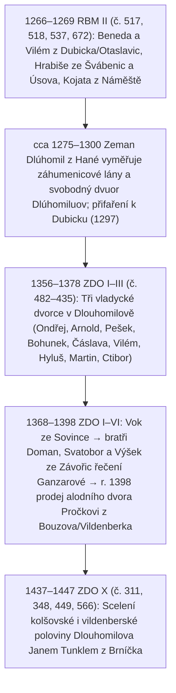

# Původ zakladatele Dlúhomila a kompletní regestář Olomouckých zemských desek (1266–1447)
*Jazykovědná (onomastická a dialektologická) analýza, diplomatické kořeny kolonizace Zábřežska a Dubicka ve 13. století a všech 32 zápisů o Dlouhomilově v prvním svazku Moravských zemských desek (`ZDO I–X`, 1356–1447)*

---

## 1. Otázka zakladatele: Kdo byl Dlúhomil, odkud přišel a kdy žil?

Originální zakládací (lokační) listina Dlouhomilova se – podobně jako u většiny zemanských lesních lánových vsí severomoravského podhůří – nedochovala. Přesto kombinace **historické jazykovědy (antroponomastiky, toponomastiky a dialektologie)** s digitální excerpcí celého korpusu **Codex diplomaticus et epistolaris Moraviae (`CDM I–IX, XV`)**, **Regesta diplomatica nec non epistolaria Bohemiae et Moraviae (`RBM I–IV`)** a **Moravských zemských desek (`ZDO I–X`, `ZDB`)** umožňuje osobnost zakladatele **Dlúhomila** vymezit s mimořádnou přesností.

### 1.1 Jazykový „rodný list“ jména *Dlúhomil* a názvu *Dlouhomilov*

1. **Stavovská výlučnost dvoučlenného jména *Dlúhomil* (`*Dl̥gomilъ`):**
   - Praslovanské a staročeské složené jméno **`Dlúhomil`** spojuje první člen *dlúho-* („dlouho, trvale, vytrvale“) s druhým členem *-mil* („milý, drahý“) ve významu rodového přání **„nechť je dlouho (trvale) milý a milován“** (stejný slovotvorný typ jako *Bohumil*, *Drahomil*, *Dalimil* či sousední *Radomil → Radomilov* u Rudy nad Moravou, doložený roku 1371).
   - Ve druhé polovině 13. a ve 14. století již selské a poddanské vrstvy na Moravě užívaly takřka výhradně domácké zkráceniny (**hypokoristika**, srov. okolní názvy *Benek → Benkov*, *Kojiš → Kojišov/Kolšov*, *Sluhoň → Sluhoňov*, *Sudek → Sudkov*) nebo křestní jména světců (*Jan, Mikuláš, Martin, Petr*). **Plné, nezkrácené slovanské kompozitum `Dlúhomil` bylo ve 13.–14. století na Moravě i v Čechách výsadním stavovským znakem domácí nižší a vyšší šlechty (velmožů, vladyků, zemanů a kapitulních hodnostářů).** V celém diplomatickém korpusu *CDM* a *RBM* do roku 1400 nenajdeme jediného neurozeného nositele tohoto jména.

2. **Hláskoslovné a dialektologické určení původu mluvčího:**
   - **Provedená změna `g > h` a dlouhé `dlúh-`:** V sousedním Opolském a Kozelském Slezsku se praslovanské `*dl̥g-` vyvinulo v polské *dług-* se zachovaným explozivním `-g-` (srov. patronymické *Dlugomilovici* z roku **1217**, dnes *Długomiłowice* u Kozlí); na východní Moravě a Slovensku pak zůstalo krátké slabičné *dlh-* (*dlhý*). Dlouhomilov má naproti tomu od nejstarších zápisů z roku **1356** dlouhý česko-středomoravský kmen **`Dlúho-`** (`Dluhomilow` 1356, `v Dlúhomilově` 1407, `ves Dlúhomilov` 1490; pouze dvakrát písař v letech 1360 a 1368 v nepřízvučné slabice zapsal grafickou redukci `Dylhomilow` v `ZDO I, č. 742` a `Dlhomyelow` v `č. 1158`).
   - **Středomoravský (hanácký) vývoj `Dlúhomilov > Dlóhomilov > Dlómilov`:** V místním severohanáckém nářečí přešlo staročeské `ú > ó` (*Dlóhomilov*) a po zániku intervokalického `-h-` došlo ke stažení samohlásek do podoby **`Dlómilov`** (stejně jako u hanáckého *Bohuslavice > Bóslavice*; viz *Hosák–Šrámek I*, s. 180).
   - **Druhotný a pozdní vznik německého *Lomigsdorf*:** Německé jméno *Lomigsdorf* (řidčeji *Lommersdorf*) prokazatelně nevzniklo při založení vsi ve 13. století – tehdy by buď neslo souběžné německé jméno lokátora, nebo by adaptovalo plný kmen *Dluhomil-*. Tvar **`Lōmigsdorf`** mohl vzniknout **až v raném novověku z hotového hanáckého staženého tvaru `Dlómilov`**: němčina odsunula pro ni nevyslovitelnou počáteční skupinu `dl- > l-` (*Dlómil- > Lōmil-*) a nahradila koncovku *-milov* členem *-migs-dorf*. Ještě v zemských deskách let 1490–1513 vystupuje ves jen česky a v urbáři roku 1585 má 20 z 22 hospodářů české jméno. **Zakladatel i první kolonisté byli nepochybně rodilí mluvčí staré češtiny středomoravského (hanáckého) typu.**

3. **Střídání *ves Dlúhomilov* ↔ *dvuor v Dlúhomile*:**
   - Zatímco staré říční osídlení v úvalu Moravy do počátku 13. století neslo čelední příponu `-ici > -ice` (*Bohuslavice* u Dubicka, *Lukavice*), podhorský věnec lesních lánových vsí s přivlastňovací příponou **`-ov` / `-ín`** (*Dlúhomil-ov, Kojiš-ov, Sluhoň-ov, Benk-ov, Radomil-ov, Hrabiš-ín*) vymezuje vnitřní emfyteutickou kolonizaci **2. poloviny 13. století**.
   - V zápisech *ZDO I–X* a *Knih půhonných* se vedle *Dlúhomilov* opakovaně objevuje i bezpříponový tvar **`Dlúhomil`**: `ZDO I, č. 1012` (1368 *Bohuncone de Dluhomil*), `ZDO II, č. 294` (1373 *in villa Dluhomyl*), `ZDO V, č. 12` (1386 *Wockonis de Dluhomyl*), `ZDO VI, č. 587` (1397 *In Dluhomyl Curiam allodialem*), `ZDO X, č. 566` (1447 *villam mediam Dluhomil*) a `KP IV/2, č. 525` (1463 *za dvuor v Dluhomile* vedle `č. 543` *dvuor Dluhomiluov*). Jádrem lokace byl tedy **svobodný zemanský dvůr samotného Dlúhomila (*dvuor Dlúhomiluov*)**, kolem něhož nechal vyměřit záhumenicové lány.

---

## 2. Odkud a kdy Dlúhomil přišel? Listinné stopy let 1266–1310

### 2.1 Kdy žil? Zpětný výpočet z trojdvorcové struktury roku 1356
Když Dlouhomilov po sv. Janu Křtiteli roku **1356** (`ZDO I, č. 482, 484`) vstupuje do zemských desek, nestojí zde již jediný lokátorský statek, nýbrž **tři samostatné svobodné vladycké dvorce (*Curiae*)**, vodní mlýn, dvě krčmy, devět chalupnických dvorků (*curticulae*), pět zahrad a přibližně 13 až 15 poplatných lánů rozdělených mezi početné příbuzenstvo (*Ondřej, Arnold, Pešek, Bohunek, vdova Čáslava, Vilém, Hyluš*). Aby byla lesní ves plně vyklučena, prošla 13–20letou daňovou lhůtou a dědickým dělením mezi syny a vnuky zakladatele se rozštěpila na tři dvorce (přičemž již v r. 1365 vdova Čáslava prodává věno po zemřelém držiteli třetího dvorce a živé patronymum *syn Dlúhomilův* již vymizelo), musely od založení uplynout **dvě až tři dospělé generace (cca 60–80 let)**:
* **Doba založení (lokace) Dlouhomilova:** **poslední třetina 13. století (cca 1275–1300)**, za vlády sklonku Přemysla Otakara II. nebo Václava II.
* **Pravděpodobná doba života zakladatele Dlúhomila:** narozen **cca 1240–1265**, zemřel **cca 1295–1320**.

### 2.2 Kritické vyloučení homonymní stopy *Dluhomila z Veselí* (1267 a 1289)
V listině Přemysla Otakara II. dané **7. srpna 1267 v Budyni nad Ohří** pro klášter Hradisko u Olomouce (`CDM III, s. 396, č. CCCXCIV` = `RBM II, s. 214, č. 556`) vystupuje mezi královskými a královninými dvořany svědek **`Dluhomilus de Wezzele`**. Protože 16 km jižně od Dlouhomilova leží *Veselí* u Pavlovic/Mohelnice, prověřili jsme všechny výskyty této osoby v celém diplomatáři:
* Týž **`Dluhomilus de Wezzele`** svědčí podruhé **10. ledna 1289 na Pražském hradě** při lenním holdu opolského knížete Kazimíra králi Václavu II. (`RBM II, s. 629–630, č. 1466`), a to uprostřed nejvyšších **českých panských rodů** (*Bavor ze Strakonic … Hynek z Dubé, Mutina z Kostomlat … Bohuslav z Boru [ze Švamberka], Dluhomil z Veselí, Oldřich z Jindřichova Hradce*).
* Srovnání s českými listinami (`RBM II, s. 5` r. 1253 *Dluhomilus de Bor*; `RBM IV, s. 717` r. 1254 koupě Budětic *Dluhomilovi*; `RBM III, s. 579` r. 1328 *Dluhomilus de Psrichowiz*; `RBM IV, s. 30` r. 1334 *Dluhomilus de Wilherticz*) potvrzuje, že *Dluhomilus de Wezzele* z let 1267 a 1289 patřil k jihočeské panské elitě z **Veselí nad Lužnicí** v sousedství pánů z Hradce a ze Strakonic, nikoli na Mohelnicko. Rovněž slezský rytířský rod **Dluhomilů z Bierawy** u Kozlí (*Mikuláš a Gumprecht Dluhomilové*) získal Bierawu až roku **1402** – tedy o více než sto let později (patrně jako potomci moravských zemanů, u nichž se zanikající křestní jméno otce proměnilo v příjmení; srov. bratry *Dlúhomila a Mikuláše z Tupce* r. 1373 v `ZDO II, č. 223`).

### 2.3 Hanácko-dubický a švábenicko-úsovský kolonizační most (listiny let 1266–1269)
Skutečný původ zakladatele Dlúhomila odkrývají čtyři listiny z let **1266–1269** v `RBM II` (`č. 517, 518, 537 a 672`), které přímo propojují naše severomoravské údolí s **jižní a střední Hanou**:

1. **Mírovský vzorec lokace (26. 5. 1266, `RBM II, č. 517, s. 200`):** Na sousedním hradě Mírově udělil biskup Bruno ze Schauenburku lokátoru Oldřichovi dědičnou rychtu, každý desátý lán svobodný, třetinu soudních pokut, mlýn o jednom kole a 13–20 let daňové lhůty.
2. **Olomoucká listina kolonizátorů severomoravského podhůří (1269, `CDM IV, č. XXX, s. 36–38` / `RBM II, č. 672, s. 262`):** Listina hlásící se k pobytu krále Přemysla Otakara II. na Olomouckém hradě roku **1269** (diplomaticky klášterní redakce/falzum hradišťských premonstrátů z přelomu 13. a 14. století ve sporu o železnorudné doly a vodní hutě – *hutte* – u Domašova nad Bystřicí, která však převzala **autentickou svědečnou řadu královského dvora na Olomouckém hradě z roku 1269**, kde měl vlastní dům lovčí Beneda z Dubicka, `RBM II, č. 537`) zachycuje bok po boku všechny čtyři klíčové rody kolonizující naše podhůří:
   - **Všebor (komorník bítovský) a jeho bratr Hrabiše I. z Úsova (*Wsseborius camerarius Betouiensis, Hrabisse frater suus de Vssow*), synové Idíka I. ze Švábenic (erb rozsoch – čtyř střel spojených do kříže):** mocní páni z jižní Hané u Vyškova, jimž král svěřil pohraniční hrad Úsov (9 km od Dlouhomilova) k organizaci kolonizace lesního hvozdu a rýžovišť v povodí Oskavy a Loučky. Přímo po Hrabišovi nese jméno sousední hornická a lesní ves **Hrabišín** (*Hrabyssina*, r. 1437 v `ZDO X, č. 311` prodávaná společně s Kolšovem, Studénkami, Sluhoňovem a Dlouhomilovem).
   - **Vilém I. z Náměště na Hané a jeho bratr Kojata z Drnovic (*Wilhelmus de Namyescz, Koyata frater suus*), synové Slavibora z Drnovic:** bratranci Všebora a Hrabiše z druhé větve rozrodu Švábeniců; domácký tvar rodového jména *Kojata* je **Kojiš** – srov. sousední **Kojišov = Kolšov** (*Cogissow*), tvořící s Dlouhomilovem v roce 1356 majetkové dvojče. Hydrograficky přitom Kolšov neleží v ústí potoka Loučky (který z Hrabišína přes Medelské, Dlouhomilov a Sluhoňov/Brníčko vyúsťuje do nivy Moravy u **Lesnice** – srov. `ZDO I, č. 483` *Předota z Lesnice* přímo mezi zápisy o Dlouhomilově `č. 482` a `484`!), nýbrž **západně za hřbetem Bukovické hory** na vlastním Kolšovském potoce: příčný majetkový pás *Kolšov – Studénky – polovina Sluhoňova – polovina Dlouhomilova – Hrabišín* (`ZDO I, č. 493`; `ZDO X, č. 311, 449`) tak dokládá, že kolonizace pronikala do horního údolí Loučky **příčně přes hřbet** ze starších nížinných sídel ještě před postavením hradu Brníčka ve 30. letech 14. století!
   - **Beneda z Dubicka a jeho syn Vilém (*Beneda de Dubiszco, Wilhelmus filius suus*):** královský vrchní lovčí (*magister venatorum*, doložen 1238–1269; r. 1266 daroval klášteru Hradisko polnosti v Křemačově za spásu svého syna, olomouckého kanovníka Markvarta, `RBM II, č. 518`) a jeho synové (*Vilém, Mikuláš a Přešek*, stavitelé hradu **Otaslavice u Prostějova na Hané** v letech 1279–1287), z jejichž rodu vzešel ve 30. letech 14. století stavitel hradu **Brníčka** *Ctibor Morava*. Právě k prastaré faře v **Dubicku** (kostel doložen **1297**) patřil Dlouhomilov církevně nepřetržitě až do let **1720/1722** (`Dubicko Zá IV 1–2`), roku **1359** držel v Dlouhomilově lán **Vaňko z Dubicka** (`ZDO I, č. 674`) a mezi samotnými vladyky *z Dlouhomilova* se v letech 1356–1378 opakují typická rodová jména dubicko-otaslavického rodu (**Pešek/Přešek, Vilém, Ondřej, Ctibor**)!
   - **Kuno z Kunštátu (*Kuno de Chunstat*) a synové Zdeslava ze Šternberka:** zakladatel pánů z Kunštátu a kastelán na Úsově (1275–1277), jehož potomek **Ješek Puška z Kunštátu** držel před rokem 1397 platy přímo v Dlouhomilově (`ZDO VI, č. 706, 879`).
3. **Koncentrace jména *Dlúhomil* v hanáckém zázemí těchto rodů:** Rodová sídla pánů ze Švábenic a z Otaslavic leží na jižní Hané v bezprostředním sousedství **Ivanovic na Hané** (4 km od Švábenic – kde již k r. 1167 listina `CDM I, s. 279` zmiňuje moravskou ves ponechanou **Dlúhomilovi**, vnuku Bavorovu) i zaniklých **Soběbřich** na Bučovicku (12 km od Švábenic – sídlo vladyky **Dlúhomila ze Soběbřich**, 1353–1358, `ZDO I, č. 313; CDM IX, s. 95`), zatímco přímo v Olomouci působil v letech **1303–1320+** scholastik **Dlúhomil**, synovec biskupa Jana VI. Holého (`CDM V, s. 173, 209; VI, s. 76`, kde pečetí hned vedle olomouckého komorníka *Vítka ze Švábenic*).

> **Závěr:** Zakladatel **Dlúhomil** (žijící cca **1240/1265 – 1295/1320**) byl s nejvyšší pravděpodobností **česky (hanácky) mluvící zeman či služebný družiník původem ze střední Moravy – Hané (oblast Otaslavicka / Prostějovska, Švábenicka / Vyškovska a Olomoucka)**, který v poslední třetině 13. století (**cca 1275–1300**) v rámci kolonizačního postupu pánů z Dubicka/Otaslavic a ze Švábenic/Úsova vyměřil nad Kolšovem a Dubickem lesní lánovou ves se svobodným dvorem (*dvuor Dlúhomiluov*) a osadil ji českými kolonisty z Hané.

---

## 3. Přehled všech moravských nositelů jména *Dlúhomil* v listinách a deskách (1123–1384)

| Období / Rok | Zápis a citace pramene | Postavení a lokalita | Poznámka k onomastické a rodové souvislosti |
| :--- | :--- | :--- | :--- |
| **† 8. 7. 1123** | *comes Dlugomil* (*Kosmas*) | Předák na pouti s biskupem Jindřichem Zdíkem | Nejstarší doklad jména v česko-moravském prostředí. |
| **1167–1177** | *Dlugomil pincerna*, *Bavori comitis nepos* (`CDM I, s. 279, 291, 296, 308`) | Královský číšník z rodu Bavorů; dědic moravské vsi vyňaté z daru **Ivanovic na Hané** | Zakládá prestižní tradici jména *Dlúhomil* u šlechty na Hané (4 km od Švábenic). |
| **kol. 1200–1221** | *Dluhomilus filius Crissye, magne nobilitatis vir* (`CDM II, s. 36, 126`) | Velmož darující johanitům ves *Mezun*; svědek na Velehradě 1221 | Dokládá posun pravopisu `Dlugomil > Dluhomil` po provedení změny `g > h`. |
| **1221–1222** | *Dluhomil abbas Brevnouensis* (`CDM II, s. 128, 137`) | Břevnovský opat ve sporu s klášterem Hradiště u Olomouce o Hranicko | Církevní hodnostář v Čechách. |
| **prosinec 1243** | *Dluhomilus* (`CDM III, s. 38`) | Svědek na Křivoklátě za purkrabím Bočkem ze Znojma | Generace otců kolonizátorů poloviny 13. století. |
| **1267 & 1289** | *Dluhomilus de Wezzele* (`CDM III, s. 396`; `RBM II, č. 556 & 1466`) | Panský svědek v Budyni (1267) a na Pražském hradě (1289) vedle Bavora ze Strakonic, Bohuslava z Boru a Oldřicha z Hradce | Jihočeský velmož z **Veselí nad Lužnicí** (nikoli Veselí u Mohelnice – vyloučeno křížovým rozborem svědků r. 1289). |
| **1303–1320+** | *Dluhomilus, nepos episcopi Johannis, scolasticus Olomucensis* (`CDM V, s. 173, 209–210; VI, s. 76, 280`) | Synovec olomouckého biskupa Jana VI. Holého (1302–1311), plebán ve Vratěníně, arcijáhen znojemský a scholastik v Olomouci | Dokládá živé užívání jména v olomoucké elitě kol. r. 1300; r. 1307 pečetí vedle komorníka *Vítka ze Švábenic*. |
| **29. 8. 1344** | *Dluhomilus [de Suzichcz]* (`CDM VII/1, s. 401, č. 399`) | Syn urozeného Ruperta a Jitky ze Sušic u Uherského Hradiště | Východomoravský zemanský doklad (švagr Slavibora z Buchlovic). |
| **1353–1358 († před 1371)** | *Dluhomilus de Sobyebrzich* (`ZDO I, č. 313; II, č. 166; CDM IX, s. 95`) | Vladyka držící tvrz a patronát v zaniklých **Soběbřichách** na Bučovicku (vdova Eva r. 1371) | Doklad přetrvávání jména u zemanů na jižním okraji Hané v olomoucké cúdě. |
| **1373–1377 († před 1384)** | *Dluhomil de Tupecz* (`ZDO II, č. 223; III, č. 362; IV, č. 476`); v `ZDB` též *Dluhomil z Divic* a *z Ořechova* | Vladyka v **Tupci** u Lipníka nad Bečvou, syn Vojslavy a bratr Mikuláše (*Dluhomil cum Nicolao fratres*, choť Anna) | Poslední generace křestního jména *Dlúhomil* na Moravě (po r. 1380 přechází v příjmení – srov. *Mikuláš a Gumprecht Dluhomilové z Bierawy* 1402+). |

---

## 4. Kompletní regestář všech 32 vkladů o Dlouhomilově v *ZDO I–X* (1356–1447)

Následující tabulka poprvé přináší **úplný diplomatický soupis všech 32 zápisů** týkajících se Dlouhomilova v prvním svazku olomouckých zemských desek (*Die Landtafel des Markgrafthumes Mähren. I. Band: Olmützer Cuda 1348–1466*, ed. P. Chlumecký – J. Chytil – K. Demuth – A. Wolfskron, Brünn 1856; digitálně [RBM Online `book/301`](https://www.rbmonline.cz/portal/book/301)). Nově vyexcerpované položky mimo jiné osvětlují osud třetího zemanského dvorce (*Čáslava → Vilém → Ondřej a Hyluš → Ondřejek Chylec → Martin → Ctibor*) i způsob, jakým roku **1398** (`ZDO VI, č. 879`) přešel alodní dvůr od **Domana ze Závořic** na **Pročka z Bouzova (Vildenberka)**.

| Poř. | Rok | Kniha & číslo (`str. edice`) | Zápis toponyma | Aktéři a právní obsah vkladu |
| :--- | :--- | :--- | :--- | :--- |
| **1.** | **1356** *(po 24. 6.)* | `ZDO I, č. 482` (`s. 24`, fol. XXV r) | *Dluhomilow* | **Ondřej z Dlouhomilova** prodává **Arnoldovi z Dlouhomilova** za `60` hřiven grošů **1 dvůr, 6 lánů a 1 krčmu** dědičně, jak je sám držel (*prout ipse tenuit et possedit*). |
| **2.** | **1356** *(po 24. 6.)* | `ZDO I, č. 484` (`s. 24`) | *Dluhomilow* | **Pešek z Dlouhomilova** prodává za `60` hřiven grošů **druhý dvůr, 1 hřivnu ročního platu a vodní mlýn** bratřím **Bohunkovi a Dětmarovi z Kolšova** (*de Cogissow*). |
| **3.** | **1358** *(po 6. 1.)* | `ZDO I, č. 493` (`s. 24`, fol. XXVI r) | *Dluhomulow / Dluhomilow* | **Bohunek z Dlouhomilova** zapisuje manželce **Gertrudě** `100` hřiven věna na `2` hřivnách platu, **1 dvoře se 2 poplatnými lány** v Dlouhomilově a na lese v Kolšově (*Coyssaw*). |
| **4.** | **1359** | `ZDO I, č. 674` (`s. 33`, fol. XXXVII v) | *Dluhomilow* | **Vaňko z Dubicka** (*Wanco de Dubieczk*) postupuje dědičně manželce **Ance** a jejím dědicům **1 lán** v Dlouhomilově. |
| **5.** | **1360** | `ZDO I, č. 742` (`s. 37`, fol. XLI r) | *Dylhomilow* | **Arnold z Dlouhomilova** prodává paní **Čáslavě ze Šumvaldu** (*de Senwald*) a jejím dětem **1,5 lánu** se vším příslušenstvím. |
| **6.** | **1360** | `ZDO I, č. 744` (`s. 37`) | *Dluhomilow* | **Bohunek z Kolšova** (*de Coyssow*) vyplatil u **Arnolda** v Dlouhomilově **dvůr s 5 poplatnými lány**, který Arnold intabuluje Bohunkovi a jeho dětem. |
| **7.** | **1365** | `ZDO I, č. 857` (`s. 42`) | *Sluhomirow* | **Dětmar z Kolšova** (*de Kosuschow*) zapisuje manželce **Zdence** `125` hřiven věna na svém zboží v Kolšově a v Dlouhomilově (*Sluhomirow*). |
| **8.** | **1365** | `ZDO I, č. 859` (`s. 42`) | *Dluhomilow* | Vdova **Čáslava z Dlouhomilova** vymazává z desek své vdovské věno `40` hřiven, které měla od zemřelého manžela na **třetím dvoře a čtvrtlánu** v Dlouhomilově. |
| **9.** | **1365** | `ZDO I, č. 860` (`s. 42`) | *Dluhomilow* | Táž **Čáslava** prodává a postupuje toto věno na **dvoře a čtvrtlánu** v Dlouhomilově **Vilémovi** (s dědici) a **Jindřichu Pípeřovi ze Zábřeha**. |
| **10.** | **1368** | `ZDO I, č. 1012` (`s. 50`) | *Dluhomil* | Výmaz vzájemného spolku (*congressus*) mezi bratry **Dětmarem z Kolšova** (*de Kohusow*) a **Bohunkem z Dlouhomilova** (*de Dluhomil*). |
| **11.** | **1368** | `ZDO I, č. 1028` (`s. 50`) | *Dluhomylow* | **Vilém z Dlouhomilova** prodává dědičně **Ondřejovi a Hylušovi v Dlouhomilově** (*Andree et Hylusschio ibidem*) **dvůr s poplatným čtvrtlánem**. |
| **12.** | **1368** | `ZDO I, č. 1124` (`s. 55`) | *Dluhomilow* | **Bohunek z Kolšova** (*de Kohusowa*) prodává **Vokovi [ze Sovince] a jeho bratřím** v Dlouhomilově velký celek: **1 dvůr, 5 lánů, 2 krčmy, 9 dvorků/chalup (*curticulae*), 1,5 čtvrtlánu, 5 zahrad, vodní mlýn a les**. |
| **13.** | **1368** | `ZDO I, č. 1158` (`s. 57`) | *Dlhomyelow* | Výmaz dřívějšího vkladu **Jakubka z Olšan** pro **Viléma ze Zábřeha** v Dlouhomilově (*in Dlhomyelow*). |
| **14.** | **1371** | `ZDO II, č. 23` (`s. 60`) | *Dluhomilow* | **Ondřejek Chylec z Dlouhomilova** prodává dědičně **Martinovi z Dlouhomilova** kmetcí/dvorcový dvůr s poplatným čtvrtlánem (*Curiam Colonariam cum quartali censuali*). |
| **15.** | **1371** | `ZDO II, č. 44` (`s. 61`) | *Dluhomylow* | **Petr Šišma z Úsova** (*de Husowa*) zapisuje švagrové **Kateřině** `25` hřiven věna na **1,5 poplatném lánu, krčmě a podsedku** v Dlouhomilově. |
| **16.** | **1371** | `ZDO II, č. 104` (`s. 64`, fol. LXVII r) | *Dluhomilow* | **Výšek ze Studénky** a **Vok z Dlouhomilova** uzavírají majetkový spolek na vše, co drží ve Studénce a v Dlouhomilově. |
| **17.** | **1373** | `ZDO II, č. 294` (`s. 73`) | *Dluhomyl / Dluhomylow* | **Katruše z Lipňan**, dcera Pitroldova (s bratrem Vícenem), kvituje `16` hřiven platu věna v Dlouhomilově od **Voka z Dlouhomilova**, které jí plně vyplatil **Ganzar** (*quas a Ganzero integre recepit*). |
| **18.** | **1378** | `ZDO III, č. 435` (`s. 114`) | *Dluhomilow* | **Ctibor z Dlouhomilova** (*Stiborius de Dluhomilow*) daruje a postupuje **Martinovi tamtéž** **2,5 poplatného čtvrtlánu** v Dlouhomilově. |
| **19.** | **1386** | `ZDO V, č. 12` (`s. 168`, fol. III r) | *Dluhomyl* | **Dorota z Vinar**, manželka **Voka z Dlouhomilova** (*Conthoralis Wockonis de Dluhomyl*), prodává svůj věnný dvůr ve Vinarech Divovi z Čekyně. |
| **20.** | **1387** | `ZDO V, č. 48` (`s. 170`) | *Dluhomilow* | **Domanko ze Závořic** zapisuje manželce **Kačně** `130` hřiven věna na vsi Dlouhomilově a veškerém panství; ručí bratři **Svatobor a Výšek ze Závořic**. |
| **21.** | **1397** | `ZDO VI, č. 587` (`s. 209`, fol. XLIV r) | *Dluhomyl* | **Mikšík z Dlouhomilova** (*Mixik de Dluhomyl*) prodává **Zvěstovi z Topolan** v Dlouhomilově **svobodný poplužní dvůr (*Curiam allodialem*) a 3,5 poplatného čtvrtlánu**. |
| **22.** | **1397** | `ZDO VI, č. 706` (`s. 216`) | *Dluhomylow* | **Výšek ze Závořic** postupuje bratru **Domanovi ze Závořic** v Dlouhomilově **alodní dvůr s poplatnými lidmi, lesy, rybníky, loukami, chalupami a potoky** (s výjimkou statků **Ješka řečeného Puška z Kunštátu**). |
| **23.** | **1397/1398** | `ZDO VI, č. 730` (`s. 218`) | *Dluhomylow* | **Zvěst z Topolan** zapisuje **Markétě**, manželce Ondřeje ze Žárové, `40` hřiven věna na svém alodním dvoře a poplatných lidech v Dlouhomilově. |
| **24.** | **1398** | `ZDO VI, č. 876` (`s. 228`) | *Dluhomylow* | **Zvěst z Topolan** prodává dědičně **Ondřeji Záhorovi** (*Andree Zahora*) svůj **alodní dvůr a 3,5 čtvrtlánu** v Dlouhomilově. |
| **25.** | **1398** | `ZDO VI, č. 879` (`s. 228`) | *Dluhomylow* | **Doman ze Závořic** prodává **Pročkovi z Bouzova [Vildenberka]** (*Proczkoni de Buzow*) **hlavní alodní dvůr v Dlouhomilově** s poli, loukami, lesy, vodami a ročním platem (mimo platy dříve prodané *Ješkovi Puškovi z Kunštátu*). |
| **26.** | **1408** | `ZDO VII, č. 528` (`s. 271`) | *Dluhomylow* | **Vok z Kolšova** (*de Kozyssow*) přijímá na spolek veškerého zboží **Výška z Dlouhomilova** a **Svatobora z Domašova řečené Ganzary** (*dictos Ganzar*). |
| **27.** | **1408** | `ZDO VII, č. 531` (`s. 271`) | *Dluhomylow* | **Vok z Kolšova** zapisuje **Janovi řečenému Ganzer z Kolšova** a jeho bratřím `3` hřivny ročního platu v Olešné se souhlasem společníků **Výška z Dlouhomilova** a **Svatobora z Domašova**. |
| **28.** | **1420** | `ZDO IX, č. 340` (`s. 354`) | *Dluhomylowe / Dluhomylow* | Prodej `4` lánů a `2` zahrad ve Sluhoňově a **`2` lánů, `1` čtvrtlánu a `4` poplatných chalup v Dlouhomilově** **Benešovi z Víckova** a převod věna `125` hřiven paní **Kateřiny** z Kolšova a Dlouhomilova. |
| **29.** | **1437** | `ZDO X, č. 311` (`s. 379`) | *Dluhomylow* | **Albert z Kolšova** prodává **Janovi zvanému Jone Tunklovi z Eichholze (Dubicka)** tvrz a dvůr Kolšov se Studénkou, Sluhoňovem, **vsí Dlouhomilovem** a Hrabišínem. |
| **30.** | **1437** | `ZDO X, č. 348` (`s. 381`) | *Dluhomylow* | **Jan Tunkl z Eichholze** přijímá **Jana Tunkla z Drahanovic** na spolek na vsi Studénku, Sluhoňov a **Dlouhomilov**. |
| **31.** | **1446** | `ZDO X, č. 449` (`s. 388`) | *Dluhomilow* | **Jon z Eichholze a z Kolšova** převádí **Janu Tunklovi z Brníčka** Studénku, polovinu Sluhoňova a **polovinu vsi Dlouhomilova, jak odedávna příslušela ke Kolšovu** (*sicut eedem ville ab antiquo sunt mensurate*). |
| **32.** | **1447** | `ZDO X, č. 566` (`s. 396`) | *Dluhomil* | Rukojmí po zemřelém **Pročkovi z Vildenberka** (*Jeník z Valdštejna, Vok z Holštejna, Ješek ze Lhoty, Výšek ze Stříteže, Jan Koblih z Říčan*) vkládají **Janu Tunklovi z Brníčka** **druhou polovinu vsi Dlouhomilova se svobodným poplužním dvorem a rybníky** (navazuje na spory v půhonech let 1463–1466, viz [zemske_desky_a_puhony_1466_1622.md](zemske_desky_a_puhony_1466_1622.md)). |

---

---

> [!TIP]
> **Máte doplnění k nejstarším středověkým listinám nebo zemanským rodům v údolí?**  
> [💬 Otevřít zpětnou vazbu / nahlásit připomínku na GitHubu](https://github.com/KarelBerka/Dlouhomilov/issues/new?title=%5BDl%C3%BAhomil%20%26%20ZDO%201356%E2%80%931447%5D%20Zp%C4%9Btn%C3%A1%20vazba&body=%2A%2AStr%C3%A1nka%2FDokument%3A%2A%2A%20docs%2Fpuvod_dluhomila_a_zdo_1356_1447.md%0A%2A%2APopis%20p%C5%99ipom%C3%ADnky%20nebo%20dopln%C4%9Bn%C3%AD%3A%2A%2A%0A)
