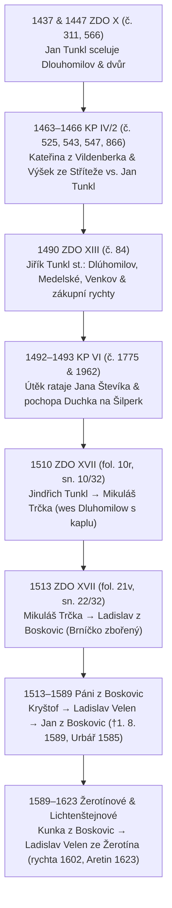

# Olomoucké zemské desky po roce 1466 a půhonné knihy (1463–1623)
*Vývoj po konsolidaci Tunkly: spory o svobodný dvůr, útěky dlouhomilovských poddaných v roce 1492, přechod k Trčkům, Boskovicům a Žerotínům i proměna svobodných dvořáků a Medelského (Tři lány)*

---

## 1. Pramenná základna: MZA Brno (`A 3`) a Czech Medieval Sources

Výzkum navazující na první vlnu zápisů ze středověkých olomouckých zemských desek z let **1356–1447** (*ZDO I, IV, X*) propojuje originální rukopisy uložené v **Moravském zemském archivu v Brně (MZA Brno)** s vědeckými edicemi dostupnými v databázi **Czech Medieval Sources online (AV ČR)**:

1. **MZA Brno – fond `A 3 Stavovské rukopisy` (1348–1970)**
   - **Národní kulturní památka č. 2 – Moravské zemské desky (`inv. č. 82–154`, plně digitalizováno v [ARON](https://www.mza.cz/aron/apu/56721cb4-2dd1-41cd-9e31-b4416c2037ca)):**
     - **Kniha XVII – Kniha Jana z Pernštejna (`1506–1515`, `inv. č. 98, díl XVII`):** [přímý odkaz ARON (`d6c753db-2245-43bb-8311-59e640135577`)](https://www.mza.cz/aron/apu/d6c753db-2245-43bb-8311-59e640135577) — `sn. 10/32` (`fol. 10r`, vklad r. **1510**: Jindřich Tunkl → Mikuláš ml. Trčka z Lípy) a `sn. 22/32` (`fol. 21v–22r`, vklad **24. 6. 1513**: Mikuláš ml. Trčka z Lípy → Ladislav z Boskovic).
     - **Kniha XXX – Kniha Hynka z Valdštejna na Brtnici (`1588–1595`, `inv. č. 111, díl XXX`):** [přímý odkaz ARON (`a1c55c94-a46d-471e-8c14-58a8a3ac4390`)](https://www.mza.cz/aron/apu/a1c55c94-a46d-471e-8c14-58a8a3ac4390) — `sn. 11/149` a `sn. 25–29/149` (zasedání zemského soudu v roce **1589**, bez trhového převodu zábřežského panství).
     - **Kniha XXXI – Kniha Fridricha staršího z Žerotína (`1596–1598`, `inv. č. 112, díl XXXI`):** [přímý odkaz ARON (`3b2b73b2-658b-494b-a25e-cc9265f72cf3`)](https://www.mza.cz/aron/apu/3b2b73b2-658b-494b-a25e-cc9265f72cf3) a navazující **Kniha XXXII** (`1598–1603`, `inv. č. 113`) — období nástupu dědičných nároků Žerotínů po vymření Třebovských i Černohorských Boskoviců.
     - Vědomosti o předbělohorských zasedáních a vkladech doplňuje digitalizovaná řada **Knih půhonných a nálezových** téhož fondu (`inv. č. 680–696, 728–762, 764–765, 793–796`).
2. **Moravské zemské desky. II. řada olomoucká (`1480–1566`)** (ed. **František Matějek**, Brno 1948; [CMS online `bookid=990`](https://sources.cms.flu.cas.cz/src/index.php?s=v&bookid=990)):
   - Kniha **XII** (`1480–1481`, Kolšov & Třemešek, `č. 91, 93, 141`), Kniha **XIII** (`1490`, vklad hradu Brníčka č. 84, `s. 55–56`), Kniha **XVI** (`1506`, rybniční privilegium č. 241, `s. 155`), Kniha **XVII** (`1510` č. 59, `s. 169`; `1513` č. 131, `s. 182–183`), Kniha **XVIII** (`1518–1519`, Studénka č. 59, `s. 208`), Kniha **XXV** (`1544` č. 99, `s. 329`; `1548–1549` č. 206, `s. 358–360`), Kniha **XXVI** (`1557` č. 40, `s. 407–408`). Pro období **1567–1642** navazuje tištěná edice *MZD III. Kraj olomoucký* (ed. F. Matějek, Praha 1953).
3. **Knihy půhonné a nálezové (*Libri citationum et sententiarum I–VII*, ed. Vincenc Brandl & Berthold Bretholz)** ([CMS online](https://sources.cms.flu.cas.cz/)):
   - **Svazek I (`1405–1411`, `bookid=803`):** `č. 800` z r. **1407** (`s. 299`).
   - **Svazek IV/2 (`1463–1466`, `bookid=805`):** `č. 525, 543, 547, 866` (`s. 388, 391, 392, 444`).
   - **Svazek VI (`1483–1493`, `bookid=866`):** `č. 147–155, 161` (`s. 27–30`), `č. 1760–1775` (`s. 292–294`) a `č. 1959–1964` (`s. 324`).
   - **Svazek VII (`1490–1503`, `bookid=545`):** `č. 844, 894` (`s. 180, 188`, spory Tunklů jako zemských soudců a žalobců).

---

## 2. Spory o svobodný dvůr v Dlouhomilově po konsolidaci Tunkly (`1463–1466`)

Poté, co **Jan Tunkl starší z Brníčka** získal v roce **1437** část Dlouhomilova od Alberta z Kolšova (*ZDO X, č. 311*) a v roce **1447** druhou polovinu vsi **se svobodným poplužním dvorem a rybníky** od ručitelů po zemřelém Pročkovi z Vildenberka (*ZDO X, č. 566*), zdaleka nedošlo k okamžitému klidu. Starý alodní dvůr se v letech **1463–1466** stal předmětem čtveřice provázaných žalob před olomouckým zemským soudem (*KP IV/2*, `bookid=805`):

* **Kontext starších nároků (`1407`, `KP I, s. 299, č. 800`):** Již v předhusitské době se o příjmy ze vsi soudila drobná šlechta z blízkého Kolšova — *Jan Puška* tehdy poháněl *Jana a Petra Bedřichovy syny řečené Gonzary z Kojišova [= Kolšova]*, **„že mi drží tři hř. platu v Dlúhomilově, ješto Damon Ganzar stúpil mému otci v penězích“**.
* **Kateřina z Vildenberka vs. Jan Tunkl (`KP IV/2, s. 391, č. 543`):** Dědička vildenberského rodu **Kateřina z Vilmberka (= Vildenberka)** zažalovala **Jana Tunkla z Brníčka** o 200 hřiven grošů, že jí protiprávně drží rodový dvůr v Dlouhomilově:
  > *„543. Kateřina z Vilmberka poh. Jana Tunkle z Brníčka etc. ze dvú set hř. gr. dob. stř. etc., že mi drží **dvuor Dluhomiluov** s jeho příslušenstvím a já k tomu lepší právo mám. Zná-li etc. chci to dskami pokázati.“*
* **Ručitel Výšek ze Stříteže vs. Kateřina z Vildenberka (`KP IV/2, s. 388 č. 525` & `s. 392 č. 547`):** Na vklad z roku 1447 navázal druhotný spor o *zprávu* (právní záruku prodeje). Zeman **Výšek ze Stříteže**, který při prodeji slíbil záruku za dvůr, hnal Kateřinu ze Lhoty, aby jej ze závazku vyvázala (*„vyvadila“*):
  > *„525. Výšek z Stříteže poh. Kateřinu z Wildmberka a ze Lhoty etc. z LXXX hř. gr. dob. stř. etc., že drží otce svého dědictví a zboží, ježto sem byl slíbil za zprávu **za dvuor v Dluhomile** s jeho příslušenstvím a o to sem pohnán a ona mě vyvaditi nechce.“* (Půhon `č. 547` na s. 392 pak obsahuje poznámku, že byl později přeškrtnut smírem.)
* **Jan Tunkl vs. Výšek ze Stříteže (`KP IV/2, s. 444, č. 866`):** Obratem poháněl sám Tunkl ručitele Výška o tutéž sumu 80 kop grošů:
  > *„866. Týž Jan [z Brníčka a z Zábřeha] poh. Výška z Stříteže ut sup. z LXXX kop gr. dob. stř. etc., že mi slíbil za zprávu **dvora v Dlúhomilově** se vším jeho příslušenstvím a o to sem pohnán a narčen. Zná-li etc., chci listy i dskami pokázati.“*

---

## 3. Tunklovská éra, zákupní rychty (1490) a útěky poddaných z Dlouhomilova (1492)

### Rodinný vklad z roku 1490 (`ZDO XIII, č. 84`): nejstarší doklad zákupní rychty
V roce **1490** převedli bratři **Jan, Jiřík, Albrecht, Jindřich a Křištof z Brníčka** (*ZDO XIII, fol. 12v, č. 84*, `MZD II, s. 55–56`) hrad Brníčko s rozsáhlým souborem vesnic na svého strýce **Jiříka Tunkla staršího z Brníčka a z Zábřeha**. V deskovém výčtu stojí bok po boku všechny tři části dnešní obce i jejich rychtářská samospráva:
> *„...vkládáme ve dsky hrad Brníček, městečko tu pod Brníčkem, dva mlýny, kaplu v městečku s dvorem, ves Sloňov, **ves Dlúhomilov**, ves Studénka, **ves Medelské**, **ves Venkov**, ves Medvězí a Kamenné ... **se všemi rychtami zákupními v těch vsech** a s kostelnim podacím, hamr Hyknšův u Klášterce, hamr Vickův u Raškova, hamr Michalův u Rudy, hamr Lorencův u Dúbravice...“*

Právě formula **„se všemi rychtami zákupními v těch vsech“** posouvá písemnou existenci zákupních (dědičných) rychet na brníčském zboží včetně Dlouhomilova **o 112 let hlouběji před listinný doklad z roku 1602**.

### Rybníkářství, tvrdá vrchnost a dva doložené útěky z Dlouhomilova roku 1492 (`KP VI`)
Jiřík Tunkl starší vybudoval v údolí Moravy a Desné mohutnou síť rybníků a hamrů (doloženou i královským povolením krále Vladislava II. pro Jiříka st. a jeho syna Jindřicha vloženým do `ZDO XVI, fol. 36–36v, č. 241`, `MZD II, s. 155`: rybníky pod Frankštátem, pod Třemeškem a dva jezy přes Moravu *proti Postřelmovu a pod Kláštercem*). Monumentální zemní práce, robotní tlak a pohraniční vpády se sousedy (**Jan z Dalčic na Šilperku**, **Hynek ze Zvole na Kolštejně / Golštajně**, **Znáta ze Zvole**) vyvolaly v roce **1492** vlnu zběhnutí poddaných a krutou selskou vzpouru (1492–1494).

V knize olomouckých půhonů **`KP VI` (zasedání zemského soudu započaté dne 18. května 1492 *ten pátek po Sv. Žofii* na `s. 260` a uzavřené před úterým před sv. Vítem `1493` na `s. 324`)** se dochovaly hned **dva přímé případy útěku lidí přímo z Dlouhomilova**, zasazené mezi desítky žalob o uprchlé sedláky ze Sudkova (*Hanušek, Matěj, Pavel, Mikuláš, Jakub*), Bohutínka (*tesař Dušek*), Jakubovic (*Petrek*), Březné (*Blah*), Písařova (*Pechaň*), Bratrušova (*Macek*) či Frankštátu (*fojt Kašpar*):

1. **Půhon č. 1775 (`KP VI, s. 294`, rok 1492) — rataj Jan Števík z Dlouhomilova:**
   > *„1775. **Jiřík Tunkl st.** etc. poh. **Znatu ze Zvole** etc. z X hř. gr. d. stř. etc., **že mi jest vzal odpuštění Janovi rathajovi Števíkovi z Dlúhomilova, člověku mému, listem svým, ješto toho obyčeje a práva v zemi této není.** Zná-li etc., chci listem jeho pokázati etc., por. č. Jindřicha syna.“*
   *Historický význam:* **Jan Števík** působil v Dlouhomilově jako **`rataj`** (*rathaj* = dvorský oráč / správce potahů na poplužním hospodářství). Znáta ze Zvole porušil moravské zemské právo tím, že cizímu poddanému vystavil vlastní výhostní / ochranný list (*odpuštění listem svým*) bez souhlasu Jiříka Tunkla.

2. **Půhon č. 1962 (`KP VI, s. 324`, závěr relace 1492 před červnem 1493) — pochop (= dráb) Duchek z Dlouhomilova:**
   > *„1962. **Jindřich [Tunkl]** etc. poh. **Jana z Dalčic** etc. z X hř. gr. šir. etc., **že mi jest byl pochop Duchek z Dlúhomilova ušel z dědiny i byl pod Šilperským na mlýně u Šilperka a pan otec muoj jej u Šilperského právem obstavoval a práva naň žádal a on jeho vydati nechtěl a potom jej pryč upustil a práva naň nedopomohl a ta dědina i podnes pusta stojí.** Zná-li etc. ut sup. Poklid.“*
   *Historický význam:* Záznam odhaluje přesnou totožnost slavného „uprchlého panského drába na Štítecko“: šlo o dlouhomilovského **`pochopa` (= drába, obecního/vrchnostenského biřice) jménem Duchek**, který současně držel vlastní selskou usedlost (**`dědinu`**). Ušel na **mlýn u Šilperka** (dnešní Štíty), kam za ním ještě před svou smrtí vyslal Jiřík Tunkl starší (*pan otec muoj*) právní obstávku, avšak **Jan z Dalčic na Šilperku** jej nevydal a nechal jej odejít neznámo kam — a Duchkův dlouhomilovský grunt zůstal podle žaloby ležet pustý (*„a ta dědina i podnes pusta stojí“*).

---

## 4. Přechod panství v zemských deskách: Trčkové (1510), Boskovicové (1513–1589) a Žerotínové (1589–1622)

Finanční vyčerpání tunklovských staveb a nákladných sporů přimělo **Jindřicha Tunkla z Brníčka** (fojta Markrabství lužického) k prodeji celého severomoravského panství:

* **Rok 1510 (`MZA Brno, fond A 3, Kniha XVII – Jana z Pernštejna`, `sn. 10/32`, `fol. 10r`, `č. 59`; `MZD II, s. 169`):**
  Jindřich Tunkl vložil **Mikuláši mladšímu Trčkovi z Lípy a na Lichnici (*Liechtmburce*)** obě jádra panství i naše tři vsi včetně výslovné první deskové zmínky dlouhomilovské kaple přímo na dochovaném rukopisném pergamenu:
  > *„Gindrzich Tunkl z Brniczka etc. foyt Markrabstwij Luziczko(!) Mikulassowi mladssimu Trczkowi z Lippy a na Lychtmburcze ... [wklada] swe wlastni zbozi a diedicztwi totiz hrad Zabrzieh s miestem a przedmiestijm, hrad Brniczko s miesteczkem a s kaplu, Zamek Zborzeny Hosstain ... wes lauczka, **wes dluhomilow s kaplu**, czoz tu mam, trzy lany w olessnem, a w hrabissinie, **wes medelske**, **wes wenkow** ... s many s rychta[mi]...“*
* **Dne 24. června 1513 (`MZA Brno, fond A 3, Kniha XVII`, `sn. 22/32`, `fol. 21v–22r`, `č. 131`; `MZD II, s. 182–183`):**
  Mikuláš ml. Trčka z Lípy prodal panství **Ladislavovi z Boskovic a na Moravské Třebové**. Pod okrajovým přípisem ***„Zábřeh“*** na `fol. 21v` je hrad Brníčko poprvé výslovně intabulován jako rozbořený a Dlouhomilov znovu s kaplí:
  > *„...Ladislawowi z Bozkowicz jeho diediczom a buduczim [swe wlastn]ie a diedicztwij, totiz **hrad Zabrzieh s Miestem a s przedmiestijm**, **hrad Brniczko zborzenj s Miesteczkem a s kaplu**, Zamek zborzeny [Hosstajn] ... wes lauczka, **wes dluhomilow s kaplu**, wes olessney, a w hrabyne, **wes Medelsko**, **wes wenkow**...“*
* **Vláda pánů z Boskovic (1513–1589):**
  1. **Ladislav z Boskovic († 1520):** Zkonsolidoval panství (roku 1518–1519 propustil sousední Studénku z manství Zábřeha, `MZD II, s. 208`).
  2. **Kryštof z Boskovic († před 24. 6. 1549):** Zajistil roku **1544** věno Bohunce z Lipého pro syna **Ladislava Velena z Boskovic** (`MZD II, č. 99, s. 329`), jenž se stal Kryštofovým univerzálním dědicem roku **1549** (`MZD II, č. 206, s. 360`).
  3. **Sirotci Václav a Jan z Boskovic (`1553–1557`):** Po předčasné smrti Ladislava Velena spravovali majetek nezletilých sirotků poručníci **Václav** a **Jan Jetřich Černohorský z Boskovic** (`MZD II, XXVI, č. 40, s. 407–408`).
  4. **Jan z Boskovic a na Moravské Třebové († 1. srpna 1589):** Poslední mužský potomek moravskotřebovské větve Boskoviců (nikoli jeho bratranec **Jan Šembera Černohorský z Boskovic na Bučovicích**, †1597, jenž zasedal na zemském soudu v Olomouci roku 1589) nechal v roce **1585** pořídit nejstarší dochovaný **Urbář panství Zábřeh (*URB00015585*)**, který zachytil český Dlouhomilov (`22` usedlíků), Medelské (`8` držitelů na `5` položkách) a převážně německý Benkov (`10` usedlíků).
* **Přechod na Žerotíny po roce 1589 (`Kniha XXX–XXXII`, 1588–1603):**
  Prohlídka **Knihy XXX (`sn. 11–29/149`, rok 1589, [ARON](https://www.mza.cz/aron/apu/a1c55c94-a46d-471e-8c14-58a8a3ac4390))** potvrdila, že roku 1589 nedošlo k žádné trhové smlouvě na zábřežské panství v zemských deskách. Po smrti bezdětného Jana z Boskovic (1. 8. 1589) přešla Moravská Třebová a Zábřeh (včetně Brníčka, Dlouhomilova, Medelského a Benkova) dědictvím přes jeho sestru **Kunhutu (Kunku) z Boskovic** († 1590 na zámku v Zábřehu, choť Jana ml. ze Žerotína na Břeclavi) na jejich nezletilého syna **Ladislava Velena ze Žerotína** (*1579–†1638), pod jehož správou je k roku **1602** listinně potvrzena dlouhomilovská **dědičná rychta (čp. 7)** až do pobělohorské konfiskace (1622) a Aretinovy mapy (1623).

---

## 5. Od vladyckých dvorů ke svobodným dvořákům a názvu *Tři lány*

Středověká síť zemanských dvorců v Dlouhomilově (`ZDO I` 1356–1368; *dvůr Dlúhomilov* v letech 1447–1465; dvůr s ratajem Janem Števíkem 1492) a tří dvorců v Medelském nezanikla beze stopy — prošla však zásadní sociální přeměnou:

* **Rozdíl oproti sousednímu Kolšovu:** Zatímco **tvrz a svobodný dvůr v Kolšově** (*Kojišově*, doložen i v `ZDO XII` 1480–1481 u Anny a Doroty z Kolšova a v `MZD II s. 169, 183`) zůstal samostatným deskovým statkem vrchnosti (*Svobodný dvůr Kolšov*, v r. 1750 přiznaný v *MZA D 3, sign. 172/1*), dlouhomilovské dvory v držbě Tunklů, Boskoviců a Žerotínů **nebyly obnoveny jako panské poplužní dvory (*Meierhöfe*)**.
* **Zrod osvobozených sedláků a rodu Dvořáků:** Místo toho byly pozemky bývalých alodních dvorců postupně rozděleny do větších zákupních selských gruntů a svobodných rychet (*1490 rychty zákupní*, `čp. 7` s `90` měřicemi a velké grunty po `60` měřicích typu **čp. 29** a **čp. 22**). Jejich držitelé – lidově nazývaní **dvořáci** (odtud nejčastější místní příjmení **Dvořák**, doložené v Zábřeze 1651, Lánovém rejstříku 1657/1677 i gruntovnici od 1679) – si uhájili privilegovaný statut ***Befreytte Bauern*** (osvobození od naturální roboty peněžitým platem, jak výslovně potvrdila lokální vizitace z 17. srpna 1756 v *MZA D 2*).
* **Medelské jako *Tři lány* (`1605–1657`):** Stejný vývoj prodělaly tři původní selské dvory jižní osady – v deskových pramenech psané jako *Medilsk* (1385) a *ves Medelské / Medelsko* (1490–1513), v urbáři roku 1585 s 8 hospodáři v párových spoludržbách, v pramenech let **1605–1657** zaznamenané pod českým jménem **Tři lány** (*Hosák–Šrámek II*) a posléze v němčině jako ***Dreihöfen*** (*Tři Dvory*), než po třicetileté válce berně splynuly s Dlouhomilovem až do obnovy čísel popisných `Medelské čp. 1+` v letech 1770–1771.

---

## 6. Chronologický přehled přelomových zápisů (1407–1623)

| Rok | Pramen & citace | Hlavní aktéři | Klíčové zjištění pro Dlouhomilov, Medelské a Benkov |
| :--- | :--- | :--- | :--- |
| **1407** | `KP I, s. 299, č. 800` | Jan Puška vs. Jan a Petr z Kolšova | Spor o 3 hřivny platu *v Dlúhomilově* |
| **1437 & 1447** | `ZDO X, č. 311 a č. 566` | Albert z Kolšova; Proček z Vildenberka → **Jan Tunkl** | Scelení obou polovin Dlouhomilova se svobodným dvorem a rybníky |
| **1463–1466** | `KP IV/2, č. 525, 543, 547, 866` | **Kateřina z Vildenberka**, Výšek ze Stříteže, **Jan Tunkl** | Čtyři půhony o *dvuor Dluhomiluov* (`200` hř. gr.) a jeho právní záruku (`80` kop) |
| **1490** | `ZDO XIII, fol. 12v, č. 84` (`MZD II, s. 55–56`) | Bratři z Brníčka → **Jiřík Tunkl starší** | Hrad Brníčko s *ves Dlúhomilov, ves Medelské, ves Venkov ... se všemi rychtami zákupními* |
| **1492** | `KP VI, s. 294, č. 1775` *(soud 18. 5. 1492)* | **Jiřík Tunkl st.** vs. Znáta ze Zvole | Znáta neoprávněně přijal *listem odpuštění* rataje **Jana Števíka z Dlúhomilova** |
| **1492 / 1493** | `KP VI, s. 324, č. 1962` | **Jindřich Tunkl** vs. Jan z Dalčic na Šilperku | Útěk dlouhomilovského **pochopa (= drába) Duchka** z dědiny na **mlýn u Šilperka** (*dědina pusta stojí*) |
| **1506** | `ZDO XVI, fol. 36–36v, č. 241` (`MZD II, s. 155`) | Král Vladislav II. pro **Jiříka a Jindřicha Tunkly** | Potvrzení vodních struh a rybníků na zábřežsko-brníčském panství |
| **1510** | `ZDO XVII, fol. 10r, č. 59` ([ARON 10/32](https://www.mza.cz/aron/apu/d6c753db-2245-43bb-8311-59e640135577)) | **Jindřich Tunkl** → **Mikuláš ml. Trčka z Lípy** | Prodej Brníčka a Zábřeha; výslovně *wes dluhomilow s kaplu, wes medelske, wes wenkow* |
| **1513 (24. 6.)** | `ZDO XVII, fol. 21v–22r, č. 131` ([ARON 22/32](https://www.mza.cz/aron/apu/d6c753db-2245-43bb-8311-59e640135577)) | **Mikuláš ml. Trčka** → **Ladislav z Boskovic** | Převod Zábřeha, **hradu Brníčka zbořeného** (*zborzenj*) a vsí *Dluhomilow s kaplu, Medelsko, wenkow* |
| **1520–1589** | `MZD II` (`s. 208, 329, 360, 407–408`); `URB00015585` | **Kryštof → Ladislav Velen → Jan z Boskovic (†1. 8. 1589)** | Urbář r. 1585 (22 + 8 + 10 usedlých); jazyková hranice; bezdětná smrt Jana z Boskovic 1589 |
| **1589–1623** | `ZDO XXX–XXXII`; *AKP ČR č. 81* | **Kunka z Boskovic → Ladislav Velen ze Žerotína** | Dědictví Žerotínů (1589–1622), listinné potvrzení rychty čp. 7 (1602), Medelské *Tři lány* (1605+), konfiskace Lichtenštejny a Aretinova mapa (1623) |

